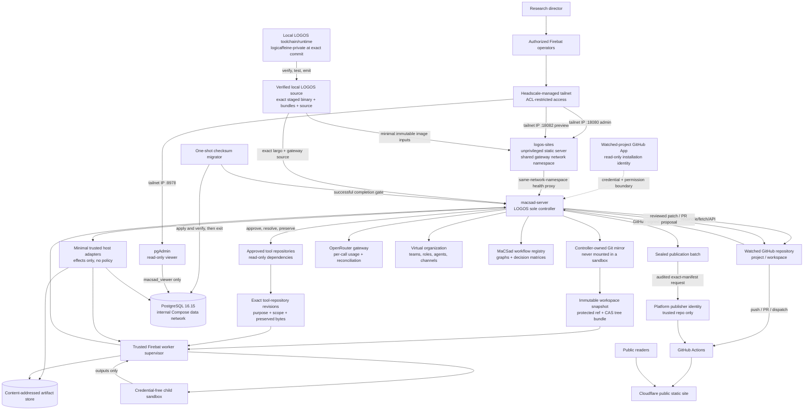
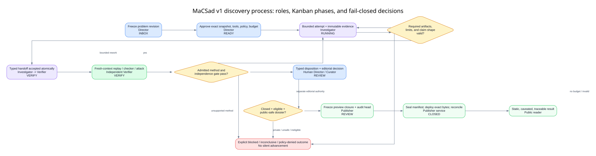

# MaCSad design document

> **Status:** Initial system design, 2026-08-31  
> **Name:** MaCSad — Mathematics and Computer Science Auto-Discovery  
> **Scope:** A deliberately small, LOGOS-first system, not a merger of the audited repositories  
> **Primary deployment target:** Firebat One Docker Compose for the private tailnet environment; Cloudflare remains the later public edge

## 1. Executive decision

MaCSad will be a controlled research harness that turns a bounded mathematics or computer-science question into a versioned trail of plans, attempts, artifacts, checks, conclusions, and—only when approved—a public static report.

Its fundamental goal is:

> **Continuously accumulate reproducible, inspectable footholds toward mathematical and computer-science discoveries without allowing agents to confuse activity, plausible prose, or successful execution with verified truth.**

The first MaCSad should not merge ProxAPI, datacenterdev, `logicaffeine-private`, and the Dioxus template into one application. It is a new LOGOS project. It uses the locally checked-out `logicaffeine-private` repository as its pinned language toolchain and runtime while borrowing the other repositories' strongest principles behind small MaCSad-owned contracts:

- from **ProxAPI**: one control-plane authority, durable work state, budgets, pause/resume/cancel, evidence-linked gates, and an operator board;
- from **datacenterdev**: one typed tool invocation seam, versioned manifests, least authority, idempotency, and one append-only event history;
- from **Logicaffeine / LOGOS**: the implementation language and toolchain, explicit formalization, deterministic bounded execution, separation of search from checking, exact replay, and multi-valued research outcomes;
- from the **Dioxus template's implemented `pit` harness**: the concepts of Git-versioned process graphs, machine validation, role guidance, and MCP navigation—rewritten as MaCSad's own format and engine;
- from **Tristen Harr's Aug. 31 Granola transcript**: a Kanban board that is also a graph, play/pause controls, hard budgets, morning decisions, nightly memory compaction, periodic static publication, committees that advise rather than self-authorize, and progress measures protected against reward hacking.

The v1 shape is intentionally small:

1. one new MaCSad platform repository is implemented primarily in LOGOS;
2. its development toolchain resolves locally to `/home/alejandro/projects/logicaffeine-private`, while every build records one exact toolchain commit and binary digest;
3. one selected watched GitHub repository is the sole research project and primary workspace; zero or more explicitly approved tool repositories may be attached as read-only exact-version dependencies, never as additional projects;
4. every problem revision, card, run, and artifact is pinned to an exact primary-workspace commit/tree and the exact approved tool-repository revision set it may use;
5. one LOGOS `macsad-server` is the sole policy and state-transition authority;
6. one PostgreSQL 16.15 container runs continuously in the Firebat Compose stack, without a published database port, and stores control metadata plus an append-only, hash-chained domain history;
7. one content-addressed filesystem stores immutable artifacts and preserved workspace snapshots;
8. one trusted Firebat worker supervisor launches credential-free, bounded child sandboxes;
9. one small MaCSad-native process-graph engine begins with one fixed discovery workflow and deterministic decision matrices, then grows into the four named workflow families;
10. one repo-scoped virtual organization begins with a Director, Investigator, Verifier, and one task thread before expanding into teams, channels, and richer handoffs;
11. one LOGOS admin application combines conversation, Kanban, and process views;
12. one independently generated, read-only public website is deployed in sealed batches; and
13. authenticated GitHub events plus GitHub Actions connect repository pushes to workspace reconciliation, validation, preview, and gated Cloudflare deployment.

## 2. Source basis and confidence

This design is grounded in:

- the separately maintained `OVERVIEW.md`, the combined autonomous-campaign analysis;
- the separately maintained `proxapi-overview.md`;
- the separately maintained `datacenterdev-overview.md`;
- the separately maintained `logicaffeine-private-overview.md`;
- the separately maintained `dioxus-postgres-template-overview.md`; and
- the most recent relevant email from Tristen Harr, subject **“granola hehe,”** sent 2026-08-31, containing the Granola transcript titled **“Autonomous research agent framework — task board, budgeting, and guardrails.”**

The repository audits were primarily static. For this revision, the local `logicaffeine-private` checkout was additionally fetched and inspected: it is clean on `main`, equal to `origin/main`, at commit `132dc5346728e2d204df798dd7544e6405306a2c`, with workspace version `0.10.1` (`v0.10.1-3-g132dc534`). That establishes the source version and exposed interfaces, not that MaCSad's intended combinations already work. Every integration remains a proposed design until its executable contract test passes.

Cloudflare, GitHub, PostgreSQL 16, and OpenRouter operational recommendations were checked against their official documentation on 2026-08-31. External platform details can change and must be rechecked during implementation.

## 3. Product thesis

MaCSad is not an autonomous oracle. It is a research operating system for bounded discovery.

It should make five things unusually easy:

1. **Ask a precise question.** Preserve the original question, definitions, assumptions, bounds, success criteria, refutation criteria, and permitted methods.
2. **Try many things without losing the trail.** Every attempt records what was tried, why, by whom, with which inputs, tools, model, budget, and result.
3. **Stop agents from declaring victory early.** State transitions require objective artifacts and independent gates, not an agent's claim that it is finished.
4. **Separate discovery from belief.** Candidate generation may be creative and probabilistic; checking, replay, and publication must be conservative and traceable.
5. **Publish safe snapshots.** The public site is a generated batch of approved material, never a live view into the research database or private control plane.

The intended experience is that a research director can wake up, inspect a morning report, approve a small set of proposed expenses and directions, let bounded work proceed, and later review exactly what happened. Overnight, MaCSad compacts the day's history, prepares follow-up work, and optionally publishes a sealed public batch.

## 4. V1 boundaries

### 4.1 In scope

- Connecting MaCSad to one selected GitHub repository; that repository is the sole v1 project and primary workspace.
- Watching authenticated repository events and reconciling the default branch, pull requests, and relevant Actions results.
- Pinning every card, run, artifact, and publication to the primary repository ID plus exact commit/tree and to the exact approved tool-repository revisions used by that work.
- Attaching zero or more explicitly approved tool repositories, including the local `logicaffeine-private` checkout, as read-only dependencies with a declared purpose, access mode, exact commit/tree, preserved source artifact, and allowlisted operation manifests. A tool repository never becomes a project, supplies workspace identity, or activates project policy.
- A controller-owned Git mirror plus preserved snapshot bundles and credential-free per-attempt source trees on Firebat One; changes return as patch artifacts and reviewed pull requests.
- Mathematics and computer-science research cards.
- A fixed Kanban lifecycle with budgets, WIP limits, play, pause, cancel, block, verify, review, and publish controls.
- A MaCSad-native, navigable control-flow graph whose steps name responsible roles and whose decision matrices determine allowed next steps.
- A minimal virtual organization: one human Director, one Investigator profile, one Verifier profile, assignments, a small inbox, one operations conversation, per-card threads, and the minimum explicit handoff lifecycle.
- Slack-like discussion attached to repo, task, workflow, node, run, artifact, or decision context.
- A small graph connecting tasks, sources, hypotheses, artifacts, claims, and follow-up questions.
- One OpenRouter adapter initially, with per-call request identity, native-token usage observations, provider-reported cost, reconciliation, and budget variance.
- One local bounded worker on Firebat One.
- Curated source bundles supplied at intake; restricted live retrieval can come after the evidence path works.
- One mathematical fixture and one executable CS fixture.
- Immutable artifacts, explicit evidence dimensions, independent verification, and replay.
- Git-versioned MaCSad-native organization, workflow, decision, and role definitions.
- A new LOGOS codebase whose domain logic, workflow compiler/evaluator, API policy, MCP policy, and publication generator are written in `.lg` files.
- Local development against the current `logicaffeine-private` checkout, with an exact reviewed toolchain lock for every run and deployment.
- An agent-facing MCP surface that cannot approve budgets, accept claims, or publish.
- A private admin application and a public static publication application.
- GitHub Actions validation and Cloudflare deployment.

### 4.2 Explicit non-goals

- Multiple active primary project repositories in v1, or treating a tool dependency as a second project/workspace.
- Running against a floating branch name without resolving and storing the exact commit first.
- Letting a worker keep GitHub credentials, push directly, merge, modify Actions workflows, or operate in the canonical mirror.
- Floating, unreviewed, or write-capable submodules, Git LFS dependencies, or tool repositories. Every admitted dependency requires an approved exact revision, preserved bytes, declared scope, and pinned policy before use.
- Importing all of ProxAPI as the first MaCSad runtime.
- Importing datacenterdev as a v1 provider framework.
- Copying `pit` source, its 33 workflows, its ten software roles, or its file format as MaCSad's runtime. MaCSad rewrites the concepts into its own domain model, schemas, compiler, validator, and engine.
- A generic user-authored workflow builder.
- Agent swarms, recursive agent creation, or unattended committees with spending authority.
- A scalar “progress points” reward that agents can optimize.
- A graph database; ordinary relational edges are enough initially.
- Multiple schedulers, distributed sagas, queues, federation, or multi-node consensus.
- General departments/teams, organization diagrams, arbitrary channels, and rich people-management automation before the fixed discovery loop proves the need; these are post-v1 Phase 6 expansion.
- Direct shell, arbitrary plugin, infrastructure, netboot, disk, certificate-interception, or Cloudflare mutation authority for agents.
- JIT, CUDA, hardware synthesis, FPGA, or place-and-route research tiers. Native AOT is allowed only as the pinned production form of the MaCSad service after reference-tier parity tests; it is not accepted as independent research evidence merely because it runs.
- Treating parser success, a proof-search hit, a timeout, a test pass, a model answer, or human enthusiasm as equivalent to proof.
- Live public access to draft discoveries, private artifacts, Postgres, or the admin API.
- Public donations, Stripe funding, or user-directed token purchases in v1.
- Automatic domain purchase. Domain registration is billable and non-refundable after completion; it requires an explicit human confirmation of the exact name and price.

## 5. Principles adopted from the portfolio

| Source | Principle to keep | MaCSad v1 expression | What to leave out initially |
|---|---|---|---|
| ProxAPI | One durable control plane | `macsad-server` owns cards, transitions, leases, budgets, evidence gates, and publication requests | The 885-path API, Proxmox surface, generic workflow canvas, swarms, broad infrastructure control, mixed storage families |
| ProxAPI | Board plus durable workflow state | Fixed Kanban states backed by transactional transitions; polling UI is sufficient | Real-time collaboration and a second task engine |
| ProxAPI | Data Graph and audit ideas | Relational task/evidence edges, Markdown dossiers, append-only domain audit events, sealed publication manifests | A general knowledge platform before a real discovery loop exists |
| datacenterdev | One invocation seam | Every executable tool is a versioned `ToolManifest` with schemas, effects, limits, and capabilities | Hot loading, native/remote provider federation, generic saga/DAG engines |
| datacenterdev | One append-only log | Every state change and material tool result appends a correlated event | Bidirectional event bridges or shared tables with another controller |
| datacenterdev | Least authority | Workers receive named artifact and compute capabilities, not ambient filesystem/network/shell rights | Treating native or remote execution as inherently isolated; only explicit isolation counts |
| Logicaffeine / LOGOS | Primary implementation substrate | MaCSad domain logic, process runtime, API policy, MCP policy, and web generation are authored in LOGOS against a pinned local toolchain | Treating every internal crate or experimental tier as a supported MaCSad API |
| Logicaffeine / LOGOS | Formalization before proof | Freeze question, vocabulary, assumptions, goal, bounds, and semantic rendering | Assuming controlled English automatically matches human intent |
| Logicaffeine / LOGOS | Search is not checking | Proof/counterexample candidates have separate checker states | Calling every proof family kernel-checked before end-to-end fixtures exist |
| Logicaffeine / LOGOS | Determinism and replay | Pinned source/toolchain closure, seed, deterministic fuel, controlled effects, explicit execution tier, exact clean replay | Floating “latest,” implicit tree-walker fallback, or JIT/native/hardware evidence before reference-tier parity |
| `pit` | Process as a navigable graph | MaCSad defines its own versioned workflow/role/decision format, compiler, validator, and runtime | Copying the Python implementation, the 33 software/Dioxus workflows, or the ten role files |
| `pit` | MCP-guided agents | Agents can inspect current policy, assigned role, current node, decision inputs, and allowed next steps | Letting chat or MCP narration become state authority, authorization, or approval |
| Granola notes | Board plus graph | Kanban shows current work; typed edges preserve long-term context and lineage | A graph UI so ambitious that it delays the first working board |
| Granola notes | Virtual organization | Agents behave like managed virtual people with teams, roles, inboxes, channels, tasks, supervisors, handoffs, budgets, and availability | Anthropomorphic freedom without auditable identities, limits, or reporting lines |
| Granola notes | Budgeted autonomy | Per-call, per-run, per-card, and daily hard ceilings with human budget gates | Agents assigning their own value or extending their own budget |
| Granola notes | Daily rhythm and memory | Morning digest, approval window, work window, nightly compaction, sealed publication | Endless context accumulation and continuous public mutation |
| Granola notes | Self-improvement | Agents may propose process changes as reviewed Git pull requests | Self-modifying active policy or silently changing in-flight workflows |
| GitHub workspace | The watched repository is the project | Stable GitHub repository ID, exact commit snapshots, watched events, isolated source trees, patch/PR handoff | An internal “project” abstraction that drifts away from the repository or lets work run on an unpinned branch |
| Tool repositories | Dependencies are explicit capabilities, not projects | Approved read-only repository identity, exact preserved revision, case-level purpose/scope pin, versioned operation manifests | Floating local paths, ambient host-tree access, dependency webhooks activating policy, or treating a tool checkout as another workspace |

## 6. Proposed architecture



### 6.1 LOGOS implementation baseline and local toolchain pin

MaCSad is built in LOGOS. “Built in LOGOS” means its domain model, workflow compiler and evaluator, decision matrices, state-transition policy, HTTP handlers, MCP authorization policy, research adapters, and publication generator are authored as MaCSad-owned `.lg` modules. A small trusted host boundary may expose mechanical capabilities that the current language does not yet provide end to end—PostgreSQL transactions, content-addressed file commits, GitHub App signing/API calls, process isolation, and Cloudflare deployment handoff—but that boundary cannot decide task state, research truth, budget approval, or publication eligibility.

The development toolchain resolves to the existing Firebat checkout:

```text
LocalToolchainResolution/1              # machine-local, ignored by Git
  checkout: /home/alejandro/projects/logicaffeine-private
  largo_after_build: /home/alejandro/projects/logicaffeine-private/target/debug/largo

LogosToolchainLock/1                    # committed and reviewed
  workspace_version: 0.10.1
  source_commit: 132dc5346728e2d204df798dd7544e6405306a2c
  source_describe: v0.10.1-3-g132dc534
  promoted_bundle_hash: <recorded at promotion>
  largo_binary_hash: <recorded at promotion>
  runtime_source_closure_hash: <recorded at promotion>
  cargo_vendor_and_index_closure_hash: <recorded at promotion>
  generated_aot_lock_and_vendor_hash: <recorded at promotion>
  rustc/cargo/linker/target/build_image: <exact identities and digests>
  build_profile/features: <recorded at promotion>
  LOGOS_WORKSPACE_relative_root: <recorded at promotion>
  behavioral_fixture_manifest_hash: <recorded at promotion>
  hermetic_rebuild_status: <false until byte-reproducible build is proven>
```

At design time the source checkout is present and current, but `target/debug/largo` is not yet built there; Phase 0 creates, tests, hashes, and promotes a signed, self-contained toolchain bundle. The bundle contains `largo`, the exact required runtime/workspace source closure, a vendored Cargo/index closure, the generated-AOT lock/vendor closure, and the compiler/linker/build-environment descriptors needed to use it without the private checkout or network. Consumers verify every digest and set `LOGOS_WORKSPACE` to the bundle's recorded runtime-source root. The absolute development checkout path is local configuration, not a portable dependency declaration and not a secret. The committed lock contains identities and digests, never the developer's filesystem path. “Use the latest version” means a deliberate toolchain-promotion operation may fetch the local checkout, require a clean branch with zero ahead/behind, run the toolchain's checks, and propose a new exact lock in a reviewed pull request. A task, build, CI job, replay, or publication never resolves “latest” at runtime.

The audited current source supports the foundation MaCSad needs:

- multi-file LOGOS projects with `Import` and explicit path imports;
- project-aware `largo check --json`, deterministic/bounded `largo run`, entry-file `## Test` execution through `largo test`, and native builds;
- LOGOS HTTP handlers through `largo serve` and a native-AOT HTTP path whose parity must be tested;
- DOM/Wasm browser output through `largo emit wasm-dom` and a local live-reload DOM server; and
- `largo mcp`, exposing `logos_check`, `logos_run`, `logos_logic`, `logos_prove`, `logos_emit`, and `logos_opts`, plus embedded learning resources.

Six source-level limitations shape the design:

1. `Largo.toml` accepts `{ path = "..." }` dependency syntax, but the inspected project build path does not yet establish that manifest dependencies link MaCSad to arbitrary internal workspace crates. MaCSad therefore points at `logicaffeine-private` as its toolchain/runtime source and uses documented `largo`/MCP contracts; it does not pretend that a path declaration imports the private Rust workspace.
2. `logos_run` is killed on a deadline and may use deterministic fuel, but its subprocess is not an operating-system capability jail, and MCP `file` inputs are not confined to a MaCSad workspace. MaCSad invokes it only inside its own credential-free child sandbox, prefers inline source or server-allowlisted paths, and never exposes a raw local `largo mcp` process directly to a remote agent.
3. Native builds can translate LOGOS `## Requires` declarations into Cargo dependencies, but the current generated build path creates a fresh Cargo manifest, admits broad dependency constraints, and does not itself enforce `--locked`/`--offline`. Agent-authored research source may not introduce arbitrary requirements: reference runs are preferred, while any AOT build is no-network and limited to a reviewed, locked, pre-vendored dependency allowlist and MaCSad-owned generated lock.
4. The current MCP handlers operate on inline source or the text of one file; they are not treated as a proven multi-file project assembler. Full-project validation/build/DOM emission uses the project-aware `largo` CLI, while MCP tools serve bounded inline units until a multi-file MCP fixture proves otherwise.
5. Current `largo test` reads only the manifest entry file and does not assemble imported modules. MaCSad therefore uses an assembly-aware test wrapper or generates a deterministic self-contained test entry, and CI asserts the exact discovered test names and count; a green entry-only run is not accepted as complete project testing.
6. The selected source commit contains post-tag HTTP work while external generated/runtime resolution may otherwise select published `=0.10.1` crates that do not contain the same feature closure. A standalone `largo` binary is therefore not a valid promotion artifact. The signed bundle and explicit `LOGOS_WORKSPACE` binding above are mandatory for the admitted HTTP/native path.

For the private development environment, the LOGOS gateway and emitted LOGOS sites run in Docker Compose on Firebat. Only the exact Firebat tailnet address publishes the admin site on `18080`, public preview on `18082`, and pgAdmin on `8978`; PostgreSQL has no host mapping. There is no wildcard, LAN, public, or Tailscale Funnel listener. Direct execution of a LOGOS-produced Wasm backend inside Cloudflare Workers is deferred until an explicit Worker-ABI, limits, storage, and security fixture passes; choosing LOGOS does not justify assuming that compatibility.

### 6.2 The GitHub repository is the project

MaCSad does not invent a second generic `Project` object. In v1, a project is exactly one watched GitHub repository selected during onboarding. The stable identity is GitHub's numeric repository ID; `owner/name` is display and routing metadata that may change if the repository is renamed or transferred. An approved GitHub repository or local Git checkout may also be registered as a `tool_repository`, but that record is a read-only dependency of the workspace, not another project, workspace, policy source, or webhook authority.

The repository supplies the workspace's versioned material:

- code, tests, lockfiles, datasets, and documentation;
- MaCSad organization, workflow graph, role, and decision-matrix definitions;
- research problem specifications and public dossiers that the project elects to keep in Git;
- public dossiers and narrowly schema-validated presentation metadata; the executable generator/templates remain in the trusted MaCSad platform repository;
- GitHub Actions workflows; and
- the commit history and pull-request review boundary.

PostgreSQL still owns live operational facts such as leases, budgets, current Kanban projection, approvals, tool-repository registrations, and exact case-to-tool revision pins. The content-addressed store owns large evidence and preserved repository bytes. The primary Git repository is the workspace and reviewed change history; attached tool repositories supply only explicitly admitted, exact-version capabilities.

Every mutable branch is resolved to an immutable snapshot before work begins:

```text
workspace_snapshot identity =
  GitHub repository ID
  + commit SHA
  + Git tree SHA
  + .macsad/project.yaml hash
  + organization/workflow/decision bundle hash
  + relevant lockfile/tool-manifest hashes
```

A card may track the primary default branch for freshness, but a run never does. It runs only against a stored primary snapshot. Each case separately pins every allowed `tool_repository_revision` by exact commit/tree, preserved source artifact, purpose, access mode, and optional schema-validated path/operation scope. Workers receive only that frozen closure; they never receive a floating tool branch, a repository credential, or the host checkout itself.

### 6.3 Repository onboarding and watch loop

The first onboarding flow is:

1. An admin installs a private, initially read-only MaCSad GitHub App on exactly the selected repository.
2. MaCSad records the installation ID, stable repository ID, display name, default branch, and approved permission set—never an installation token.
3. MaCSad fetches repository metadata into a controller-owned bare mirror using a short-lived installation token supplied through an ephemeral credential header/helper, never embedded in the remote URL. The mirror is writable only by the trusted controller and is never exposed to workers.
4. MaCSad reads `.macsad/project.yaml`. If it is absent while the App is read-only, MaCSad emits a setup patch for a human to apply; an App-created setup pull request requires a separate, explicit permission-upgrade decision.
5. MaCSad compiles and validates organization, workflow, role, and decision definitions as a `candidate_bundle`, detects lockfiles and sensitive paths, and creates the initial immutable `workspace_snapshot`.
6. The admin may register read-only tool repositories, resolve each to an exact commit/tree, preserve its source bytes, review its purpose and scope, and admit only versioned operation manifests whose schemas, effects, limits, and provider revision are explicit.
7. The admin reviews watched/excluded/private paths, budgets, project and tool scopes, publication paths, branch rules, the candidate semantic diff, and model-data policy, then explicitly activates the exact candidate bundle hash. A push or tool-repository refresh never activates policy merely because it compiles.

Suggested repository contract:

```text
<watched-repository>/
  .macsad/
    project.yaml
    organization.yaml
    workflows/
      *.workflow.md
    roles/
      *.role.md
    decisions/
      *.decision.yaml
  research/
    problems/
    publications/
  .github/workflows/
```

`.macsad/project.yaml` contains identifiers, paths, policies, and limits only. It contains no secrets.

The watch loop is:

1. Verify the webhook over the original request bytes with `X-Hub-Signature-256` before parsing it.
2. Deduplicate by `X-GitHub-Delivery`, persist receipt, and return promptly.
3. Reconcile the event against GitHub rather than trusting the webhook payload as the sole truth.
4. Fetch new objects into the controller-owned mirror, create a protected internal ref for the exact commit, and write a verified tree/Git bundle into CAS so force-push, pruning, garbage collection, or GitHub deletion cannot destroy replay inputs.
5. Classify changed paths and run the corresponding policy: candidate organization/workflow compilation and semantic diff, source refresh, card-staleness analysis, CI/deployment reconciliation, or publication reconciliation. New tasks continue using the last activated bundle until a human activates the candidate hash.
6. Keep cards already pinned to older commits reproducible. Mark affected evidence or approvals stale for new promotion rather than rewriting history.
7. Periodically reconcile repository head, open MaCSad pull requests, and Actions/deployments so a missed webhook cannot permanently desynchronize the workspace.

Initial subscriptions should be limited to what is used: installation/repository lifecycle, `push`, `pull_request`, and selected `workflow_run` or deployment events. An event can wake a reconciliation job; it cannot directly declare research evidence valid.

Workers never receive an installation token. The trusted supervisor materializes a verified `git archive`, isolated clone with remotes/credentials removed, or read-only source mount plus writable overlay from the exact preserved snapshot. It rejects path/symlink escapes, active filters, unapproved submodules, and LFS indirection. A shared linked worktree is not an isolation boundary. The trusted supervisor computes the normalized patch and resulting tree hash from sandbox outputs.

V1 keeps the GitHub App read-only and delivers the reviewed `ChangeProposal` to a human-mediated branch/PR path. If the team later grants `Contents: write` so MaCSad can create a branch and pull request, the design records that the permission can also call GitHub's merge API; “does not merge” is not a technical capability boundary. The repository must therefore enforce a ruleset with no App bypass, required review/checks, protected default branch, and blocked force-push/deletion. Automated proposals reject `.github/workflows/**`, `CODEOWNERS`, rulesets, branch/security policy, and equivalent control paths; those are emitted only as human-applied patches. The controller applies an approved proposal only to its exact base and verifies the resulting tree hash before any push.

### 6.4 Deployment topology

The Firebat development topology has three tailnet-only endpoints:

| Endpoint | Purpose | Exposure |
|---|---|---|
| `http://<firebat-tailnet-ip>:18080/` | LOGOS admin bundle plus same-origin `/api/v1/health` | Headscale tailnet ACLs only |
| `http://<firebat-tailnet-ip>:18082/` | LOGOS public-site preview | Headscale tailnet ACLs only |
| `http://<firebat-tailnet-ip>:8978/` | pgAdmin with the preconfigured read-only database login | Headscale tailnet ACLs plus pgAdmin authentication and MFA |

Compose interpolates one `MACSAD_BIND_IP` that `stack.sh configure` proves belongs to Firebat's Tailscale client. The configuration rejects wildcard and loopback values. No service is published to `0.0.0.0`, the LAN, the public Internet, or Tailscale Funnel. PostgreSQL is exposed only as `postgres:5432` on the internal Compose `data` network.

Cloudflare publication and protected production delivery are separate later release paths. They do not change PostgreSQL authority and are not connected to the Firebat development stack.

### 6.5 Authority map

| Concern | Authority |
|---|---|
| Project/workspace identity and reviewed source history | Selected GitHub repository |
| Executed source baseline | Immutable `workspace_snapshot` at an exact commit |
| Approved dependency baseline | Exact `tool_repository_revision` rows pinned to the research case; preserved source artifact plus declared purpose/access scope |
| Repository event intake, reconciliation, snapshots, and proposals | `macsad-server`, authenticated to GitHub through the watched-project App installation |
| Card state, transition validity, budgets, leases, WIP, approvals | `macsad-server` |
| Current control data and transition projection | PostgreSQL |
| Immutable evidence bytes | Content-addressed filesystem |
| Organization/process definitions | Git-pinned MaCSad-native source; compiled canonical graph bundle is the runtime snapshot |
| Research responsibility guidance | Pinned MaCSad role profiles and node assignments |
| Tool behavior | Exact pinned adapter manifest and executable/image digest |
| Mechanical evidence state | Checker, validator, and replay records |
| Editorial acceptance and publication selection | Human research director or explicitly delegated human reviewer |
| Platform workflow dispatch | Separate audited platform-publisher service principal; never the watched-project App |
| Public historical release | Signed sealed batch, per-item source SHAs, platform/generator SHA, and reconciled Cloudflare deployment record |
| Web access | Cloudflare Access and narrowly scoped service identities |

The board is a projection, not authority. Dragging a card must call a transition endpoint; it may never update a status field directly.

## 7. Minimal canonical data model

The normative domain explanation is [`domain_model.md`](./domain_model.md). The executable PostgreSQL baseline is [`database/migrations/0001_initial_schema.sql`](./database/migrations/0001_initial_schema.sql), operated according to [`database/README.md`](./database/README.md). Names in those artifacts are canonical; the design does not maintain a second conceptual record vocabulary.

### 7.1 Relational groups

| Concern | Canonical PostgreSQL relations | Core rule |
|---|---|---|
| Primary workspace and tool dependencies | `workspace`, `workspace_snapshot`, `tool_repository`, `tool_repository_revision`, `tool_operation_manifest`, `research_case_tool_revision` | Exactly one watched repository is the project; each case names the exact read-only tool revisions and operations it may use |
| Policy, people, and process | `policy_revision`, `policy_member_profile`, `policy_process`, `policy_node`, `policy_transition`, `policy_node_tool_operation` | Human-readable policy compiles to an immutable, validated graph; roles, nodes, ordered decisions, and tool rights are pinned together |
| Identity and authority | `actor`, `actor_identity`, `membership`, `capability_grant` | Authentication and explicit grants authorize actions; a role name never does |
| Research work and conversation | `problem_revision`, `research_case`, `task`, `task_transition`, `task_assignment`, `thread`, `message`, `message_mention` | One case is one card; one live task is the current node; every selected edge records the exact fact snapshot and decision row |
| Execution and evidence | `execution`, `execution_tool_use`, `blob`, `artifact`, `execution_artifact`, `claim`, `attestation`, `attestation_artifact` | Attempt, transport, termination, claim, and verification remain distinct and trace to immutable bytes |
| Model spend | `budget_account`, `model_call`, `model_usage_observation`, `budget_entry`, `budget_balance_v`, `model_cost_variance_v` | Reserve before dispatch; record per-call provider usage; settle the full actual charge and expose variance or overrun honestly |
| Publication and durable integration | `publication_dossier`, `publication_batch`, `publication_item`, `publication_attempt`, `publication_head`, `command_receipt`, `inbound_delivery`, `audit_stream`, `domain_event`, `outbox_message` | Dossiers close over eligible evidence, draft-only selections freeze at preview, deployment success precedes publication, and event/outbox history remains ordered |

Stable state machines use named PostgreSQL enums; evolving provider, model, and external identifiers remain constrained data rather than enum values. JSONB is limited to immutable, schema-versioned tagged bodies whose canonical digest is stored beside them. The schema does not add a universal entity table, polymorphic graph edges, a model catalog, or a second writable Cloudflare database.

The greenfield `0001` inventory is 47 tables including the migration ledger, 50 native enum types, and exactly six read views: `case_board_v`, `budget_balance_v`, `model_cost_variance_v`, `publication_catalog_v`, `audit_timeline_v`, and `schema_version_v`.

### 7.2 PostgreSQL service and schema lifecycle

MaCSad uses one PostgreSQL 16.15 service in the Firebat Compose project. A named volume owns the data, the container uses `restart: unless-stopped`, and the host bootstrap enables Docker Engine at boot. PostgreSQL has no published host port: the one-shot migrator, LOGOS gateway, and pgAdmin reach it only through Compose's internal `data` network. The LOGOS controller remains the only domain-transition authority; pgAdmin connects through an ACL-constrained viewer login with a read-only session default and strict timeouts.

`0001_initial_schema.sql` is the one canonical create script for the greenfield schema. It creates the domains, 50 enums, 47 tables, constraints, indexes, six views, routines, defensive triggers, grants, and migration ledger in one reviewed transaction. The dedicated `migrate` container applies it through `database/apply_migrations.sh` under the migrator role and advisory lock, verifies the resulting schema, and exits successfully before Compose starts a compatible controller. Application startup never performs DDL.

Schema changes use expand, bounded backfill, then contract in a later deployment. The owner, migrator, application, and read-only roles remain separate; `PUBLIC` has no MaCSad schema authority. Backups coordinate the PostgreSQL boundary with the CAS manifest, restore into a fresh PostgreSQL 16 database, migrate forward, and pass schema plus artifact-closure verification before they count as recoverable.

Every accepted mutation, not only workflow movement, appends a `domain_event` in the same transaction as state changes and required outbox rows. Idempotency binds both key and request digest. One automatically created `audit_stream` row serializes each workspace's sequence and previous-hash link, and a previewed publication records the exact current audit head that it will sign.

### 7.3 Tasks, chats, and authoritative actions

The product should feel like Slack meets a Kanban board, but the two surfaces have different authority:

- **Conversation** is how virtual and human members discuss, ask, critique, report, and hand off work.
- **Tasks** are durable assigned obligations attached to workflow nodes.
- **Workflow transitions** are the only way discussion becomes authoritative process state.
- **Artifacts and evidence records** are the only way a message's claims become research evidence.

The schema permits one workspace-operations thread, one primary thread per case, and one thread per task. Messages may carry task context, reply to or correct an earlier message in the same thread, and mention actors explicitly.

Chat commands such as “done,” “approved,” “spend more,” or “publish this” do nothing by themselves. The member must invoke the corresponding authenticated, CSRF-protected, typed action; `macsad-server` derives actor, identity, membership, profile, scope, and authorization facts server-side, checks a valid `capability_grant`, decision matrix, evidence, budget, and optimistic version, then records the resulting facts in the schema-versioned `domain_event` payload.

### 7.4 Process graph and Kanban projection



[Full-resolution PNG](./docs/images/discovery-v1-process.png) · [Pan/zoom viewer](./docs/diagrams.html#discovery-v1-process)

`policy_process`, `policy_node`, and `policy_transition` are the compiled control-flow graph for one policy revision. Projection rows can be inserted only while that revision is a candidate and are append-only; activation therefore freezes the graph. A `task` instantiates one node for one research case. The first task must be the compiled entry node. Each successor closes the previous sequence through a `task_transition` whose finished source, target, entering policy edge, fact snapshot, decision code/order, and exact `task.transitioned` event agree. A transition without a successor must target a declared terminal node.

`case_board_v` projects the one live task's `board_phase`, assignee, deadline, and control state. The Kanban column is therefore a view of the process graph, not separately writable state. The same task, policy node, assignment, and thread drive the board, process diagram, task drawer, and inbox. A general research-knowledge graph remains outside the greenfield core; claims, attestations, artifact links, and audit events provide the relations required by the first complete journey.

### 7.5 Artifact storage

Store immutable bytes under a digest-derived path such as:

```text
/var/lib/macsad/objects/sha256/ab/cd/<full-sha256>
```

Uploads are staged, hashed, size-checked, scanned, and atomically renamed. An existing digest is never overwritten. PostgreSQL stores metadata and lineage, not large blobs. Back up Postgres and the artifact tree as a coordinated set and regularly test restoration.

## 8. Kanban lifecycle

The Kanban board is the deterministic `case_board_v` projection of live `task` rows across active research cases in the watched repository. In the first slice, one research case is one card; its one live task instantiates the current compiled policy node, whose immutable `board_phase` determines the visible column. There is no separately writable process-status field. Later child tasks may represent parallel branches only after their ownership and join invariants exist.

### 8.1 Visible columns

```text
Inbox → Ready → Running → Verify → Review → Closed
```

- **Inbox:** an idea exists but may be vague, duplicated, unsafe, or unaffordable.
- **Ready:** scope, success/refutation criteria, workflow, roles, allowed sources/tools, and budget are approved.
- **Running:** one or more bounded attempts are active under leases.
- **Verify:** a candidate result exists and is being independently attacked, checked, or replayed.
- **Review:** the evidence snapshot is complete enough for human interpretation and disposition.
- **Closed:** the research workflow is complete; its research outcome remains visible. A closed card may separately carry `editorial_decision=eligible`, which places it in the publication queue without inventing another workflow node or board transition.

Each card shows repository and organization context: primary commit/tree, pinned tool-repository revisions, changed paths, process/node, required profile, assigned member, channel/thread, supervisor or reviewer, lease, budget, and evidence blockers. The same task can be reached from the board, a member's inbox, its conversation, or the process diagram.

`paused` and `blocked` are `research_case.control_state` values, not truth states. Their causes are recorded in the correlated schema-versioned domain-event payload; current responsibility remains the accepted task assignment, and reservation changes remain explicit budget entries.

### 8.2 Separate process status from research outcome

A card can be closed with a claim-kind-appropriate outcome. V1 uses:

- `proved`
- `refuted`
- `observed_under_frozen_protocol`
- `exactly_reproduced`
- `inconclusive`
- `invalid_formalization`
- `invalid_experiment`
- `superseded`
- `cancelled`
- `policy_denied`

“Closed” means the workflow ended, not that the proposition is true. `counterexample_validated` is an evidence event, not a competing truth label. `proved` requires a semantically reviewed representation plus family-specific checker acceptance bound to the same `ProblemRevision`; `refuted` requires a checked proof of negation or a validated counterexample that is decisive for the frozen claim's quantification. Bounded deterministic CS work reports only what was observed and exactly reproduced under its frozen protocol. Statistical/performance inference is deferred until MaCSad defines repetitions, uncertainty, host fingerprints, and an inference rule. Negative and inconclusive results remain valuable graph nodes.

### 8.3 Transition invariants

- Every transition supplies `expected_version` and an `idempotency_key`.
- Stale transitions fail with a conflict and do not partially apply.
- Every selected edge writes one `task_transition` with the exact compiled transition and fact snapshot, and appends correlated `domain_event` rows in the same transaction as task/case changes and required outbox entries.
- `Ready → Running`, budget reservation, `execution` creation, fenced supervisor lease issuance, and task activation are one atomic operation; the lease does not have to exist beforehand.
- `Running → Verify` requires at least one artifact-backed candidate, observation, or validated failure report.
- `Verify → Review` requires the workflow's evidence predicate, not a prose summary.
- Investigator and verifier must be different authenticated principals. A verifier cannot have produced or modified the candidate artifact, cannot receive write access to its workspace, and begins with a fresh run/context and the frozen problem plus artifact closure—not the Investigator's persuasive conclusion. Each attestation stores producer, environment, method, and data independence separately. Any `human_decided` attestation requires an active human actor and matching active membership; a case's disposition and eligibility attestations must carry outcome codes exactly equal to the selected typed values.
- Changing the problem, assumptions, formalization, code, workflow hash, or material evidence invalidates prior approval.
- Only a human principal holding the narrow `publication.eligibility.decide` capability may set `editorial_decision=eligible` as the workflow closes; a role name or generic admin status is insufficient.
- No card enters `Closed` merely because an agent ran out of time, context, budget, or ideas.

### 8.4 Initial WIP policy

- One running discovery per Investigator.
- A separate verification queue.
- One active run lease per attempt.
- A small global worker concurrency limit, initially one.
- No recursive worker or agent creation.

WIP limits are configuration, not new states.

## 9. Virtual organizations, process graphs, and MCP

### 9.1 Conceptual influence, independent implementation

The audited `pit` system is a design reference only. MaCSad will not depend on its Python process runtime, copy its 33 workflows, inherit its ten software-engineering roles, or promise compatibility with its Markdown schema, CLI, LSP, or MCP server.

MaCSad will reimplement the useful ideas for its own domain:

- human-readable workflow-as-code stored in the watched repository;
- a navigable graph with explicit nodes and edges;
- roles attached to responsibilities and steps;
- a compiler that produces a canonical runtime graph;
- static validation before activation;
- graph visualization derived from the authoritative definition;
- MCP tools that help an agent understand where it is and what it may propose next; and
- version pinning so an in-flight process cannot change underneath its members.

MaCSad carries over the process discipline, not the Python runtime. The human-readable workflow and role files are the only authoring source. Mermaid/SVG charts, the process index, normalized PostgreSQL rows, and MCP/admin navigation are derived views stamped with the compiled graph digest; CI fails if a checked-in derived chart drifts. CI, activation, MCP, and admin preview invoke the same full-bundle validator—never a narrower MCP-only check. It rejects missing entries, dangling node/role/tool references, invalid question/decision options, duplicate or shadowed match order, missing fail-closed defaults, unreachable nodes, terminal-free paths, disallowed cycles/node kinds, and authority/schema/evidence-producer mismatches.

Navigation operations may list or inspect processes, roles, the current node, and candidate next edges. They may only propose a transition. The controller authenticates the actor, evaluates the pinned ordered rules, and writes the successor `task` plus immutable `task_transition`; MCP narration and chart clicks never mutate process state. `case_board_v` then derives the Kanban phase from that live task, so the process chart, card, drawer, thread, and inbox cannot disagree without a failed invariant.

The MaCSad compiler, validator, graph engine, decision evaluator, schemas, role model, API, UI, and MCP tools are new LOGOS work. The implementation sequence is:

1. author MaCSad-native organization, workflow, role, and decision definitions in `.macsad/`;
2. compile them with a MaCSad-owned LOGOS parser and validator in CI;
3. emit a canonical JSON graph bundle with a content hash and normalize its member profiles, processes, nodes, ordered transitions, and node-tool grants into the `policy_*` relations;
4. activate that immutable policy revision in PostgreSQL;
5. pin each research case and task to the policy revision; and
6. let `macsad-server` enforce nodes, decisions, assignments, gates, and transitions.

### 9.2 The virtual organization

Each primary watched repository has one virtual organization. Attached tool repositories do not create organizations, members, channels, or independent work queues. The organization is a managed workplace for human and agent members rather than a loose pool of prompts. V1 materializes only the root organization, the Director/Investigator/Verifier profiles, one operations channel, per-task threads, assignments, and inboxes; the fuller hierarchy below is the growth model.

The target organization model is:

```text
Repository workspace
  └─ Organization
      ├─ Teams
      │   ├─ Roles
      │   └─ Members: humans or agents
      ├─ Channels and task threads
      ├─ Workflow catalog
      ├─ Task queues and member inboxes
      └─ Budgets, WIP, availability, and escalation policy
```

When actual workload warrants teams, begin with Research, Verification, and Publication/Operations. Math and Computer Science remain task domains until staffing justifies separate departments.

Every virtual member has a stable identity and profile:

- human or agent kind;
- team, roles, supervisor, and escalation target;
- model/provider and version policy for an agent;
- allowed tools and data classifications;
- per-call and per-period budget class;
- WIP limit and concurrency;
- availability: offline, available, assigned, running, paused, blocked, or awaiting review;
- inbox and current assignments; and
- memory scope tied to the repository, task, and permitted channels.

An agent does not become authorized merely because its prompt says “Research Director” or “Verifier.” Authentication and capabilities remain independent from role guidance. The assignment service chooses a member only when role fit, availability, WIP, budget, conflict-of-interest, data policy, and required independence all pass.

Handoffs are first-class. A handoff records the source and destination principals/member roles, exact workspace/problem/workflow snapshots, question, artifact closure, unresolved items, acceptance criteria, budget remaining, deadline, escalation target, and conversation thread. It moves through `offered`, `clarification_requested`, `accepted`, `rejected`, or `expired`. Acceptance atomically transfers the assignment; before acceptance the sender remains owner, and afterward only the recipient does, preventing accidental dual ownership. Timeout escalates without silently transferring responsibility.

### 9.3 MaCSad workflow and decision model

A workflow is a versioned process control-flow graph. It does not merely label a task; it defines the navigable route by which virtual people may work, consult, decide, verify, hand off, wait, and finish.

The target graph language needs these node kinds:

| Node kind | Meaning |
|---|---|
| `start` | Typed entry and initial facts |
| `task` | One bounded obligation assigned to a required role |
| `decision` | Evaluate a versioned decision matrix over explicit facts |
| `gate` | Require evidence, approval, budget, security, or separation conditions |
| `fork` | Create bounded parallel child paths |
| `join` | Wait for a declared all/any/quorum condition and reconcile outputs |
| `handoff` | Transfer responsibility with a typed handoff package |
| `wait` | Suspend until a time, event, answer, budget, or external result |
| `call` | Invoke an exact pinned subworkflow and return its typed result |
| `terminal` | End with an explicit process and research disposition |

The first vertical slice executes only an acyclic, fixed schema using `start`, `task`, `decision`, `gate`, `handoff`, `wait`, and `terminal`. It has one active node at a time. `fork`, `join`, general `call`, and user-authored loops are rejected in v1, keeping a one-worker system honest. Every `wait` declares allowlisted wake event types and issuers, correlation and deduplication keys, a finite deadline, and explicit timeout and cancel successors. A later `call` must pin the child bundle, input/output schemas, child-run identity, return edge, inherited/suballocated budget, and failure/cancel propagation. A later fork atomically creates unique branch/node instances with one live owner each; a join declares `all`, `any`, or fixed quorum, consumes each branch result idempotently once, and quarantines late/cancelled results. Any later loop requires an explicit iteration limit/fuel plus timeout and cancel exits.

Every node declares:

- stable ID, title, type, responsible role, and deterministic `board_phase` projection;
- required inputs/facts and output schema;
- entry, completion, evidence, gate, and edge predicates expressed only in the same closed typed decision DSL described below or as versioned trusted predicate IDs from an allowlist;
- allowed tools, data class, budget ceiling, timeout, and retry policy;
- channel/thread behavior and required handoff;
- candidate outgoing edges; and
- the evidence or decision record required to traverse each edge.

A decision matrix is data, not agent prose. V1 chooses deterministic ordered first-match semantics and returns one declared outcome:

```text
DecisionMatrix/1
  inputs: typed facts with provenance and authority class
  rows: ordered first-match conditions
  outcome: edge ID + assignments + required gates
  default: explicit fail-closed outcome
```

The expression subset is deliberately finite: typed literals and fact references; equality/inequality and numeric comparisons; enum/set membership; and bounded Boolean composition. It has no calls, loops, mutation, clock, network, filesystem, or side effects. Missing facts are `unknown`; an unknown comparison does not match, and only an explicit `is_unknown` routing predicate may inspect it. `is_unknown` can request information but can never satisfy authorization, budget, approval, semantic-review, checker, or publication gates.

Facts carry `source`, `producer`, `schema`, `artifact/event reference`, timestamp, and one authority class: `agent_asserted`, `tool_observed`, `checker_attested`, `controller_derived`, or `human_decided`. These are categories, not a strength ordering. Every input/predicate declares exact allowed authority classes, trusted issuer/predicate IDs, and schema constraints. A human decision never substitutes for a checker attestation; a controller-derived fact retains its derivation closure and input-event/artifact hashes. Agent assertions may inform routing but cannot satisfy budget, identity, capability, checker, or approval predicates. For example, intake may consider domain, duplication, scope completeness, controller-calculated cost, data classification, and risk; the controller, not the producing agent, evaluates the matrix.

The v1 compiler rejects missing node/role/fact/evidence-producer references, unreachable nodes, shadowed decision rows, missing fail-closed defaults, disallowed node kinds, cycles, terminal-free paths, schema/authority mismatches, and unauthorized role transitions. It validates reference, producer, and schema closure for gates; it does not claim to solve arbitrary external satisfiability. Runtime evaluation writes one `task_transition` containing the exact policy-transition row, typed fact snapshot and digest, first matched order, decision code, deciding actor, source task, and successor task or terminal target.

The process diagram is a digest-stamped derived view of the activated graph. Operators can see active nodes, assigned virtual people, blockers, budget, recent chat, artifacts, and permitted next edges. Clicking a node opens the same task/thread seen in Kanban and the member inbox; selecting an edge opens a typed command/proposal and never edits board or task state directly.

### 9.4 One initial graph, four workflow families

The product vocabulary names four workflow families because they clarify different jobs. The first executable slice does **not** compose four engines or use subworkflow calls: it compiles one acyclic `discovery-v1` graph containing scope intake, a deterministic math/CS branch, verification, review, and terminal disposition. After both fixtures traverse that graph, the same sections may become four separately versioned workflows using the pinned `call` contract described above.

#### `scope-discovery`

```text
intake
→ deduplicate and connect related cards
→ classify math or computer science
→ state one bounded question
→ define success, refutation, and inconclusive outcomes
→ record assumptions, sources, licenses, risk, budget, and allowed tools
→ assign Investigator and Verifier
→ take the in-graph math or CS branch
```

This rewrites the portable planning, threat-model, decision-record, and documentation concepts identified in the `pit` audit.

#### `math-discovery`

```text
preserve original statement
→ define vocabulary, domain, assumptions, bounds, and goal
→ produce formal representation and reverse paraphrase
→ independent semantic-review gate
→ generate proof and/or counterexample candidates
→ run one admitted bounded search/check family
→ independently recheck or attack the result
→ classify proved, refuted, unknown, or invalid formalization
→ enter the in-graph review branch
```

#### `cs-discovery`

```text
state falsifiable hypothesis or executable specification
→ define baseline, metric, inputs, bounds, and stopping rule
→ pin code, dependencies, environment, seed, limits, and effects
→ run bounded experiment
→ preserve raw outputs and diagnostics
→ clean replay plus differential, metamorphic, or property test
→ independent methodological review
→ classify supported, refuted, inconclusive, or invalid experiment
→ enter the in-graph review branch
```

#### `review-and-publish`

```text
verify artifact closure and hashes
→ bind each claim to evidence and limitations
→ check reviewer separation and public classification
→ choose one branch:
    close-private → terminal private disposition
    revise → terminal revision_requested/superseded
    accept-for-publication → terminal Closed with editorial_decision=eligible
```

`revision_requested` closes the old research case and creates a separately bounded new `problem_revision` and `research_case` linked by supersession; it is not a cycle or return edge. Eligibility is an editorial attribute on the closed case, not a board phase. Selection, sealing, deployment, failure, retry, and errata occur only in the separate `publication_batch`/`publication_attempt` state machines.

### 9.5 Four responsibility roles

| Role | Responsibility | Cannot do |
|---|---|---|
| **Research Director** | Human scope, priority, budget approval, risk acceptance, final interpretation, publication | Change mechanical evidence states by decree |
| **Investigator** | Research, formalization, candidate generation, experiment construction, evidence production | Approve its own result or extend its own budget |
| **Independent Verifier** | Semantic criticism, counterexample search, proof/certificate checks, clean replay, methodological review | Mutate the candidate while claiming independent reproduction |
| **Curator / Publisher** | Dossier quality, citations, public classification, batch construction, errata | Convert weak evidence into a stronger scientific claim |

“Formalizer,” “experimentalist,” “source scout,” “toolsmith,” and “budget analyst” begin as hats under these roles. Split them only when observed workload or conflicts require it. A Compute Custodian may later be an operational role for privileged tools, but no v1 research agent receives that authority.

Roles are prompts and responsibility contracts. Security permissions belong to authenticated principals and service identities through explicit, revocable `CapabilityGrant` records; no role name creates permission by itself.

### 9.6 MaCSad MCP surface

Expose a small MaCSad-owned MCP server for agents. Every MCP session is bound to one authenticated `ActorSession`; principal, effective member, role, workspace, and channel scope are server-derived and cannot be supplied or elevated in tool arguments.

| Tool | Purpose |
|---|---|
| `macsad.workspace.current` | Read the repository identity and exact permitted workspace snapshot |
| `macsad.organization.directory` | Read visible teams, roles, members, reporting lines, availability, and handoff policy |
| `macsad.inbox.list` | Read the member's assigned and mention queues |
| `macsad.task.get` | Read the assigned card/task, current node, constraints, thread, and evidence requirements |
| `macsad.task.assignment.accept` | Accept an assignment already offered to the authenticated member; does not create a worker lease |
| `macsad.chat.read` | Read only the channels and task threads visible to the member |
| `macsad.chat.post` | Post discussion or a typed handoff message; posting never changes task state |
| `macsad.workflow.current` | Read the pinned graph/node, role guidance, decision inputs, gates, and permitted next edges |
| `macsad.transition.propose` | Propose an answer and transition; server validates and decides |
| `macsad.budget.remaining` | Read remaining token, currency, compute, and time budget |
| `macsad.artifact.register` | Register a staged artifact after server-side hashing and scanning |
| `macsad.evidence.propose` | Attach a claim/evidence interpretation without changing its mechanical grade |

There is deliberately no agent-callable `approve_budget`, `accept_claim`, `publish`, `merge_pull_request`, `change_policy`, `grant_capability`, or generic `exec` tool.

MaCSad's MCP and LOGOS's local `largo mcp` have separate responsibilities. MaCSad MCP exposes organization, task, policy, conversation, and proposal context. The trusted worker supervisor may start the pinned local `largo mcp` inside an outer OS sandbox and map its six current tools to versioned MaCSad `ToolManifest` operations. It sends inline source or an allowlisted sandbox path, applies stricter time/fuel/output/effect limits, and validates structured results. Only the worker-authenticated supervisor API may claim, heartbeat, complete, or cancel execution leases; neither an agent MCP client nor `largo mcp` has scheduler authority.

### 9.7 Safe self-improvement

Agents may propose:

- a new workflow version;
- a changed role profile;
- a new test or checker fixture;
- a revised budget heuristic; or
- a new tool manifest.

Each proposal becomes a patch or reviewed pull request. CI validates it, but a push produces only a candidate bundle and semantic diff. A human principal with the narrow activation capability approves the exact hash and transitions that immutable `policy_revision` to active; new work then uses it. In-flight cases remain pinned to their old revision unless an explicit migration is approved. MaCSad never silently rewrites its own active rules.

## 10. Tool and worker contract

### 10.1 One typed invocation seam

Every executable capability is declared by one `tool_operation_manifest` bound to an exact `tool_repository_revision`:

| Field | Purpose |
|---|---|
| `operation_key` and `operation_version` | Stable MaCSad operation identity |
| `tool_repository_revision_id` | Exact source commit/tree and preserved bytes supplying the operation |
| `provider_key` and `provider_revision` | Adapter identity and exact binary/image/commit digest |
| request/response schema IDs, versions, and digests | Frozen wire contracts |
| `effect_class` | `pure_check`, `bounded_compute`, `model_call`, or `artifact_emit` |
| schema-versioned manifest body | Exact required capabilities, determinism profile, effects, and resource ceiling |
| `manifest_digest` | Immutable identity used by attempts and replay |

V1 has no generic shell manifest. An adapter may internally spawn an allowlisted executable, but an agent cannot provide a command line.

### 10.2 Worker isolation

The worker has two explicit trust layers:

- the **trusted supervisor** authenticates to `macsad-server`, claims and heartbeats fenced leases, reads the permitted CAS closure, materializes source, starts/stops children, hashes outputs, and submits completion; and
- the **untrusted child sandbox** runs agent-generated LOGOS/code with no controller, CAS, GitHub, model-provider, database, or publication identity.

The supervisor uses mTLS or an equivalently scoped service credential and receives lease-scoped artifact rights. It never places that credential inside the child. Each sandbox receives:

- a fresh isolated process/container namespace containing a verified archive/read-only source tree at the exact `workspace_snapshot` commit, with Git remotes and credentials absent;
- only the exact case-pinned tool-repository revisions and operations, materialized read-only from preserved artifacts rather than mounted host checkouts;
- source objects materialized by the supervisor from a protected snapshot/CAS bundle, never a linked worktree or controller-owned mirror mount;
- read-only digest-addressed inputs;
- a fresh writable output directory;
- no host home or repository write access;
- no secrets or service credentials;
- no network by default;
- hard CPU, memory, process, disk, output, wall-time, token, and currency ceilings;
- a deterministic seed and step/fuel budget when applicable;
- cancellation and heartbeat handling; and
- atomic publication of result metadata and artifacts;
- any proposed repository change captured as a normalized patch/tree artifact; and
- no direct push, merge, branch-protection, Actions-workflow, release, or repository-administration capability.

Model access is separated from untrusted program execution. `macsad-server` and its model proxy are the sole spending authority; an agent requests a typed model operation but cannot select an unrestricted account, model, or ceiling. Generated code runs in the no-network child. The trusted supervisor can deliver a model response as a new immutable input artifact but does not expose provider credentials to the child.

The controller-owned mirror is never an agent workspace. After a patch passes workflow gates, MaCSad records a normalized patch artifact linked to the task, execution, evidence snapshot, conversation, exact base tree, and expected result tree. V1 hands that artifact to a human-mediated branch/PR flow. Optional later App-authored PR creation follows the permission/ruleset constraints in Section 6.3.

### 10.3 Proposed formal operations

These are MaCSad contracts implemented through the pinned local LOGOS toolchain; they are not claims that identically named Logicaffeine APIs exist:

- `macsad.formal.check.v1`
- `macsad.formal.render.v1`
- `macsad.execute.reference.v1`
- `macsad.proof.search.<family>.v1`
- `macsad.proof.check.<family>.v1`
- `macsad.counterexample.validate.v1`

The local `logicaffeine-private` checkout is the selected provider source. Each operation remains disabled until:

1. the BSL/additional grant, deployment shape, private repository boundary, and permitted data flow are approved;
2. the exact signed `LogosToolchainLock` bundle, source/runtime/vendor closure, build identities, and binary digest are verified, and its behavioral fixtures reproduce on an independent network-disabled worker; a byte-identical rebuild is required only after `hermetic_rebuild_status=true` is earned;
3. positive, negative, malformed, timeout, and resource-limit command/envelope fixtures pass; and
4. each admitted proof family demonstrates search/candidate conversion/checker behavior end to end.

The likely first mappings are `logos_check` for source well-formedness, `logos_logic` for controlled-English-to-FOL rendering, engine-asserted bounded `logos_run` for reference execution, and `logos_prove` for the admitted theorem flow. MaCSad still preserves its own request/response schemas and separates generation, candidate formation, checker attestation, and semantic review. `largo test` is used by trusted CI only through the assembly-aware/generated-entry discipline in Section 6.1; it is not invented as a seventh current MCP tool.

For admitted synchronous programs, the first reference execution tier is the pinned, fuel-bounded bytecode VM that current `logos_run` actually executes. MaCSad must add an engine-trace fixture and record the observed engine/tier in every operation envelope. Async programs, VM rejection, or any unreported fallback fail closed for `macsad.execute.reference.v1`; they may not silently become tree-walker evidence. A raw-tree-walker operation can be added later only as an explicitly named differential tier. JIT/native/hardware paths remain out of scope for research evidence.

## 11. Research evidence model

### 11.1 Freeze the question before search

For math-like work, preserve separately:

1. original human-readable question;
2. vocabulary and definitions;
3. assumptions;
4. domain and bounds;
5. goal or counterexample condition;
6. formal source and canonical rendering; and
7. independent reverse paraphrase/semantic review.

A candidate cannot add an assumption, narrow the domain, or weaken the goal without producing a visible diff and a new card revision.

For CS work, also freeze code, dependencies, inputs/dataset, baseline, metric, stopping rule, environment, architecture, seed, and effect policy.

### 11.2 Separate status layers

Every attempt result has three independent status layers:

| Layer | Example values |
|---|---|
| Transport | `accepted`, `rejected`, `unavailable`, `protocol_error` |
| Termination | `clean_exit`, `step_limit`, `wall_timeout`, `oom`, `signal`, `cancelled`, `policy_denied`, `tool_error`, `partial_output` |
| Claim/check outcome | `well_formed`, `ill_formed`, `proof_candidate`, `checker_accepted`, `checker_rejected`, `counterexample_candidate`, `counterexample_validated`, `observed`, `unknown`, `inconclusive` |

Exit code zero is not a proof. Timeout, exhaustion, and failure to find a proof are not refutations. A counterexample candidate is not a refutation until validated against the frozen statement.

### 11.3 Independent evidence dimensions

Do not store a single `verified` Boolean or a single evidence ladder.

| Dimension | Example states |
|---|---|
| Representation | unchecked, well formed, semantically reviewed, rejected |
| Proof/checking | not attempted, proof candidate, checker accepted, checker rejected, unknown |
| Counterexample | none, candidate, validated, rejected |
| Execution | not run, observed, exactly reproduced, mismatch, inconclusive |
| Independent verification | not run, agreed, disagreed, inconclusive |
| Human interpretation | pending, approved, rejected, changes required |
| Publication | private, eligible, queued, published, superseded, corrected |

Human approval never upgrades a mechanical proof/check/replay dimension.

### 11.4 Exact replay

Replay is a new attempt on a clean worker using the frozen attempt specification. Successfully provisioned jobs declared deterministic must match their expected artifact and output hashes exactly. Infrastructure failures are tracked separately; they do not become tolerated nondeterminism.

Replay proves reproducibility of that execution. It does not prove that a formalization was faithful, a theorem is universally true, or a checker is sound.

## 12. Budgeting, committees, and anti-reward-hacking controls

### 12.1 Exact period budgets

A `budget_account` controls one resource and unit for a workspace or optional research case over the half-open period `[period_start, period_end)`. All quantities and money use `numeric(30,12)`. Ledger entries may additionally attribute an execution or model call without changing the account scope.

OpenRouter is the single v1 model provider. Before dispatch, the controller creates one `model_call`, binds it through composite foreign keys to the same case/task/execution and to an admitted `model_call` operation, stores a sanitized schema-versioned request plus digest, and appends a worst-case `reserve` entry. A reservation is accepted only inside the account period and when `spent + reserved + requested_reservation <= spending_limit`. The controller holds the OpenRouter credential and submits outside the research sandbox.

OpenRouter usage is recorded per call, never inferred from a process-wide token counter. The terminal response or final SSE usage object appends a `model_usage_observation`; the controller later uses the OpenRouter generation ID to reconcile missing or provisional data through `/api/v1/generation`. Normalized fields include resolved model/provider, native prompt/completion/reasoning/cache-read/cache-write/audio/media/search quantities, provider-reported billed amount or credits, upstream inference cost, observation source/sequence, and whether the observation is final. The sanitized provider payload remains schema-versioned JSON for auditability as fields evolve. `/api/v1/credits` is a management-key aggregate cross-check, not per-call settlement authority, and that key never enters a worker.

Settlement always records the full provider-reported actual charge. A model commit must settle that same call's exact reservation and equal its final usage observation's billed amount and currency; it never clamps cost to the reservation or limit. A corrected billed amount appends a `spend_adjustment`; a cost-equivalent correction appends a zero-quantity `usage_reconciliation`, and the reconciled call may be reopened to `usage_pending` before the correction is added. `model_cost_variance_v` shows the reservation, latest usage, settlement, adjustments, reservation/reconciliation variance, unreconciled usage, and exceeded-reservation state; `budget_balance_v` shows ledger consistency, available-to-reserve, and overrun quantity. Limit changes are explicit `limit_adjustment` entries.

The admin screen shows reservation, provider actual, reconciliation state, variance, overrun, and remaining budget. One emergency-stop control prevents new claims and cancels or drains active work according to policy.

### 12.2 Budget committee

A cheap multi-agent budget committee may later propose:

- expected value range;
- estimated cost range;
- cheaper alternative;
- uncertainty and failure modes; and
- recommended stopping rule.

It is advisory. It cannot reserve funds, approve itself, select an unrestricted model, or launch work. Its proposals are logged and calibrated against actual outcomes.

### 12.3 Progress without a gameable score

Do not give agents a scalar score to maximize. Maintain a progress ledger with independent measures:

- questions made precise;
- hypotheses eliminated;
- formalizations semantically accepted or rejected;
- proof/counterexample candidates independently checked;
- exact reproductions;
- new graph coverage and useful negative results;
- cost and time consumed;
- human follow-up created; and
- later corrections or reversals.

The dashboard may derive trends, but the raw dimensions remain visible. “Breakthrough” is a reviewed label, not a number the producing agent assigns. Metrics are evaluated for whether they predict durable verified progress and retired when agents begin optimizing the proxy rather than the goal.

## 13. Daily operating rhythm

The cadence is configurable, but the default behavior should resemble:

### Morning digest

- Work completed, failed, blocked, paused, or still leased.
- New candidates and contradictions.
- Evidence awaiting verification or human review.
- Budget estimate proposals for ready cards.
- Spend versus daily/monthly limits.
- Suggested next actions and process-improvement proposals.

### Human decision window

The Research Director scopes or rejects cards, approves bounded budgets, adjusts priorities, and answers workflow questions. Approval is bound to the exact card/workflow/evidence revision.

### Research window

Workers claim only approved jobs. The board exposes live lease, current workflow node, cost, heartbeat, last artifact, and pause/cancel controls.

### Nightly compaction

- Stop new long jobs before the cutoff.
- Close or checkpoint attempts explicitly.
- Summarize transition history into card dossiers without deleting raw events.
- Deduplicate or connect related cards.
- Reconcile missing artifacts, abandoned leases, and budget entries.
- Propose follow-up cards.
- Construct a public-safe publication candidate from accepted material.

### Batch publication

Publication runs only if there is a newly sealed batch. An empty day produces no forced content.

## 14. Admin experience

The first LOGOS admin UI is one workspace shell with four surfaces, not seven separate products:

1. **Board:** fixed columns, one card per workflow, WIP, play/pause/cancel, and a compact morning decision strip.
2. **Task + thread drawer:** frozen problem, exact commit, current node/process ribbon, assigned Director/Investigator/Verifier, one conversation, runs, artifacts, budget, and event history.
3. **Evidence review:** semantic-review and checker/replay attestations, achieved independence dimensions, disposition, and narrow eligibility decision.
4. **Operations/publication:** worker health, emergency stop, eligible cards, sealed-batch preview, deployments, and errata.

The richer virtual-workplace destination can later split out an organization directory, member inboxes, general channels, and a navigable graph canvas. Fork/join visualization does not appear before fork/join execution exists. A user can still move among a card, its thread, assigned virtual people, and active process node without losing context. The initial UI polls; streaming is not required for correctness.

Dangerous buttons require explicit confirmation, reason, current-version match, and recent identity. “Publish” shows the exact immutable manifest hash and public diff.

## 15. Public publication experience

The public site is static and read-only. It contains no admin JavaScript, private API base URL, draft data, worker endpoint, credentials, or direct artifact-store listing.

Each published discovery page should show:

- the notice **“Machine-generated/internal research; not external peer review”**;
- the original question;
- definitions, assumptions, and bounds;
- the exact frozen formal statement, approved formalization/assumption diff, and conservative public claim;
- method and relevant workflow version;
- the checker and trusted-boundary/toolchain versions, phrased as “Checker X accepted artifact Y for formal statement Z” rather than an unqualified claim that MaCSad proved the human-language statement;
- whether the evidence is proof-checker acceptance, a validated counterexample, or an observation, including the exact protocol and scope for observations;
- achieved verifier independence dimensions, not merely an “independent” badge;
- evidence summary with mechanical states kept separate;
- public-safe artifact hashes and reproduction instructions;
- sources and licensing/provenance notes;
- limitations, unknowns, and negative results;
- known trusted-computing-base, checker, formalization, and methodological limitations; and
- batch ID, source commit, generated time, and errata/supersession links.

The site should distinguish visually among mechanically checked results, reproduced computational observations, unverified candidates, and human interpretation. It must never market an observation as a theorem.

## 16. Batch publication contract

### 16.1 Dossier, preview, and sealed manifest

Each immutable `publication_dossier` binds one eligible closed case, problem revision, claim, and public-safe dossier artifact to a schema-versioned closure body/digest. A `publication_item` may select that dossier only while its batch is `draft`, and it copies the exact disposition and eligibility attestation IDs, ordinal, and item digest.

Moving the nonempty batch to `previewed` allocates its workspace-local `batch_sequence` and records the generator/toolchain artifacts, generator/platform/toolchain digests, evidence/artifact closure digests, and current `audit_stream` head. Those fields then freeze. Moving it to `sealed` adds the public-safe manifest artifact/digest, signature, sealing actor, and time; those fields then freeze as well. `corrects_batch_id` expresses an explicit research correction.

The manifest artifact is stored in CAS and included in the generated public bundle. GitHub and Cloudflare delivery observations belong to `publication_attempt`, not the research closure.

### 16.2 Publication algorithm

1. A human creates immutable dossiers for closed, eligible cases and selects them as items while the batch is `draft`.
2. The server runs privacy, license/export, citation, secret, link, closure, audit-chain, and claim-language checks, allocates the next batch sequence, records the current audit head, and accepts the `previewed` closure.
3. The exact bundle is generated outside database locks, committed to CAS, read back, and signed.
4. A human with publication authority records the public-safe manifest and moves the previewed batch to `sealed`; the same transaction appends the domain event and a `pending` outbox request.
5. GitHub Actions retrieves only that sealed public bundle, validates and renders it, uploads one Cloudflare version, and smoke-tests the result.
6. One `publication_attempt` records its positive `attempt_no`, trigger kind, target, platform/generator digests, release-request digest, GitHub workflow/run identity, and Cloudflare version/deployment identity.
7. API reconciliation moves the attempt from `running` to `succeeded`; success requires all GitHub and Cloudflare deployment identities.
8. Only a batch with a succeeded attempt may move from `sealed` to `published`.
9. `publication_head` then selects that exact successful batch/attempt pair as the public pointer.

A delivery retry appends another attempt number; its immutable release-request digest identifies whether it repeats the same request. Corrections to research content create a new batch linked by `corrects_batch_id`; they do not rewrite history.

## 17. Repository and delivery layout

The connected repository is the project workspace. It should gain only the MaCSad-owned configuration and research paths that the project's onboarding pull request explicitly approves:

```text
<watched-project>/
  .macsad/
    project.yaml
    organization.yaml
    workflows/
    roles/
    decisions/
  research/
    problems/
    publications/
  .github/workflows/
    macsad-project-checks.yml   # optional; installed/reviewed by a human
```

The MaCSad platform implementation normally lives in a separate trusted repository. It contains several independently buildable LOGOS projects; this does not assume that `largo` currently implements a Cargo-style multi-package workspace or that `Largo.toml` path dependencies link them:

```text
macsad-platform/
  .macsad/
    toolchains/
      logos.lock.toml
  logos/
    gateway/
      Largo.toml
      src/
        main.lg
        domain/
        workflow/
        decisions/
        api/
        mcp/
        publication/
    admin/
      Largo.toml
      src/
        main.lg
        board/
        conversations/
        process/
        evidence/
    public-site/
      Largo.toml
      src/
        main.lg
        dossier/
        manifest/
  host_adapters/             # narrow mechanical effects; no domain policy
    postgres/
    github/
    artifact-store/
    worker-supervisor/
  schemas/                   # versioned wire and artifact contracts
  fixtures/
    math/
    computer-science/
    logos-toolchain/
  database/
    README.md
    apply_migrations.sh
    verify.sql
    migrations/
      0001_initial_schema.sql
  ops/
    compose/
      compose.yaml
      stack.sh
      images/
      nginx/
      pgadmin/
      postgres/
    firebat/
      bootstrap_container_host.sh
  docs/runbooks/
  scripts/
  .github/workflows/
```

Each LOGOS project uses multi-file `Import` declarations within its own source tree. Because the pinned `largo test` is entry-file-only, each project also owns an assembly-aware test manifest generator/wrapper that emits one deterministic self-contained test entry and asserts the expected test-name set and count before executing it. Missing imported-module tests fail CI. Shared behavior begins as schemas and golden fixtures across deployables; unsupported cross-project imports are not assumed. If later `largo` releases prove and lock path-package resolution and project-aware test discovery, duplication and the wrapper may be reduced through a reviewed migration.

During bootstrap the platform repository may also be the first watched project, but MaCSad must store the platform-repository identity and workspace-repository identity separately. Attached tool repositories are a third, explicitly dependency-only category. This prevents either the implementation repository or a local tool checkout from becoming an implicit global workspace when a different project is connected later.

Provisional stack:

| Layer | V1 choice |
|---|---|
| Language/toolchain | LOGOS from local `/home/alejandro/projects/logicaffeine-private`, promoted as an exact signed binary/source/runtime/vendor/build-environment bundle |
| Server | Containerized LOGOS gateway built from the exact staged `largo` binary and gateway source; health-only until the typed HTTP/database adapter gates are green |
| Sites | Unprivileged static container holding only emitted admin/public bundles; it shares the gateway's network namespace so the admin health proxy remains same-origin |
| Control database | PostgreSQL 16.15 in Compose with a durable named volume, internal network only, checksum migrator completion gate, and no published database port; LOGOS remains transition authority |
| Database viewer | pgAdmin on tailnet port `8978`, authenticated with MFA and connected only through ACL-constrained `macsad_viewer`, whose session defaults to read only |
| Artifact bytes | Local content-addressed filesystem |
| Worker | Trusted minimal supervisor plus credential-free child sandbox running the pinned `largo` toolchain |
| Organization/process authoring | MaCSad-native repository format plus LOGOS compiler/validator; canonical graph JSON at runtime |
| Agent interface | MaCSad policy MCP plus sandboxed local `largo mcp` tool adapters |
| Admin UI | LOGOS DOM/Wasm application emitted by the pinned toolchain |
| Public site | Deterministic LOGOS generator from sealed JSON/Markdown bundles; output is static HTML/assets |
| Private edge | Exact Firebat tailnet-IP bindings on `18080`, `18082`, and `8978`; no wildcard, LAN, public, or Funnel exposure |
| Public edge | Cloudflare Workers Static Assets after the separate release gates are provisioned |
| CI/CD | GitHub Actions plus Wrangler |

The Dioxus template remains a process/design reference, not reusable application code. MaCSad does not choose Dioxus for its frontend: the user-facing and admin surfaces are LOGOS projects. A non-LOGOS host adapter is acceptable only for a capability gap and must remain smaller than the policy it serves, typed, least-privilege, and replaceable.

## 18. GitHub Actions and Cloudflare design

Repository watching and CI/CD are related but distinct:

- **`macsad-server`**, authenticated through the read-only watched-project GitHub App installation, receives webhooks, reconciles the selected project, creates immutable snapshots, and links pull requests/Actions observations to tasks;
- **GitHub Actions** runs code/process validation and creates preview or production deployments from an exact Git commit.

Publication uses a separate `platform-publisher` service principal authorized only for the trusted platform repository/workflow. The watched-project App is never broadened for this job. Its command receipt records actor/identity and request digest, while the correlated event payload and `publication_attempt` record release and deployment facts. If a suitably narrow dispatch credential is unavailable, use a pull model: the trusted scheduled/manual workflow claims one exact pending outbox manifest instead of allowing `macsad-server` to dispatch.

An Actions success is an operational fact. It becomes research evidence only when a workflow node explicitly names that exact workflow/version/artifact contract and its result is ingested as an evidence record.

### 18.1 GitHub App permissions and events

Start with a private GitHub App installed on one explicitly selected repository. Request the minimum permissions discovered from the exact endpoints and events used. The likely progression is:

- Metadata: read, implicitly available to installed apps as documented by GitHub.
- Contents: read for snapshot fetch and reconciliation.
- Pull requests: read to observe; add write only with the separately reviewed App-authored-PR design.
- Checks or Actions: read only if CI/deployment reconciliation requires it.
- Contents: no write in v1. A later upgrade must acknowledge that `Contents: write` can create refs and can call merge; enforce a no-bypass repository ruleset rather than calling this technically merge-incapable.
- Workflows: no write permission. Changes to `.github/workflows/**` and other repository control paths are human-applied, never App-pushed proposals.

Use short-lived installation tokens generated when needed. Store the GitHub App private key and webhook secret only in the server's secret store; never put them in the watched repository, sandbox source tree, chat, artifact, or Actions log.

Subscribe only to necessary events. Every webhook is signature-verified, delivery-deduplicated, durably queued, and reconciled against the GitHub API. A `push` creates a candidate snapshot; a pull-request event links review state; a workflow/deployment event updates operational status. No webhook directly moves a research result to accepted or published.

### 18.2 Workflow ownership and pipelines

| Repository | Owns | Must not own |
|---|---|---|
| Watched project | `.macsad` validation, safe project tests/fixtures, problem/dossier and publication-manifest validation | Platform migrations, server/admin builds, private toolchain promotion, privileged publication deployment |
| Trusted MaCSad platform | LOGOS service/admin/generator builds, schemas, migrations, toolchain lock, releases, Cloudflare admin/public deployment | Research state or unsealed private project content |
| Sealed publication input | Immutable signed manifest and its public artifact closure | Executable workflow/code selected by the watched project |

#### `platform-ci.yml`

Runs in the trusted platform repository on every pull request and push. It downloads the exact promoted, signed LOGOS toolchain bundle named by `.macsad/toolchains/logos.lock.toml`, verifies its binary/source/runtime/vendor/build-environment closure, sets `LOGOS_WORKSPACE` to the recorded bundled source root, and runs network-disabled; a pull-request job receives neither private `logicaffeine-private` checkout credentials nor production credentials. It performs:

- project-aware `largo check --json`, format/lint, relevant LOGOS build/emit operations, and assembly-aware/generated-entry `largo test` with an exact expected test-name/count assertion for each MaCSad LOGOS project;
- server, host-adapter, schema, migration, and security tests;
- workflow/decision positive and adversarial fixtures;
- one math and one deterministic CS vertical-slice fixture;
- admin DOM/Wasm and public static builds;
- deterministic render, secret, dependency, and license/export scans; and
- toolchain-lock and generated-artifact drift checks.

#### `project-checks.yml`

Runs without platform/deployment secrets in the watched project, if a human elects to install it. It validates `.macsad` candidates, project-specific safe tests, source/data declarations, research dossiers, and sealed-manifest references. Alternatively, the platform performs these checks from the preserved snapshot after a webhook. A watched-project job never deploys MaCSad or receives publication credentials.

#### `promote-logos-toolchain.yml`

This protected, manually approved job runs only on a trusted Firebat/self-hosted context and never checks out or executes pull-request-authored MaCSad code while holding private-repository access. It verifies the local checkout is clean and equal to `origin/main`; pins the exact Rust/Cargo/linker/target/build-image identities; builds `largo`; captures the required runtime/workspace source, Cargo vendor/index, and generated-AOT lock/vendor closures; and records the required `LOGOS_WORKSPACE` root. It then runs positive and adversarial tool fixtures, signs the complete bundle and manifest, and proposes a reviewed `.macsad/toolchains/logos.lock.toml` update. An independent clean worker downloads the bundle outside any checkout, disables network access, verifies all hashes, and builds/runs the HTTP fixture from that closure. Until the build is genuinely hermetic, promotion preserves the original binary digest and requires behavioral reproduction rather than falsely promising byte-identical recompilation; once hermetic, the promotion gate also requires identical rebuilt bytes. Ordinary pushes consume only that immutable bundle and never float to the local directory or registry.

#### `deploy-admin.yml`

Runs after `platform-ci.yml` succeeds on the protected platform default branch. The unprivileged build job produces an attested LOGOS DOM/Wasm/static artifact; the privileged deploy job downloads exactly that artifact without checking out or executing branch code, deploys it to the Cloudflare admin project, records the platform SHA/toolchain lock/deployment, and runs an Access-protected smoke test. This gives the requested protected-push-to-deploy path.

Untrusted watched-project branches receive no deployment previews. Trusted platform previews are optional, contain no origin/service binding, and must be disabled or protected by Access; the privileged deploy job consumes only an attested artifact.

#### `publish-batch.yml`

This single serialized pipeline lives in the trusted platform repository and owns both public shell and content promotion. A new publication names one exact sealed batch/manifest from a `pending` outbox message; a retry names one exact batch plus next `attempt_no`; and an optional nightly pull claims one exact pending outbox item. It never resolves an arbitrary “latest sealed” batch:

- accepts one-use service authority scoped to one manifest hash and public deployment target;
- verifies manifest signature, audit-head closure, batch sequence, release-request digest, artifact closure, licenses/export rights, and platform/generator digests;
- generates and validates the site with the pinned LOGOS public generator;
- uploads one Cloudflare version, smoke-tests it, and promotes those same bytes;
- records a `PublicationAttempt` and reconciles Cloudflare's observed state; and
- cannot query arbitrary private cards or execute watched-project code/templates.

The versioned `publication_head` may select only a succeeded attempt on a published or superseded batch. The command layer decides ordering explicitly; GitHub's schedule is only a retry wake-up because scheduled workflows may be delayed.

#### `release-server.yml`

Builds and checks a versioned LOGOS server plus trusted host/supervisor artifacts using the exact promoted toolchain. Initial Firebat deployment is an explicit or pull-based operation; an untrusted GitHub job receives no broad SSH credential.

### 18.3 Deployment rules

- Pin third-party Actions to reviewed commit SHAs.
- Grant the GitHub token only the permissions needed by each job.
- Use separate admin/public Cloudflare API tokens and document their actual account-level Workers Scripts blast radius; preferably use a dedicated account containing no unrelated Workers.
- Store Cloudflare account/token values in protected secrets, never in the repository.
- Use a concurrency group so two production deployments cannot race.
- Build once and promote the same artifact; do not rebuild different bytes during promotion.
- Record source Git SHA, lockfile, build tool versions, manifest hash, and Cloudflare deployment ID.
- Keep branch protection and required review as the baseline production gate. GitHub environment reviewer features vary by plan and repository visibility, so verify availability before depending on them.
- Never run pull-request-authored code in a job holding deployment, publication, model-provider, or tunnel credentials.
- Record the platform/generator SHA separately from every per-item watched-workspace SHA; refuse floating or mismatched refs.
- Link preview and production deployment records back to the workspace snapshot, task/change request, and originating pull request when applicable.

Cloudflare currently supports static assets deployed with `wrangler deploy`, and its official GitHub Action uses `cloudflare/wrangler-action`. A self-hosted admin/API origin can be published through Cloudflare Tunnel and protected by deny-by-default Access policy. See the current official references in Section 23.

## 19. Security, integrity, and safety controls

| Risk | Required v1 control |
|---|---|
| Forged or replayed GitHub event | Verify original bytes with `X-Hub-Signature-256`, constant-time comparison, deduplicate `X-GitHub-Delivery`, reconcile through GitHub API |
| Repository rename, transfer, or branch drift | Key by stable repository ID; pin exact commit/tree; require explicit transfer/reconfiguration review |
| Snapshot disappears after force-push/GC | Protected internal refs plus verified Git/tree bundles in CAS and backup; restoration does not depend on GitHub reachability |
| Untrusted repository code reaches credentials | PR jobs and child sandboxes have no deploy/App/model secrets; no `pull_request_target` execution of untrusted code; credential-free isolated source trees |
| Shared Git metadata escapes the sandbox | Never mount a linked worktree or controller mirror; materialize a verified archive/read-only tree, remove remotes/filters, reject symlink/path/submodule/LFS escapes, use a separate output overlay |
| Agent pushes or merges its own work | Worker emits a `ChangeProposal`; v1 uses human-mediated PR creation. Any later App write upgrade relies on a no-bypass ruleset and records that `Contents: write` can technically invoke merge |
| Chat message impersonates a decision | Messages are non-authoritative; authenticated, CSRF-protected, versioned typed actions create linked audit records |
| Agent rushes or declares completion | Evidence predicates on transitions; no prose-only close; human publication gate |
| Prompt or source injection | Treat source text as data; typed tools; no shell interpolation; provenance and instruction/content separation |
| Runaway cost | Reservation before dispatch; call/attempt/card/day ceilings; WIP; emergency stop |
| Recursive agent explosion | No agent-created agents; controller owns assignments and concurrency |
| Generated code escapes | Trusted supervisor and credential-free child are separate; OS isolation, no network by default, read-only inputs, hard limits, no home/mirror mounts or secrets |
| Local LOGOS MCP reads an arbitrary path | Start it only inside the child sandbox; prefer inline source; allowlist/canonicalize any file path; never expose raw local MCP remotely |
| False proof | Search/check separation; family-specific positive and negative fixtures; explicit unknown |
| Wrong formalization | Original/formal/reverse-paraphrase bundle; independent semantic gate; assumption diff |
| Irreproducible result | Pinned environment/tool/seed/fuel/effects; clean replay; immutable artifacts |
| Duplicate side effect | Idempotency keys, optimistic versions, leases, fencing tokens, transactional outbox |
| Stale worker | Expiring lease and heartbeat; late result cannot overwrite a newer fenced attempt |
| Artifact replacement | Digest-addressed immutable paths; hash on write/read; atomic publication |
| Admin compromise | Cloudflare Access/MFA, origin validation, exact CORS/origin policy, least-privilege service tokens |
| Secret/private-data leak | Data classification, output scanning, public allowlist, isolated publication bundle, no direct DB export |
| Audit rewriting | One serialized workspace audit head, immutable sequence/hash links, preview-bound audit head, signed sealed manifest, and CI verification |
| Metric gaming | Multi-dimensional ledger, independent assessment, no agent-authored scalar reward |
| Policy self-modification | Pushes create candidate bundles only; semantic diff, CI, human exact-hash activation, in-flight pinning, no runtime rewrite |
| Privileged publication executes project code | Generator/workflow stay in the trusted platform repo; sealed data only; one-use manifest credential; no project-authored executable templates |
| Supply-chain compromise | Exact signed LOGOS binary/source/runtime/vendor/build-environment bundle, protected promotion, offline closure tests, Action SHA pinning, dependency review, signed/checksummed artifacts |

### 19.1 Licensing and confidentiality gate

LOGOS is the selected implementation substrate, but use and deployment still require an explicit license decision. Before copying code or exposing functionality:

- review `logicaffeine-private`'s BSL 1.1 parameters for **Logos 0.10.1**: its “Logic Service” additional-use restriction, organization/contractor threshold, **2030-07-11** change date, and **MIT** change license, plus private/patent/third-party material;
- quarantine `logicaffeine-private/work/` and other sensitive families from external model providers by default;
- resolve the Dioxus template's unresolved proprietary license notice before reuse or distribution;
- resolve ProxAPI's absent/conflicting license metadata before copying implementation;
- preserve datacenterdev's applicable MIT/Apache notices if code is reused; and
- choose an explicit MaCSad repository license and public-content license.

The Granola transcript and private audit reports are design inputs, not automatic public-site content.

## 20. Minimal API surface

The exact transport can evolve, but the authority surface should stay small:

### GitHub workspace and tool dependencies

- `POST /v1/github/webhooks` — unauthenticated only at the HTTP layer; original-body signature validation and delivery deduplication are mandatory
- `GET /v1/github/webhooks/{delivery_id}`
- `GET /v1/workspace`
- `POST /v1/workspace/reconcile`
- `GET /v1/workspace/snapshots/{commit}`
- `POST /v1/workspace/setup-patch`
- `GET /v1/tool-repositories`
- `POST /v1/tool-repositories` — admin-only registration of a read-only GitHub or local-checkout dependency
- `POST /v1/tool-repositories/{id}/resolve` — preserve and return one exact revision plus admitted operation manifests
- `POST /v1/cases/{id}/tool-revisions` — pin an approved revision, purpose, access mode, and optional scope to the case
- `GET /v1/policy/candidates/{hash}`
- `POST /v1/policy/candidates/{hash}/activate`
- `POST /v1/change-proposals`
- `POST /v1/change-proposals/{id}/approve`

### Organization and conversation

- `GET /v1/organization`
- `GET /v1/members`
- `GET /v1/inbox`
- `GET /v1/conversations/{id}`
- `POST /v1/conversations/{id}/messages`
- `POST /v1/handoffs`
- `GET /v1/handoffs/{id}`
- `POST /v1/handoffs/{id}/decision`

### Admin and tasks

- `POST /v1/tasks`
- `GET /v1/tasks`
- `GET /v1/tasks/{id}`
- `POST /v1/tasks/{id}/transition`
- `POST /v1/tasks/{id}/budget-decisions`
- `POST /v1/tasks/{id}/pause`
- `POST /v1/tasks/{id}/resume`
- `POST /v1/tasks/{id}/cancel`
- `POST /v1/tasks/{id}/changes/{artifact_hash}/proposal`
- `POST /v1/batches`
- `POST /v1/batches/{id}/seal`
- `POST /v1/batches/{id}/dispatch`

### Worker

- `POST /v1/runs/claim`
- `POST /v1/runs/{id}/heartbeat`
- `POST /v1/runs/{id}/complete`
- `POST /v1/runs/{id}/cancelled`
- `POST /v1/artifacts/stage`
- `POST /v1/artifacts/{staging_id}/commit`

### Publication delivery

- `GET /v1/publication-bundles/{manifest_hash}` with service authentication
- `POST /v1/publication-bundles/{manifest_hash}/observations`

There is no live public API in v1. The public website reads only generated static files.

## 21. Phased implementation plan

Each phase begins with failing acceptance tests and ends only when the stated gate is green.

### Phase 0 — LOGOS bootstrap, charter, and executable fixtures

- Approve the fundamental goal, claim semantics, non-goals, and LOGOS-first rule.
- Create the trusted MaCSad platform repository and the three standalone LOGOS project skeletons.
- Resolve development to `/home/alejandro/projects/logicaffeine-private`; review the BSL terms; promote the exact current commit as the signed binary/source/runtime/vendor/build-environment bundle in Section 6.1; commit `.macsad/toolchains/logos.lock.toml`; and prove that an independent network-disabled machine outside the checkout can verify the bundle and build/run the HTTP fixture. Require an identical rebuilt `largo` digest only after a hermetic build is established; until then preserve the promoted digest and require behavioral reproduction.
- Provision the Firebat Docker Compose project with PostgreSQL 16.15 on its internal network, durable named storage, the one-shot checksum migrator, the health-only LOGOS gateway, unprivileged LOGOS sites, and read-only pgAdmin; publish only the three reviewed ports on Firebat's exact tailnet address and verify roles, grants, catalog fingerprint, restart health, and a clean restore according to `GETTING_STARTED.md` and `docs/runbooks/`.
- Register the local `logicaffeine-private` checkout as an approved read-only tool repository at commit `132dc5346728e2d204df798dd7544e6405306a2c`, preserve its exact revision, and admit only explicitly versioned operation manifests.
- Define versioned wire/artifact schemas, canonical hashing, one fixed acyclic `discovery-v1` process in `policy_process`/`policy_node`/`policy_transition`, ordered fail-closed decision semantics, derived-chart drift checks, and three profiles: human Director, Investigator, and Verifier.
- Run a capability spike proving a LOGOS HTTP handler can cross the typed host boundary for one PostgreSQL transaction and one CAS write/read, and that the LOGOS DOM/public-generation paths produce deployable artifacts. If an in-process ABI is not yet supported, use a local authenticated stdio/loopback sidecar with the same schemas; do not move policy into it.
- Select one adjudicated math fixture and one deterministic executable CS fixture with known expected dispositions.
- Record ADRs for single authority, LOGOS/host boundary, worker trust split, storage ownership, Cloudflare boundary, and publication separation.

**Exit:** the four long-running Compose services recover after Docker/Firebat restart; `migrate` exits successfully at verified schema version `0001`; PostgreSQL is unreachable from any host interface; the three web endpoints answer only on the exact tailnet IP; and a fresh restore verifies. The exact LOGOS tool-repository revision and allowed operations are pinned; pinned `largo check`, assembly-aware/generated-entry `largo test` with an exact multi-file discovered-test set/count, engine-traced fuel-bounded-VM `logos_run`, `logos_logic`, and the chosen `logos_prove` fixture behave through recorded envelopes; an async or VM-rejected reference run fails instead of silently falling back; the network-disabled HTTP/runtime-closure, host-boundary, and web-generation spikes pass; the valid fixed process checks and adversarial decision/schema fixtures fail closed.

### Phase 1 — discovery-integrity vertical slice before platform breadth

- Start from a manually selected exact primary commit/tree bundle plus the exact approved `research_case_tool_revision` set; GitHub watching is not required yet.
- Implement in LOGOS the immutable `problem_revision` contract, fixed policy/task transitions, ordered decisions, claim-kind outcomes, and minimal CLI/API.
- Use the canonical PostgreSQL relations for process nodes/transitions, CAS metadata, hash-chained audit streams, idempotency, optimistic versions, budget reservations, and transactional outbox through typed host adapters.
- Add the trusted Firebat supervisor and credential-free child sandbox with one active lease, hard limits, cancellation, and sealed source materialization.
- Wire the pinned LOGOS formal/render/reference operations and one budgeted OpenRouter candidate call; persist `model_call`, append response/generation usage observations, settle the full provider charge, and keep model access outside the child.
- Run semantic review plus checker attestation for the math fixture and clean exact replay for the CS fixture.
- Fault-test crash, late/duplicate completion, output overflow, missing artifact, budget exhaustion, delayed/missing OpenRouter usage, actual cost above reservation, path/symlink escape, mirror mutation, and timeout.

**Exit:** both fixtures traverse intake → work → verify → review → terminal with immutable artifacts and honest outcomes; no fault creates duplicate accepted state, untracked spend, mutable evidence, credential exposure, or false proof.

### Phase 2 — watched GitHub project and minimal board/thread UI

- Select one watched project repository, record its stable numeric ID, and install the read-only GitHub App.
- Implement original-body signature verification, `WebhookReceipt`, delivery deduplication, durable intake, API reconciliation, controller-owned mirror, protected refs, and CAS snapshot bundles.
- Compile pushes into candidate policy bundles; require semantic diff, CI, and human exact-hash activation.
- Add `ChangeProposal` artifacts with human-mediated PR creation.
- Build the four-surface LOGOS admin shell: board, card/thread drawer with process ribbon, evidence review, and operations.
- Add WIP, pause/block/cancel, narrow human capabilities, and emergency stop.

**Red/green examples:** forged/duplicate webhooks fail safely; repository rename preserves identity; force-pushed snapshots replay; runs cannot use floating refs; a push cannot activate policy; chat cannot mutate state; stale versions conflict; a paused card cannot atomically start a run.

**Exit:** a protected project push produces one reconciled immutable snapshot and candidate diff, while a human can traverse both fixtures from the board/thread UI against an explicitly activated bundle.

### Phase 3 — minimal virtual staff and MCP

- Bind sessions to principals, memberships, immutable agent profiles, and one operations channel plus per-card threads.
- Add assignment offers, member inbox, typed mentions, first-class handoff lifecycle, and authoritative action links.
- Add the small MaCSad MCP policy surface and the sandboxed pinned `largo mcp` adapter.
- Add one Investigator agent and one blind/fresh-context Verifier path with immutable attestations.
- Ensure agents cannot claim worker leases, approve budgets/results, activate policy, publish, merge, grant capabilities, or execute arbitrary commands.

**Exit:** an agent can act only as its authenticated member through allowed steps, and attempts to skip review, self-approve, silently change assumptions, read an arbitrary host path, or overspend fail closed.

### Phase 4 — protected-push Cloudflare admin delivery

- Add platform CI using the promoted LOGOS artifact, the attested admin build, and `deploy-admin.yml`.
- Create Tunnel and deny-by-default Access policies for the private Firebat LOGOS origin.
- Validate Access identity, distinguish human and service principals, and add exact-origin policy, secure headers, request limits, and protected smoke tests.
- Practice rollback to a prior exact deployment.

**Exit:** every protected platform-main push after green CI creates a traceable Cloudflare admin deployment, while untrusted branches, unauthenticated access, and origin bypass fail.

### Phase 5 — signed, sealed public batches

- Implement transitive public classification/export checks, preview, monotonic batch sequence, signed manifest/audit head, and outbox.
- Build the LOGOS static generator and single serialized `publish-batch.yml` pipeline.
- Restore PostgreSQL, CAS, preserved Git snapshots, active policy/toolchain bundles, and publication signing/audit state into a clean environment; reproduce both fixtures and a sealed batch.
- Publish the two fixtures with the mandatory claim/TCB/independence/limitation language.
- Exercise stale-attempt prevention, erratum, rollback, and deployment reconciliation.

**Exit:** the public site contains only the signed sealed closure, reproduces from its manifest after disaster restore, advances monotonically, and never changes because live private state changed.

### Phase 6 — post-v1 richer workflow and virtual-organization language

Only after the vertical discovery, GitHub, admin, and publication loops are green:

- split `discovery-v1` into the four named workflow families using pinned `call` semantics;
- add bounded fork/join, explicit loop fuel, parent/child tasks, and richer graph visualization;
- add teams, general channels, organization diagrams, handoff SLAs, and richer inboxes; and
- permit more authorable workflow shapes only with compiler/adversarial fixtures.

### Phase 7 — post-v1 measured research expansion

- restricted source retrieval with citation/provenance controls;
- more admitted math/CS checker and experiment families;
- calibrated budget committee, additional workers, and additional models;
- object storage if local CAS no longer fits;
- datacenterdev-style provider packaging;
- an explicitly named raw-tree-walker differential tier only after engine tracing and parity; and
- donations or user-sponsored tasks only after abuse, refund, legal, and spending controls.

## 22. V1 acceptance criteria

MaCSad v1 is complete only when:

- MaCSad's controller, workflow/decision policy, MCP policy, admin app, and public generator are authored in LOGOS, with non-LOGOS code confined to typed mechanical host adapters;
- local development resolves to `/home/alejandro/projects/logicaffeine-private`, while CI, runs, replay, and deployments name and verify one exact reviewed, signed LOGOS binary/source/runtime/vendor/build-environment bundle;
- Firebat's PostgreSQL 16.15 container is healthy after restart with its named volume intact and no published database port; the one-shot `migrate` container applies schema `0001` through the checksum ledger and advisory lock before the application services start; catalog verification passes, the application role cannot perform DDL, pgAdmin is forced read-only, and a fresh restore verifies;
- one selected watched GitHub repository is the sole research project/workspace, keyed by stable repository ID; the separate trusted platform repository and any attached tool repositories are not MaCSad projects;
- every accepted webhook is signature-verified and delivery-deduplicated, and periodic reconciliation detects missed state;
- every accepted primary snapshot and admitted tool-repository revision is preserved independently of branch or host-checkout reachability, and every case, task, run, artifact, evidence record, patch, and publication identifies the exact primary commit/tree and allowed tool revision set;
- child sandboxes receive credential-free isolated source trees and cannot reach or mutate the controller mirror, GitHub, host home, CAS authority, model credentials, or repository settings;
- an approved exact-base `ChangeProposal` can be handed to a human-mediated branch/PR flow linked to task, evidence, conversation, base tree, patch hash, and expected resulting tree;
- the same full-bundle MaCSad-native LOGOS validator is used by CI, activation, MCP, and admin preview; it rejects broken role/node/tool references, missing fact authority, shadowed/invalid ordered decisions, unreachable or terminal-free graphs, cycles, disallowed fork/join/call nodes, derived-chart drift, and invalid evidence-producer/schema closure;
- every active task is owned by a workflow node, responsible role, assigned member, and conversation thread;
- every completed nonterminal task has exactly one `task_transition` whose fact snapshot, matched order, decision code, source, and successor agree with the pinned compiled transition; a terminal transition names a declared terminal target;
- chat messages cannot directly change task, budget, evidence, approval, or publication state;
- the member inbox, task thread, Kanban card, and process ribbon resolve to the same node state, and the board phase is derived rather than independently writable;
- one math and one CS discovery can traverse the complete workflow;
- every task is pinned to a human-activated organization/workflow bundle; a push only creates a candidate;
- every mutation is authenticated, version-checked, request-hash-idempotent, audit-recorded, and outboxed atomically where local;
- every accepted claim, attempt, attestation, and publication references one immutable `ProblemRevision`;
- every `proved` outcome binds semantic-review acceptance and a family-specific checker attestation to that same revision, with passing end-to-end fixtures;
- bounded CS work reports observations/reproduction under the exact frozen protocol rather than an unqualified scientific truth;
- every deterministic accepted execution replays exactly on a clean worker;
- timeout, resource exhaustion, parser success, and model confidence never become proof or refutation;
- Investigator and Verifier are different authenticated principals; the verifier did not produce/mutate the candidate and records fresh/blind context plus achieved independence dimensions;
- every artifact is content addressed with complete lineage, provenance, license/export metadata, and immutable verification attestations;
- raw `largo mcp` is confined inside the outer sandbox and cannot read arbitrary host paths;
- every admitted reference execution records and asserts the fuel-bounded VM tier; async, VM-rejected, or unreported fallback execution fails closed, and no tree-walker/JIT/native/hardware result is silently promoted into reference evidence;
- CI proves multi-file test completeness by comparing the assembly-aware/generated-entry discovered `## Test` names and count to the expected fixture, so entry-only omission cannot pass green;
- OpenRouter calls reserve before dispatch, record per-call response/generation usage observations, settle the full provider-reported actual charge, expose reservation/reconciliation variance and overrun, and enforce call, attempt, card, and daily admission limits without hiding delayed overages;
- pause, cancel, lease expiry, late result, retry, and emergency stop are tested;
- an agent cannot claim a worker lease, approve its budget/result, activate policy, publish, or elevate its role/capability;
- the admin UI is Access-protected and origin bypass fails;
- a protected platform-main push after green CI deploys the attested LOGOS admin assets without exposing private-toolchain or production credentials to PR jobs;
- a sealed batch is signed, monotonic, license/export-clean, deterministic, and publishes without executing watched-project code or exposing private material;
- a clean disaster restore recovers verified PostgreSQL schema/history, CAS, preserved primary and tool-repository snapshots, active policy/toolchain locks, and publication signing/audit state, then reproduces both fixtures and one batch;
- an erratum creates an explicit new record instead of silently rewriting a result.

## 23. Current platform references

These are implementation references, not permanent architectural authority:

- [PostgreSQL 16 server operation](https://www.postgresql.org/docs/16/server-start.html) — run the database under a proper operating-system service account and service manager rather than an interactive shell.
- [PostgreSQL 16 advisory locks](https://www.postgresql.org/docs/16/functions-admin.html#FUNCTIONS-ADVISORY-LOCKS) — serialize reviewed schema migration transactions.
- [PostgreSQL 16 role attributes](https://www.postgresql.org/docs/16/role-attributes.html) — separate object ownership, migration, application, and read-only privileges.
- [PostgreSQL 16 `pg_dump`](https://www.postgresql.org/docs/16/app-pgdump.html) — logical backups still require a verified clean restore and coordinated CAS closure.
- [OpenRouter usage accounting](https://openrouter.ai/docs/cookbook/administration/usage-accounting) — every response includes native-token and cost details; streaming usage arrives in the final SSE message.
- [OpenRouter generation metadata](https://openrouter.ai/docs/api/api-reference/generations/get-generation) — reconcile one generation ID to provider, routing, token, timing, and cost observations.
- [OpenRouter credits](https://openrouter.ai/docs/api/api-reference/credits/get-credits) — management-key account totals are an aggregate reconciliation signal, not per-call evidence.
- [Cloudflare Workers Static Assets](https://developers.cloudflare.com/workers/static-assets/) — static assets and Worker code can be deployed together and cached at the edge.
- [Cloudflare Workers with GitHub Actions](https://developers.cloudflare.com/workers/ci-cd/external-cicd/github-actions/) — official `wrangler-action`, account ID, and scoped API-token deployment pattern.
- [Cloudflare API token permissions](https://developers.cloudflare.com/fundamentals/api/reference/template/) — verify the real account/zone permission blast radius rather than assuming per-script scoping.
- [Cloudflare Worker preview URLs](https://developers.cloudflare.com/workers/versions-and-deployments/preview-urls/) — preview exposure and controls must be reviewed before enabling branch previews.
- [Cloudflare Access for a self-hosted application](https://developers.cloudflare.com/cloudflare-one/access-controls/applications/http-apps/self-hosted-public-app/) — deny-by-default Access policy, Tunnel, and origin token validation.
- [Cloudflare Access application tokens](https://developers.cloudflare.com/cloudflare-one/access-controls/applications/http-apps/authorization-cookie/application-token/) — validate Access identity carefully and do not treat a service token as a human user.
- [Cloudflare Tunnel setup](https://developers.cloudflare.com/tunnel/setup/) — outbound tunnel from a private server to a public hostname.
- [Cloudflare Registrar API](https://developers.cloudflare.com/registrar/registrar-api/) — beta domain search/price/registration flow; registration is billable and non-refundable after success.
- [GitHub Actions deployment controls](https://docs.github.com/en/actions/how-tos/deploy/configure-and-manage-deployments/control-deployments) — environments, approvals, deployment history, and concurrency.
- [GitHub Actions events](https://docs.github.com/en/actions/reference/workflows-and-actions/events-that-trigger-workflows) — push, manual, scheduled, and external dispatch triggers; scheduled work can be delayed.
- [GitHub Actions secure use](https://docs.github.com/en/actions/reference/security/secure-use) — privileged jobs must not execute or blindly trust untrusted branch code/artifacts.
- [GitHub repository dispatch API](https://docs.github.com/en/rest/repos/repos#create-a-repository-dispatch-event) — triggering a publication workflow from an external control plane.
- [GitHub App permissions](https://docs.github.com/en/apps/creating-github-apps/registering-a-github-app/choosing-permissions-for-a-github-app) — repository-scoped least privilege and the permissions needed for Git/API/webhook access.
- [GitHub pull-request REST permissions](https://docs.github.com/en/rest/pulls/pulls) — `Contents: write` has broader consequences, including merge-capable APIs; behavioral restraint is not capability removal.
- [GitHub repository rulesets](https://docs.github.com/en/repositories/configuring-branches-and-merges-in-your-repository/managing-rulesets/creating-rulesets-for-a-repository) — required reviews/checks, bypass controls, force-push/deletion protection, and protected branch enforcement.
- [GitHub webhook validation](https://docs.github.com/en/webhooks/using-webhooks/validating-webhook-deliveries) — `X-Hub-Signature-256`, HMAC-SHA256, original-body verification, and constant-time comparison.
- [GitHub webhook event headers](https://docs.github.com/en/webhooks/webhook-events-and-payloads) — event name and globally unique `X-GitHub-Delivery` identifier.
- [GitHub App installation tokens](https://docs.github.com/en/apps/creating-github-apps/authenticating-with-a-github-app/generating-an-installation-access-token-for-a-github-app) — short-lived installation authentication rather than a worker-held personal token.

## 24. Decisions still requiring human confirmation

These decisions do not change the fundamental architecture but must be settled at the phase that uses them:

1. The exact first watched repository and whether it also contains the MaCSad platform implementation.
2. GitHub App ownership, installation scope, initial read/write permissions, and pull-request creation policy.
3. Exact `.macsad/` concrete syntax for the already constrained acyclic v1 node schema and ordered decision expressions.
4. Initial three principal/member profiles and, after v1 evidence, the richer team/channel/supervisor/handoff structure.
5. Exact domain and whether the apex or `www` is canonical.
6. Whether admin static assets are served by a Worker gateway or directly by the tunneled origin for the first milestone.
7. Exact implementation of the typed GitHub/CAS host adapters and the PostgreSQL transaction adapter, while keeping policy in LOGOS and schema ownership in the reviewed migration boundary.
8. Firebat's OS isolation, archive/read-only mount, overlay, resource-control, and network-denial mechanism.
9. Strict default daily/call/task OpenRouter budgets plus the approved model, provider-routing, fallback, and data-retention policy.
10. The first math fixture, first CS fixture, and first admitted checker family.
11. Formal approval of the selected Logos 0.10.1 BSL deployment/data flow, private-repository CI access, and any required alternative license.
12. MaCSad source-code and public-content licenses.
13. Toolchain artifact storage/signing, protected Firebat promotion runner, and who may update `.macsad/toolchains/logos.lock.toml`.
14. Backup target, retention period, publication-key custody, and public artifact policy.
15. GitHub plan/repository visibility, ruleset/no-bypass configuration, and available deployment protections.
16. Whether the native-AOT LOGOS HTTP service passes the required interpreter differential before production.
17. Publication schedule and human review cutoff.

## 25. Bottom line

The first MaCSad should feel less like a society of unconstrained agents and more like a careful research laboratory with automated staff:

> one LOGOS codebase, one pinned local toolchain, one watched project repository, an explicit set of read-only pinned tool repositories, one preserved workspace snapshot, one immutable problem revision, one navigable process graph, one approved budget, one assigned Investigator, one independently bound Verifier, one linked task conversation, one typed worker contract, one immutable evidence trail, one replayable result, and one human-controlled path to publication.

The watched GitHub repository defines the research project and exact primary workspace; approved tool repositories contribute only pinned read-only source or typed operations. The trusted platform repository contains the new LOGOS implementation. The virtual organization supplies managed people, roles, inboxes, conversations, and handoffs. The Kanban board is the projection of the live task in MaCSad's own control-flow graph, and ordered decision matrices govern how that work may advance. MaCSad MCP supplies read/propose organizational context while the pinned local `largo mcp` supplies bounded language/proof tools inside an outer sandbox. PostgreSQL 16.15 in Firebat's private Compose network and the signed, hash-chained audit history keep operational truth. Content hashes preserve evidence and primary/tool source snapshots. Firebat performs bounded work in credential-free isolated source trees. GitHub Actions and Cloudflare turn only attested platform builds and sealed, reviewed batches into web deployments.

That is the smallest design that preserves the ambition in the Granola discussion while resisting the exact failure modes—premature completion, runaway cost, reward hacking, lost history, false certainty, and unsafe publication—that the discussion identified.
