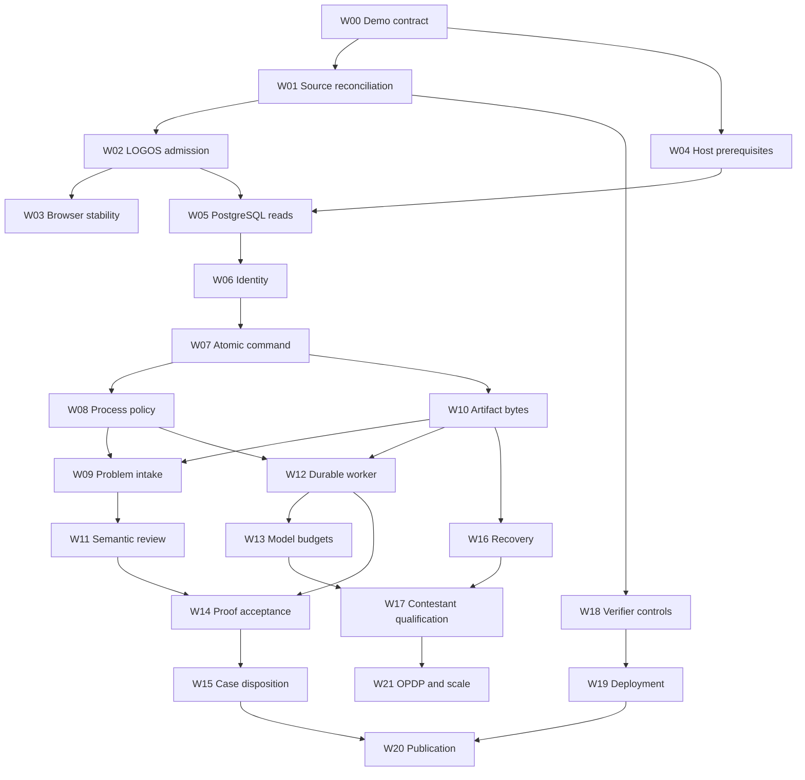

# MaCSad / LOGOS: Electron readiness and execution direction

**Internal working reference for Alejandro, Tristen, and authorized datacenter.dev collaborators.**

- Initial assessment date: **2026-09-07**. Implementation update: **2026-09-08**, section 18.
- Wednesday milestone: **2026-09-09**, assuming the coming Wednesday. Exact presentation time and timezone remain to be confirmed.
- Document status: **initial analysis plus dated implementation evidence; not a release approval or deployment instruction**. Sections 1–17 preserve the original assessment; section 18 supersedes its execution-status statements where explicitly stated.
- Initial assessment authority was read-only plus this file. The September 8 user request subsequently authorized implementation toward a working demonstration. Source changes, tests and incident recovery under that request are recorded in section 18. No commits, remote pushes, upstream LOGOS changes or new public deployment have been made by this implementation workstream.
- Canonical intended location: `Brahmastra-Labs/macsad/docs/ELECTRON_READINESS.md`. This copy remains uncommitted. A file in one checkout is not automatically available in GitHub or to every member of datacenter.dev.
- Proposed document stewards: Alejandro for mathematical/product decisions; Tristen for LOGOS capability status; the MaCSad delivery lead for implementation evidence; the operations owner for deployment/recovery evidence. These are proposed responsibilities, not assignments made by this report.

## Read this first

**There is real implementation, including real LOGOS proof machinery. There is not yet a demonstrated end-to-end, durable, multi-contestant Mathematics Factory in the running MaCSad application.**

The largest difference from the earlier assessment is that LOGOS upstream now contains a September 7 update. It adds substantive web, HTTP, proof-inventory, certificate and tooling capabilities. It must not be judged solely by September 1 bugs. Conversely, it must not be treated as an admitted working release: its observed upstream test jobs are not all green, it has not been integrated into MaCSad, and several old defects and new trust concerns remain.

The immediate goal is a **truthful, bounded Wednesday demonstration with reusable deployment foundations**. The deployment goal is a **recoverable service that accepts real users and real research without losing work, leaking it, spending without bounds, or calling unverified output a proof**. These are distinct acceptance levels.

The long-term ambition is to industrialize a mathematical research workflow across supported problem families. This report does not assume all mathematical questions can be solved automatically, that every formalization is faithful, or that a successful test proves unrestricted mathematics.

### Five decisions that unlock execution

1. Name the Wednesday presentation time, delivery lead, and precise demonstration contract.
2. Select the first mathematical problems and accepted proof/checker family, including a negative control and an inconclusive case.
3. Name one exact LOGOS candidate and authorize its separate evaluation/promotion process; do not use a floating “latest.”
4. Choose the access model: a trusted shared team, isolated deployments per competing team, or a deliberate multi-tenant expansion.
5. Name the operator with host, Headscale, runner-management, backup and deployment authority.

### Immediate critical path

`source reconciliation → candidate/toolchain evidence → stable browser + real PG boundary → authenticated durable command → preserved problem/evidence → bounded proof attempt + trusted replay → rehearsal → separately gated deployment`

Proof trust, authorization and recovery cannot be replaced by more visual polish. A polished shell is useful as a shell; it must be labeled accordingly.

## Contents

1. [Evidence scope and exact versions](#1-evidence-scope-and-exact-versions)
2. [What has actually been built](#2-what-has-actually-been-built)
3. [Demo and deployment acceptance levels](#3-demo-and-deployment-acceptance-levels)
4. [Repositories, ownership and architecture](#4-repositories-ownership-and-architecture)
5. [Defect and uncertainty register](#5-defect-and-uncertainty-register)
6. [Ordered implementation work packages](#6-ordered-implementation-work-packages)
7. [Mathematical acceptance contract](#7-mathematical-acceptance-contract)
8. [Database and event-driven rules](#8-database-and-event-driven-rules)
9. [Website and participant experience](#9-website-and-participant-experience)
10. [Deployment, verification and recovery](#10-deployment-verification-and-recovery)
11. [Security and foreseeable failure modes](#11-security-and-foreseeable-failure-modes)
12. [Test and evidence matrix](#12-test-and-evidence-matrix)
13. [Wednesday sequence and release decisions](#13-wednesday-sequence-and-release-decisions)
14. [Decisions and information still needed](#14-decisions-and-information-still-needed)
15. [How this file becomes a maintained anchor](#15-how-this-file-becomes-a-maintained-anchor)
16. [Plain-language glossary](#16-plain-language-glossary)
17. [Source index](#17-source-index)

## 1. Evidence scope and exact versions

### 1.1 Four different meanings of “current”

| Surface | Identity observed September 7 | Meaning |
|---|---|---|
| MaCSad local `main` | `f95e22be1ceb270a714b8936e8cd0d1b3f6050e5` | Clean before this direction file; contains additional read-only board contracts. |
| MaCSad actual GitHub `main` | `9c818442e5959a3ff33557fe198b815f54764628` | September 1 autonomous Firebat2 pipeline design, PR #5. |
| LOGOS local source | `f6712fe9860345bf4d6cf0b2b99014a69bf3fe6d` | September 1 source; left unchanged. |
| LOGOS actual GitHub `main` | `d9baaff5b6749c961a13cd2eca427434c5959b17` | September 7, 19:17:33 UTC; inspected through read-only API, not pulled. |
| MaCSad admitted LOGOS source | `132dc5346728e2d204df798dd7544e6405306a2c` | Exact source in `.macsad/toolchains/logos.lock.toml`, version 0.10.1. |
| Older gap-ledger evaluated candidate | `92c31ecf...` | Historical evaluation boundary, not the newest upstream or the admitted runtime. |

Local MaCSad and its actual remote main differ by one commit each. An ordinary fast-forward-only pull cannot reconcile them. A future implementation change must preserve the board-contract work and the newer remote operating-policy work; no reset, force-push or silent discard is warranted.

The September 7 LOGOS commit is large: GitHub reports 189,253 additions and 11,150 deletions, including substantial unrelated campaign/benchmark material. This review concentrates on MaCSad-dependent web, transport, PostgreSQL, proof, certificate, test and deployment surfaces. It is **not a line-by-line audit of that entire commit or a soundness audit of the whole language**.

### 1.2 What is actually running

- Existing preview services are September 1 processes: a Python static/health proxy, a Python public-file server and a LOGOS gateway on loopback ports 18080, 18082 and 18081 respectively.
- The gateway executable still running in memory has SHA-256 `8c75eeb6180a7f4692ad5abba32b562d4a1cbc08792da95ae58770d4a3cc77f1`, matching MaCSad's admitted binary lock.
- The current disk `largo` binary has SHA-256 `49cbeae65af7a27b47d05f0d8f357c7547a4c1583d0c19961de0051b58b4d1b7`. It is not the running gateway binary.
- The live executable's old filesystem name has been replaced. A process can continue running old bytes after the file at that pathname changes. No restart was performed.
- Served browser WASM files have September 1 modification times. Timestamps alone do not establish which source produced them; an exact source-to-bundle manifest is still needed.
- Live health returns `MaCSad gateway ready | persistence: not connected | mutations: disabled`.
- Public preview `/` returns a directory listing. The actual template is at `/macsad_public.html`.
- Docker and Tailscale were absent from the ordinary PATH, their services inactive, and no configured `.runtime` directory was observed. The supported Compose environment is defined but not provisioned on Firebat One.
- Scratch PostgreSQL installations are not the deployed application database. Their existence does not establish application persistence.

### 1.3 Evidence actually obtained

This assessment read repository instructions, plans, domain model, SQL/schema contracts, app handlers/views, data workers, test manifests, current framework source, GitHub state and selected running-service metadata. The preceding review in this same task also reproduced the served typing/focus failure and the old allocator boundary in an isolated in-memory probe. Those reproductions retain their original version scope.

**No new full or targeted executable suite ran during this direction-file task.** Source-established findings, hypotheses, historical failures and unavailable evidence are labeled separately. Existing tests are not described as having passed merely because their source exists.

### 1.4 CI and policy observations

| Item | Observed state | Correct interpretation |
|---|---|---|
| MaCSad Foundation run `33499818353` | Success for `9c81844` | Foundation/governance/PG evidence for that SHA; not a complete LOGOS or application release test. |
| Firebat2 ingestion run `33499902649` | Skipped; `FIREBAT2_ENABLED=false` | No Firebat2 execution evidence. Do not enable it simply to make the status green. |
| LOGOS September 7 candidate | `test (1)`, `test (2)`, `test (3)`, `extras` failed at observation | Candidate is not a fully green release. A job failure count is not an individual bug or failing-test count. |
| LOGOS failing partition 1 | Failure at “Run tests — partition 1/3” after setup/cache/archive steps | Full per-test causes were not audited; do not invent a regression count. |
| MaCSad branch protection | Strict required foundation check, admin enforcement, linear history, no force-push/delete, conversation resolution | Local prose claiming branch-protection API always returns 403 is stale. |
| Required approving reviews | Zero | Do not reintroduce a mandatory independent human code-review click as an assumed requirement. |
| Runner-group administration | API returns 403 | This remains an organization-level permission blocker. |
| GitHub deployment environments | None configured | No configured staging/production environment was established. |

Current remote ADR `docs/decisions/0002-firebat2-pipeline.md` describes machine-gated ordinary merges/application releases with zero required human approvals. Its independent **control-policy activation** mechanism remains unimplemented. Mathematical review/publication, dangerous recovery operations and ordinary software release are different authorities. This document proposes no policy changes.

## 2. What has actually been built

### 2.1 Evidence-based progress, not a percentage

| Area | Implemented | Still missing or unestablished |
|---|---|---|
| Research design | Explicit problem, assumption, attempt, evidence, decision and publication model | Operational completion of that journey through the application. |
| PostgreSQL | 47 tables, 50 enums, six views, forward migration discipline, many durable invariants | Authenticated application commands and production database connection. |
| Representative data | Deterministic scenario and 792-field coverage contract | Real problem import, real proof execution and actual research results. |
| Data workers | Narrow seed/export/DB dump/restore contracts and tests | Real CAS-byte backup, scheduled encrypted off-host recovery, participant import/export. |
| LOGOS app | 21 `.lg` source files and 16 registered policy tests in the inspected local MaCSad | Working authenticated writes, worker execution, model calls, proof acceptance and publication. |
| Website | Admin shell, six board phases, local draft, safe health request, public empty template | Accurate live board, saved problem editing, usable end-to-end research workflow. |
| New read contracts | Bounded row decoder, wire policy and exact schema probe | HTTP route exposure, actual PG read, transport wiring and live rendering. |
| LOGOS mathematical substrate | Theorem command, proof terms/kernel checking, certificates, replay, second checker | Admitted MaCSad proof adapter and hardened acceptance of untrusted certificate environments. |
| Delivery foundation | Checked-in Compose, CI guards, verification runbooks and Firebat2 design | Provisioned private runtime, disposable verifier controller, deployer and deployment/recovery rehearsal. |

A fixture exercising every schema field is useful database coverage. It is not evidence that the represented research happened. The example certificate string `math checker certificate v1` is a synthetic value, not a certificate produced by a mathematical checker.

### 2.2 What the current UI means

Board cards and counters are hardcoded examples. The draft remains in the browser. Organization, Research and Operations largely explain intended functionality. The public card is explicitly a template with no published discovery. The useful principle to retain is honest labeling; the confusing placeholder counters and verbose explanatory shell should not survive as if they were live operational data.

No implemented OPDP integration was found in the inspected MaCSad code or documents. The specific OPDP source repository/package and first import dataset must be identified before describing them as connected.

### 2.3 What changed in LOGOS on September 7

The candidate adds or advances LGX pages/components, typed routes and derived JSON, component/state/patch handling, in-place DOM reconciliation, static/release web builds, local dependency handling, browser smoke tests, HTTP read deadlines and lifecycle state, project-closure proof evaluation, theorem/axiom inventory and CLI theorem certificates.

These are real source capabilities worth evaluating. They do not automatically update MaCSad's lock, old component syntax, module/test manifests, proxy allowlist, database credentials, generated assets or running processes.

## 3. Demo and deployment acceptance levels

### 3.1 Level D0 — honest website and tool demonstration

Minimum useful Wednesday fallback if integration gates remain red:

- A stable, readable LOGOS website with no typing reset and no misleading counters.
- Clearly labeled synthetic versus persisted data.
- Original problem, formal statement, assumptions and evidence status visible.
- A real selected LOGOS proof/checking demonstration with exact tool/source identity. If run outside MaCSad, label that provenance; do not imply the app performed it.
- A list of remaining connection/deployment gaps and the next actual action.

This is a demonstration of components. It is **not near-production autonomous research**. It must not be presented as such.

### 3.2 Level D1 — preferred Wednesday vertical slice

Target one real path rather than every proposed feature:

1. An authenticated operator opens the site.
2. A selected problem and its immutable revision are preserved in PostgreSQL with source artifacts; the first prescribed append-message command establishes the durable command infrastructure on the way there.
3. Refresh and a second session show the accepted durable result.
4. A formal statement and allowed assumptions are pinned to that problem revision.
5. A bounded attempt produces a real artifact.
6. An admitted checker/replay path accepts or rejects it against the exact target.
7. The result, checker version and evidence can be reopened.
8. Duplicate submission, an invalid attempt and an inconclusive outcome are demonstrated honestly.

The existing API plan makes append-message the first durable command. Retain it as the smallest infrastructure proof unless a deliberate product decision changes the first slice; do not implement a generic CRUD framework first. Call that infrastructure milestone **D1a**. The complete mathematical journey above is **D1b** and requires an identified preserved problem revision plus W09/W11 intake/review evidence; saving a message alone does not satisfy it. D1 without a suffix below means the complete D1b path.

### 3.3 Level D2 — deployable private pilot

D1 plus reproducible build/deploy identity, supported Compose startup, approved private access, individual authentication, bounded execution/spend, actual database-and-artifact recovery, restart survival, visible failures, an operator and rollback rehearsal.

### 3.4 Level D3 — event service for contestants

D2 plus an agreed trust/isolation model, measured concurrent-user/job capacity, offboarding, incident support, submission/privacy rules, hostile-input tests, participant exports, cost controls and load/recovery rehearsal. The number of supported contestants must come from measurement, not optimism.

### 3.5 Level D4 — public scientific publication

D3 does not grant publication authority. Public results additionally require the exact eligible evidence closure, classification, rights/attribution, domain review requirements, sealed deterministic export and verified publication-head advancement. A green software build cannot authorize a mathematical claim.

## 4. Repositories, ownership and architecture

### 4.1 Repository and path map

| Repository or control plane | Responsibility | Owning paths / decision |
|---|---|---|
| `Brahmastra-Labs/macsad` | Application, domain policy, database, orchestration, evidence handling, operations and this plan | `logos/`, `database/`, `host_adapters/`, `.macsad/`, `tests/`, `scripts/`, `ops/`, `docs/` |
| `Brahmastra-Labs/logicaffeine-private` | LOGOS language/compiler/runtime/stdlib/proof substrate | Upstream ownership: Tristen and its maintainers. MaCSad records framework defects in its own `LOGOS_GAPS.md`; it does not edit/push upstream. |
| Watched research repository | Preserved problem/source snapshot for a campaign | Exact repository not selected by this report. Distinct concept from the platform repository and its tool dependencies. |
| OPDP source/problem dataset | Mathematical characterization/intake material | Exact repository, version, format, rights and owner confirmation required. No invented repository. |
| Firebat One | Supported private application runtime | `ops/firebat/`, `ops/compose/`, operator-controlled Headscale enrollment |
| Firebat2 | Disposable verification capacity | `ops/firebat2/`, `scripts/ci/`, `.github/workflows/`, remote-main ADR0002 |
| Headscale / network administration | Approved identities and network ACLs | External operator control plane; ownership/access must be confirmed. |
| GitHub organization / Actions | Source, candidate checks, runner groups, release controls | Existing settings plus unimplemented runner/deployer/control-policy mechanisms |
| Publication hosting / Cloudflare if retained | Public immutable release destination and access boundary | Account, hostnames, credentials, ownership and exact deployment contract unresolved |
| Model provider | Paid model inference and usage records | Start with one reviewed provider/model contract; current design references OpenRouter. |
| Off-host backup store / key custody | Recovery independent of Firebat loss | Destination, access, encryption, retention and restore owner unresolved |

Do not create additional repositories, services, queues or databases merely because this table has multiple responsibilities. Reuse the existing structure until a concrete boundary justifies separation.

### 4.2 Proposed responsibility split

- **Alejandro:** mathematical benchmarks, meaning/assumptions, product priorities, acceptance of demo claims and participant needs.
- **Tristen / LOGOS maintainers:** current upstream defects and proof/runtime contracts; exact candidate evidence.
- **MaCSad delivery lead:** ordered slices, interface coordination, source reconciliation and evidence-backed status.
- **Application engineers/agents:** LOGOS UI/domain commands and tests, not uncontrolled upstream changes.
- **Database/storage owner:** durable invariants, transaction integration, exact formats and tested recovery.
- **Operations/security owner:** host/network identities, secrets custody, sandboxing, release controls, backups and incidents.
- **Mathematical verifier owner:** checker admission, artifact acceptance, adversarial proof fixtures and reproducibility.

An agent role name grants no credentials or approval. Assign actual people/capabilities before execution.

### 4.3 Architectural guardrails

1. Product views, authorization/workflow decisions and research logic remain LOGOS-authored.
2. PostgreSQL is the sole mutable domain authority. Browser storage and a SQLite/JSON demo are not substitutes for the deployment contract.
3. Mechanical host adapters do typed I/O and bounded execution, not domain decisions.
4. Immutable source, evidence and certificates are content-addressed bytes with separate provenance/rights metadata.
5. Accepted commands commit their record, canonical receipt, domain event and required outbox item together.
6. External effects occur after commit, with durable reconciliation for ambiguous outcomes.
7. Untrusted model/checker/candidate code cannot reach database, deployment, repository, provider or host credentials.
8. New assumptions or problem revisions invalidate relevant old acceptance; scientific history is corrected by supersession, not overwriting.
9. Public output is an immutable approved projection, not another database/control plane.
10. No new relational table/field is proposed by default. A future addition needs use case, owner, invariant, lifecycle and failing acceptance test.

## 5. Defect and uncertainty register

### 5.1 Counting rules

Do not publish one undifferentiated “all bugs” number. Scope and evidence matter.

- The **six earlier defect IDs** are retained for continuity. Against newest LOGOS, **three persist by source**, **two have source implementations addressing the original mechanism**, and **one affected example was replaced**.
- **Nine additional technical findings** are recorded as F01–F09: four newest-framework findings, two replacement-example defects, one MaCSad database defect candidate, one live presentation defect and one test-coverage defect. No new defect-focused executable test harness ran during this report. F08 was directly observed by a live GET; the other additions are source-established or source-inferred as individually labeled.
- **One separate P0 trust concern**, T01, is a source-established missing validation boundary with an unexecuted forgery hypothesis. It is not counted as a demonstrated soundness break.
- **Three historical failures** H01–H03 require exact current evidence.
- **Two previously documented schema questions** S01–S02 require policy decisions/enforcement; they are not newly discovered LOGOS bugs.
- **One retained framework limitation**, L03, concerns static symlink containment; it remains separate from the six historical defect IDs and the nine additional findings.
- Operational gaps, drift, future risks and the **17 existing LOGOS capability families** are separate, overlapping inventories. They must not be added to the defect count.
- No claim is made that these exhaust all defects. Full latest-source testing, hostile-certificate testing, real PG integration and load testing were not performed.

Priority definitions: **P0** blocks accepting the affected trust claim; **P1** blocks reliable use of the affected demo/deployment path; **P2** is narrower or example-only but must be resolved before reuse. Priority is not the same as reproduction confidence.

### 5.2 Earlier defects re-evaluated against `d9baaff5...`

| ID | Finding | Latest status | Required next evidence |
|---|---|---|---|
| B01 | Input loses focus on repaint | New in-place reconciler exists. Old running MaCSad still exhibited the bug. Not closed in MaCSad. | Real sequential keyboard/selection/IME tests against newly built MaCSad assets; source tests alone insufficient. |
| B02 | Host text allocation crosses its single fresh 64-KiB page | Still present: `runtime.js:56–61`. Old exact implementation reproduced at 65,521 and 100,000 ASCII bytes in fresh-memory harness. | Multi-page, multibyte, repeated-allocation and long-proof tests; allocate required pages or reject with exact bounds before effects. |
| B03 | Browser transport counts UTF-16 units and rejects after whole-response buffering | Still present: `runtime.js:97–114`. | UTF-8 byte-equivalent limits across tiers, incremental bounded consumption and overflow cancellation. |
| B04 | PostgreSQL todo example uses zero-based result indexes | Old code removed; replacement uses a file store. Not evidence of repaired PG integration. | Keep real PG16 handler test in MaCSad; do not adopt replacement storage as the production backend. |
| B05 | Failed PG startup/authentication retains TCP handle | Still present in startup send exits at `postgres.lg:818–847` and authentication exits at `postgres.lg:724–794`; timeout-arming failure alone closes correctly. | Repeated authentication/startup failures return handles/connections to baseline on all relevant tiers. |
| B06 | Idle HTTP clients hold all slots indefinitely | Read timeout implementation now present at `http/server.rs:461–467`. Original mechanism addressed in source. | Real idle-client, overload, permit recovery and drain tests; also test F03 below. |

B02's numeric boundary describes the earlier fresh-memory probe, not a universal maximum page or application size. Its failure mechanism persists in the newly inspected source; the new candidate itself was not executed here.

### 5.3 Additional technical findings

#### F01 — Keyed DOM reconciliation does not physically reorder reused nodes — P1

- Evidence: source-established counterexample in newest `crates/logicaffeine_compile/assets/web/runtime.js:154–165,180–191`.
- Existing real order `[A,B]`, fresh keyed order `[B,A]`: the algorithm matches and patches B then A, but never moves their real DOM nodes. Newly mounted nodes always append. The committed virtual order can disagree with what the user sees.
- The patch-stream `beginPaint` path also invokes this reconciler; do not assume LGX is automatically exempt.
- Impact: sorted/reprioritized research cases, newly inserted rows and per-item controls may display stale order.
- Owner: LOGOS browser runtime; MaCSad adds a real-board regression.
- RED: reorder, insert-at-start/middle, delete and restore keyed rows; verify actual DOM order, text, focus and handler-to-record identity. Not runtime-reproduced in this task.

#### F02 — Browser bookkeeping retains growing state over long sessions — P1 before sustained use

- Evidence: `runtime.js:73–74,83–115,132,164,193–208` grows node IDs, reserves new slots during repaint and retains completed fetch records. Removal does not comprehensively release node/handler records. No completed-response deletion path was found in the inspected host.
- Impact: repeated typing, board refresh and proof-output polling can accumulate retained nodes, slots, closures and response bodies.
- Owner: LOGOS runtime.
- RED: thousands of fixed-size repaint/fetch/remove cycles; measure registry counts and retained heap after collection in an isolated browser. Specify lifecycle/release ownership before adding cleanup; do not remove a result while a legitimate consumer still owns it.
- Classification: source-established retention paths; rate and practical exhaustion threshold unmeasured.

#### F03 — HTTP timeout does not stop underlying handler work — P1

- Evidence: newest `crates/logicaffeine_system/src/http/server.rs:569–585` returns 503 and releases admission while a `spawn_blocking` handler continues detached.
- Impact: a client sees timeout although a database effect may later commit; repeated timeouts can leave more work running than the nominal serving capacity.
- Owner: LOGOS HTTP lifecycle plus MaCSad command owner.
- RED: a blocked handler remains counted toward the real work budget; repeated timed-out requests cannot exceed configured execution concurrency. A timed-out mutation is reconciled by its idempotency key, never blindly repeated.
- Define separate request deadline, cancellation request, work completion and accepted-command status. Killing an HTTP response is not rollback.

#### F04 — MCP proof surface is behind the CLI proof surface — P1 for autonomous proof integration

- Evidence: newest `apps/logicaffeine_cli/src/mcp/tools.rs:137–147,217–235` reads a selected raw file and returns older proof status/axiom-count fields. It does not expose the CLI's project closure, full inventory and certificate envelope.
- Impact: an agent using MCP may unknowingly prove/check a different input closure or lack required replay evidence even when a manual CLI demo works.
- Owner: LOGOS MCP/proof interface maintainer; MaCSad chooses and pins one admitted interface.
- RED: the same multi-file problem through CLI and MCP identifies the same theorem/dependencies/outcomes and required receipt fields, or the unsupported route explicitly refuses the requested contract. Never fabricate missing certificate fields.
- Classification: confirmed current integration/interface gap, not an experimentally demonstrated false proof.

#### F05 — Replacement todo example reports success after failed storage writes — P2, example only

- Evidence: newest `examples/fullstack_todo/src/server.lg:53–62,96–97,107–108,116–117`; `saveTodos` returns false, callers ignore it and return the proposed new list.
- Impact: UI can display unsaved changes. `loadTodos` also treats all read errors as empty data, not only missing-file initialization.
- RED: permission/disk/write failure is visible and does not claim persisted success; unreadable/corrupt existing storage must not become a successful empty database.
- Do not transplant this storage approach into MaCSad. Owner: upstream example maintainer.

#### F06 — Replacement todo file framing does not escape user text — P2, example only

- Evidence: `server.lg:39–47,53–58,88–97` accepts Text but stores `id|text|done` with no delimiter/newline escaping.
- Counterexample: text containing `|` or a newline changes the fields/rows interpreted on reload; `hello|1` can alter the decoded completion flag.
- RED: arbitrary Unicode, pipes, CR/LF and long text round-trip exactly; malformed files fail visibly.
- Related non-counted identity risk: `nextId=max+1` reuses the largest deleted ID despite the comment's stability claim. Decide the intended identity contract and test delayed actions against reused IDs before claiming durable identity.

#### F07 — Budget reservation replay is checked after mutable lifecycle conditions — P1 before paid autonomous work

- Evidence: MaCSad `database/migrations/0001_initial_schema.sql:2656–2661,2671–2679` checks current expiry/model-call state before replay lookup at `2745–2754`.
- Hypothesis supported by control flow: an accepted reservation replayed after its model call becomes submitted or its period expires fails instead of returning its original entry ID.
- Owner: MaCSad database/command owner.
- RED: accept a reservation, legally advance lifecycle, replay identical key/digest and expect the original ID with no ledger/balance/event change. Repeat after expiry. New requests after expiry still fail; same key/different digest still conflicts.
- Classification: high-confidence source-inferred defect; not executed. If confirmed, correct through the next migration, never by editing applied `0001`.

#### F08 — Public preview root is a directory listing — P1 for the demo

- Evidence: live GET of the existing public server root.
- Impact: opening the expected homepage does not show the public application; generated filenames are listed in the private preview.
- Owner: MaCSad preview/operations.
- RED: `/` serves the intended page, correct asset MIME types work, unknown paths return an intentional error, directory enumeration is unavailable. No private research leak was demonstrated.

#### F09 — Browser smoke bypasses the typing failure — P1 test coverage

- Evidence: MaCSad `scripts/ci/browser-probe.mjs:125–132` assigns an entire input value, dispatches synthetic events and invokes a button rather than typing sequential real keys.
- Impact: the smoke can pass without noticing focus loss after the first character.
- Owner: MaCSad browser-test owner.
- RED: user-like sequential key entry, selection replacement, backspace, paste, IME and asynchronous repaint; assert value, focused element and selection after each step. This is a test defect, not a second instance of B01.

### 5.4 T01 — Certificate-controlled environment validation — P0 trust concern

Newest `TheoremCertificate.rebuild_context` installs certificate-supplied declarations and definitions directly. `Context.add_definition` / `add_declaration` use raw map insertion, and both checkers obtain a global's declared type from that context.

Sources: LOGOS `crates/logicaffeine_kernel/src/certificate.rs:197–209`, `context.rs:434–463`, `type_checker.rs:62–66`, `recheck.rs:804–808` at `d9baaff5...`.

**Established by source:** the reconstruction path lacks validation of supplied definition bodies and trusted-name collisions before installing them.

**Not established by execution:** whether a complete forged external certificate with an ill-typed definition declared to inhabit False can pass both checkers through the actual public acceptance path. Do not call this a demonstrated kernel soundness break.

Before accepting arbitrary contestant certificates, test:

1. Ill-typed definition body with a superficially acceptable declared type.
2. Proof reference to that forged global.
3. Redefinition/shadowing of a trusted prelude name.
4. Duplicate definitions/declarations with contradictory types.
5. Unapproved assumptions inserted as declarations.
6. Cyclic/forward dependency tricks, invalid universes and oversized contexts.
7. The exact target proposition silently replaced by a different claimed type.
8. Same hostile context evaluated by both checkers: agreement alone must not approve unvalidated shared premises.

Required boundary: reconstruct a validated, dependency-ordered, version-pinned context from approved assumptions; type-check definitions; reject collisions; bind the claimed theorem to the trusted challenge independently of the submitted certificate. Owner: Tristen / LOGOS proof maintainers, with MaCSad verifier acceptance tests. Keep external-certificate admission disabled or restricted to a separately reviewed trusted path until evidence exists.

### 5.5 Historical failures and existing schema questions

| ID | Status and next action |
|---|---|
| H01 — SCRAM hang | New 5-second socket I/O timeout and scripted failed-SCRAM test exist. TCP establishment occurs before timeout arming, and separate reads are not one overall deadline. Retest exact live failure under bounded overall connect/auth policy. |
| H02 — cancel affects following query | New `pgCancelInFlight(false)` no-op helps; legacy cancel passes true. A caller Boolean is not atomic query-generation ownership. Retest cancellation/reuse race and discard uncertain connections when required. |
| H03 — generated WASM i32/i64 mismatch | Recover the original failing fixture and run it against the new candidate in real V8. New general WASM tests are not proof that this exact regression is fixed. |
| S01 — mention workspace membership | Existing `message_mention` references do not themselves require source-workspace membership. Decide allowed behavior, then enforce active membership at command acceptance and add a negative test. |
| S02 — public license/attribution | Existing dossier validation checks public classification/scanning/redistribution but does not require license/attribution fields. Define explicit allowed/not-applicable cases and fail-closed publication validation. |
| L03 — static symlink containment limitation | Retained separately from B01–B06: newest `serve_web.rs:414–431` follows filesystem symlinks without canonical root-containment validation. Before adopting that serving/export path, require containment checks and escaped-symlink tests; do not serve arbitrary private source trees as a workaround. Source-level limitation, not a newly exploited production disclosure. |

### 5.6 Existing LOGOS capability families: do not treat as 17 defects

The existing ledger must be updated later in a separately authorized implementation/documentation change. This report does not change `LOGOS_GAPS.md`.

| Family | Direction after newest-source inspection |
|---|---|
| G1 typed browser requests | Correlation/headers/status/error/abort/timeout exist; B02/B03/F02 and MaCSad acceptance still matter. |
| G2 header-aware HTTP | Substrate exists; authenticate trusted identity, canonical headers and exact command transport in MaCSad. |
| G3 typed PostgreSQL | Substantial API exists; cleanup, overall deadlines, cancellation, TLS/auth/result budgets and exact application contracts remain. |
| G4 routing/navigation | Native history and newer pages exist; test actual reload/deep-link/back-forward behavior. |
| G5 project assembly | Source support advanced; prove actual MaCSad module closure and remove compatibility workarounds only with tests. |
| G6 honest cross-tier evidence | Strict comparisons advanced; actual selected-tier results and schema of reports still need candidate evidence. |
| G7 deterministic static publication | Static/release build substrate exists; L03 containment needs evidence and MaCSad's sealed scientific publication workflow does not. |
| G8 binary HTTP response parity | Revalidate current byte/MIME/compression/static-serving paths; do not infer whole closure from old candidate status. |
| G9 deep-check stability | New multi-file/deep-check tests exist; run MaCSad's exact fixture before closing. |
| G10 local dependency linking | New local dependency support exists; preserve immutable admitted source closure and reject floating dependencies. |
| G11 typed structured data | Derived route JSON exists; verify exact types, integers, decimals, UUIDs, nullability, duplicates and invalid inputs. |
| G12 genuine engine differentiation | Not exhaustively re-audited. Inventory actual independently exercised implementations and unsupported cases. |
| G13 proof semantics/non-vacuity | CLI inventory/certificates advanced; T01, F04, target binding and finite/unrestricted distinction are critical. |
| G14 external-tool preflights | New tests exist; absence of required tools must produce explicit failure, not a skipped/empty success. |
| G15 production server/lifecycle | Deadlines/drain/admission substrate exists; F03 and real deployment/DB effects still need evidence. |
| G16 nested component scope | Recheck actual MaCSad closure/component state on candidate before removing redundant imports. |
| G17 actual browser/WASM behavior | B01 source mechanism addressed, H03 pending, new F01/F02 and F09 require browser evidence. |

## 6. Ordered implementation work packages

Everything below is **future work requiring separate implementation authority**. No task is marked complete merely because it appears here. Proposed paths for new modules are design locations, not files already present. Each package must record exact source, observed RED, targeted GREEN, applicable full gate and residual risk.

### W00 — Freeze the demonstration contract and ownership

**Owner:** Alejandro + delivery lead. **Dependencies:** none.

1. Choose D0/D1 target and D2/D3 deployment goals separately.
2. Name the live mathematical problem, false/invalid control and inconclusive control.
3. Decide whether the demo includes a real model call or a clearly labeled externally generated proof artifact.
4. Define what a viewer can do and what will deliberately remain unavailable.
5. Choose trusted-team versus competing-team access for the first pilot.
6. Name people responsible for demo, LOGOS fixes, data, proof trust and operations.
7. Set event time, rehearsal time and feature freeze; preserve failure gates rather than promising an outcome regardless of evidence.

**Acceptance:** one written demo script and evidence checklist; every displayed capability has an honest provenance label. No invented solved-problem or active-agent count.

### W01 — Reconcile source and authority without losing work

**Owner:** MaCSad delivery lead. **Paths:** branch history, ADR0002, intake/upgrading/deployment runbooks. **Depends:** W00.

1. Inspect all contributors' current work and preserve the two named MaCSad heads.
2. Review the local board-contract commit and remote Firebat2 policy commit together.
3. Integrate them by a reviewed history-preserving approach compatible with linear-history policy; do not force-push/reset or discard work.
4. Reconcile stale local statements about branch-protection 403 and human review with actual remote policy/settings.
5. Keep mathematical publication, control-policy activation and ordinary application release authority distinct.
6. Inventory protected control paths and current exact runner/tool locks.

**Acceptance:** one agreed base SHA containing both intended changes, clean known diff, accurate operating docs, no upstream LOGOS writes. This uncommitted direction file must not be committed just to make a cleanliness gate pass without permission.

### W02 — Evaluate and admit an exact LOGOS candidate

**Owner:** Tristen supplies upstream evidence; MaCSad toolchain owner integrates. **Paths:** `.macsad/toolchains/logos.lock.toml`, `LOGOS_GAPS.md`, `tests/logos-module-manifest.json`, `scripts/logos.sh`. **Depends:** W01.

1. Name the exact candidate, initially `d9baaff5...` or a later explicitly identified fixing commit.
2. Preserve the old admitted compiler/source/runtime closure and usable rollback artifacts.
3. Inspect complete failed upstream job results; separate environment failures from individual regressions before assigning counts.
4. In a separately authorized isolated evaluation environment, run upstream and MaCSad-dependent tests serially; do not move the shared source checkout implicitly.
5. Reproduce B02/B03/B05 and the new browser/lifecycle issues, or establish that a later candidate fixes them.
6. Execute T01 adversarial proof-context tests before external receipt admission.
7. Check legacy MaCSad syntax and any required LGX migration, imported modules, exact test discovery/report envelopes and generated runtime assets.
8. Record source commit/tree, lock digest, compiler bytes, build environment, version and full runtime dependency closure.
9. Change only the MaCSad candidate lock after compatibility evidence; record upstream versus admitted fixes separately.
10. Separate candidate evaluation from activation: evaluation can precede W18; changing the admitted control/toolchain state requires the independently installed control-policy gate described in W18. Do not blindly follow stale local approval text or silently bypass missing control-policy infrastructure.

**Acceptance:** exact candidate evidence with no hidden skips; deterministic application bundles; all relied-on behaviors pass actual affected tiers. A version string, source commit message or archive-success job is insufficient.

### W03 — Repair browser interaction and modernize only as required

**Owner:** MaCSad UI/test owner; upstream defects to Tristen. **Paths:** `logos/admin/`, `logos/public-site/`, browser tests/manifests. **Depends:** W02.

1. Lock the existing typing failure with real browser input, not synthetic whole-value assignment.
2. Test F01 ordering and F02 retention before a frequently refreshed board is trusted.
3. Decide whether retained Component syntax or newer LGX Pages is the smallest supported route; avoid an untested wholesale rewrite.
4. If adopting `pages/`, update MaCSad's production-module and test manifests intentionally; upstream page support does not update MaCSad's guardrails automatically.
5. Preserve component instance state, event-handler identity, caret, selection, scroll and browser navigation.
6. Replace static counts with values derived from the displayed projection; remove decorative claims and redundant instructional copy.
7. Represent loading, empty, error, denied, stale, pending and saved states explicitly.

**Acceptance:** useful narrow-screen and desktop UI, correct keyboard operation, no focus loss, exact row ordering/identity, no false saved state and no unbounded observed retention in the agreed endurance test.

### W04 — Establish supported private host prerequisites

**Owner:** authorized operations human. **Paths:** `ops/firebat/`, `ops/compose/`, `GETTING_STARTED.md`. **Depends:** W00/W01 for bootstrap/network investigation; runtime configuration also depends on W02's admitted exact closure.

1. Verify host identity, OS/architecture, storage capacity, privilege owner and existing processes before changes.
2. Confirm Headscale endpoint, approved identities and ACL owner; do not invent or broaden access for all datacenter.dev users.
3. Review pinned package/image availability and provenance, then authorize the one-time Docker/Compose/Tailscale bootstrap.
4. Enroll interactively without exposing keys/passwords to prompts, Git, shell logs or agents.
5. Verify daemon/group privileges, real tailnet address, service startup and denied network paths.
6. After the exact admitted toolchain is available, configure only ignored runtime state/secrets using the supported harness. Configuration invokes the LOGOS lock verifier; the present source/binary mismatch prevents treating this step as independent of W02.
7. Define per-service memory, CPU, process and disk limits before shared workloads; current Compose limits are not complete capacity controls.

**Acceptance:** supported prerequisites and negative exposure checks pass; PostgreSQL has no host-published port; application/viewer containers have no host Docker socket, private checkout or repository credential.

### W05 — Connect PostgreSQL readiness and bounded reads

**Owner:** LOGOS backend + database owner. **Paths:** gateway HTTP/read/schema policy, admin board decoder, `case_board_v`, Compose proxy/secrets. **Depends:** W02/W04 for adapter integration; W06 for exposing any private participant read route. Pre-W06 work uses isolated scratch data only.

1. Supply only the narrow runtime database credential to the gateway; current health-only gateway does not mount it.
2. Implement real connection setup, required-auth/TLS policy, total deadline, cleanup and pool/row/byte limits.
3. Read and validate the exact schema/server version row, OIDs, columns and nullability.
4. Expose exact liveness/readiness routes with different meanings; liveness is not database readiness.
5. Query a fixed bounded board projection for a server-selected authorized workspace; use prepared statements, not client SQL.
6. Honor existing row/byte limits (including the local board contract's 200-row and 1-MiB bounds) or deliberately revise them with tests.
7. Add only the named proxy routes; current Nginx otherwise allows only health. Do not proxy all `/api/` as a shortcut.
8. Wire accepted data into the UI, including disconnect/schema-mismatch/timeout states.

**RED/acceptance:** actual scratch PG16; zero/multiple probe rows, wrong OID/schema/version/nullability, duplicate cases, malformed UUIDs/enums, over-limit rows/bytes, unknown workspace and timeouts fail safely; every path releases connections. Pure policy tests alone do not satisfy this package.

### W06 — Authenticate and authorize narrow commands

**Owner:** security/backend owner. **Paths/entities:** `actor_identity`, `actor`, `membership`, `capability_grant`, `docs/API_COMMAND_BOUNDARY.md`. **Depends:** W05's internal adapter contract, not public exposure. Identity design can proceed in parallel with scratch-PG integration; private read/write exposure waits for both.

1. Select the trusted transport identity mechanism and document what validates it.
2. Bind actor/workspace on the server; ignore/reject self-assigned identity in request bodies.
3. Validate session expiry/revocation, active membership and narrow capabilities at acceptance.
4. Specify origin/CSRF protection appropriate to the chosen session/token model and TLS boundary.
5. Reject unknown fields where required, duplicate keys, malformed UTF-8, unsafe sizes, invalid exact types and inconsistent headers before effects.
6. Return typed status/error/correlation data without leaking existence across access boundaries.

**Acceptance:** two real identities; forged headers, missing/revoked identity, wrong workspace, guessed object ID, invalid origin and oversized body cause no domain write. Tailnet membership alone does not authorize a command.

### W07 — Implement the first durable command transaction

**Owner:** LOGOS backend + database owner. **Paths/entities:** append-message flow, `thread`, `message`, `command_receipt`, `domain_event`, `audit_stream`, optional outbox. **Depends:** W06.

1. Implement `macsad-command/1`: idempotency key, expected version, exact payload; identity comes from transport.
2. Canonicalize/hash the request using a versioned deterministic format.
3. Authenticate current access; within the transaction, resolve existing receipt before treating changed aggregate state as a new command. Specify revoked-user replay disclosure policy explicitly.
4. Same key/digest returns the accepted result; different digest conflicts.
5. Lock/compare aggregate version, evaluate LOGOS policy and apply only the allowed append.
6. Append the canonical event/audit link and required outbox record, persist result and commit atomically.
7. Respond “accepted/pending” only when appropriate; never pretend a remote effect already completed.
8. Refetch the authoritative thread in the browser.

**Acceptance:** two-session stale-version race, duplicate retry, digest mismatch, denial and crash at transaction boundaries; exactly one accepted message/receipt/event, no partial records or duplicate side effects.

### W08 — Compile one small research process

**Owner:** LOGOS domain engineer. **Paths/entities:** `.macsad/` research definitions, `policy_revision`, compiled policy projections. **Depends:** W07.

1. Author one explicit bounded process and decision matrix; do not build a generic workflow engine first.
2. Validate references, acyclic paths and fail-closed defaults; reject unsupported loops/fork/join/call behavior rather than guessing.
3. Compile canonical projections/digest and a viewable process graph from the same source.
4. Activate by the prescribed explicit domain authority; pin running cases to the chosen revision.
5. Map Kanban columns from process nodes; prohibit direct column/status edits bypassing transition policy.

**Acceptance:** cycles, missing references, shadowed rules, unsupported constructs and terminal-free paths fail; policy changes do not silently alter an existing case.

### W09 — Import selected problems through an exact intake contract

**Owner:** Alejandro + application/data owner. **Entities:** `problem_revision`, `research_case`, tool/snapshot pins, initial task/thread. **Depends:** W07/W08 and preserved-source handling.

1. Choose a small representative dataset and record its source, rights and stable version.
2. Specify original statement, definitions/domain, hypotheses, quantifiers, bounds, desired result and success, refutation and inconclusive criteria.
3. Preserve the original bytes as an artifact; do not overwrite source with the AI's interpretation.
4. Implement typed create-problem intake using existing schema/payloads; validate the whole accepted unit before effects.
5. Create revision/case/initial task and event/receipt atomically.
6. Add a small batch driver only after the single-problem path is correct; use bounded streaming, stable record keys and a dry-run validation report.
7. Define batch atomicity deliberately: either all-or-nothing bounded batch or per-record durable acceptance with explicit results. Never report a partially imported batch as wholly accepted.
8. Semantic edits create a new immutable revision/case relationship, not an overwrite.

**Acceptance:** duplicate/source-revised/malformed/oversized/unlicensed inputs, interrupted batch and replay; exact record counts and provenance. No raw SQL import, generic ETL framework or SQLite production detour.

### W10 — Preserve real artifact bytes and source/tool closure

**Owner:** storage/backend owner. **Entities:** `blob`, `artifact`, source/tool revisions and manifests. **Depends:** W07; needed by W09/W11/W12.

1. Choose controlled CAS storage with explicit owner, quotas and path rules.
2. Stage bounded bytes, compute digest/length, verify readback and atomically publish immutable content.
3. Commit metadata only against a verified durable object, or use a documented staging protocol whose crashes leave only unreachable bytes.
4. Keep deduplicated bytes separate from distinct authorship, rights and artifact-use records.
5. Preserve exact watched repository snapshot, admitted tool source/runtime closure and operation allowlist; no ambient working tree.
6. Reject traversal, symlink escape, missing/changed/truncated bytes and unbounded output.
7. Define retention and conservative garbage collection respecting live, sealed and backup references.

**Acceptance:** loss/corruption/path attacks and process crashes cannot produce an accepted result referencing unverifiable bytes; duplicate content preserves correct distinct provenance.

### W11 — Formalization and semantic review

**Owner:** Alejandro + formalization/verifier owner. **Entities:** existing problem/claim/attestation payloads and artifacts. **Depends:** W09/W10.

1. Show original problem beside formal source and a readable reverse paraphrase.
2. Expose definitions, domain, quantifiers, hypotheses, axioms, bounds and differences from the original.
3. Treat AI output as a proposed formalization, not automatically accepted meaning.
4. Pin the decision to exact source/statement/assumption digests.
5. Preserve the current schema's human semantic/methodological review requirements; AI assistance does not grant a human issuer identity.
6. Invalidate relevant review on a changed statement or assumption set.

**Acceptance:** misleading rewording, weakened goal, vacuous domain and altered assumptions are visible and cannot inherit an earlier approval. General consistency is not promised to be automatically decidable.

### W12 — Execute one durable, bounded worker

**Owner:** runtime + domain owner. **Entities:** execution, assignment, tool use, outbox. **Depends:** W08/W10, reviewed isolation.

1. Start with global execution capacity one and explicit per-case rules.
2. In one start transaction, take the relevant account locks and commit worst-case budget/resource reservation, execution/fenced lease, task activation, receipt, per-aggregate events and dispatch outbox together. Compute-only proof work still needs bounded admission before W13 adds paid model calls.
3. Use a trusted supervisor to deliver read-only inputs/admitted operations to an untrusted child.
4. Enforce wall time, deterministic work budget where supported, CPU, RAM, processes, disk/output and network limits externally.
5. Accept heartbeat/completion only from the exact active execution identity and lease.
6. In the current schema, an expired execution ends; a retry is a new execution. Do not invent same-row lease-token takeover.
7. Preserve every failed/expired attempt and reconcile ambiguous dispatch before retry.
8. Return the original result for exact authorized replay of an accepted completion without new effects. Reject conflicting duplicates, wrong lease/token and new mutations to a terminal execution; never accept an agent's self-assigned success classification.

**Acceptance:** controller/worker kill before and after dispatch, timeout, stale heartbeat, duplicate completion, queue restart and orphan cleanup preserve one accepted outcome and bounded work.

### W13 — Add one model provider and honest cost control

**Owner:** model adapter + database owner. **Entities:** model call, usage observation, budget account/entry. **Depends:** W12 and F07 resolution.

1. Choose one allowed model/provider, data-handling agreement and pricing/version record.
2. Keep provider credentials in a trusted effect service; prompts/agents receive no keys.
3. Reserve exact budget before a paid effect and record an idempotent provider request identity where supported.
4. Separate estimated, reserved, reported actual and reconciled costs using exact decimal amounts.
5. Handle rate limits with bounded backoff; distinguish a definite rejection from an ambiguous submitted request.
6. Preserve partial output and pending usage when streaming ends without final usage; do not report zero cost.
7. Record full billed overages/corrections honestly and block further admission when limits require it.
8. Bound prompts/context, calls, generated bytes and total campaign spend; add operator stop and reconciliation.

**Acceptance:** provider timeout-after-accept, dropped stream, duplicate submission, usage correction, overage and concurrent reservations cannot create silent double charges or false remaining balances.

### W14 — Admit a proof receipt and independent replay

**Owner:** proof adapter owner + Alejandro; upstream trust fixes by Tristen. **Depends:** W10/W11/W12, T01 adversarially tested and resolved or the affected certificate-admission path excluded, exact checker admission.

1. Select a proof family with an actual supported portable evidence path.
2. Pin CLI/MCP interface and exact environment. Current MCP and CLI are not interchangeable.
3. Preserve theorem inventory, full assumptions/declarations/definitions, source closure and certificate bytes.
4. Match the returned theorem/claimed type to the trusted target independently of candidate-controlled labels.
5. Reconstruct only a validated context and replay outside the producer's mutable environment.
6. Evaluate actual certificate availability, checker result and secondary-checker support/agreement; exit code alone is insufficient.
7. Persist exact tool/checker/prelude identities, result, errors, digests and achieved independence dimensions.
8. Do not pipe the new CLI envelope into the existing old `Certificate` example without an explicitly implemented compatible consumer.
9. Treat unsupported Tarski certificate export, missing result, timeout and disagreement as explicit non-acceptance/unknown states.

**Acceptance:** positive theorem plus the adversarial cases in section 7; no result marked proved solely from a checker row, model assertion, software test or zero exit status.

### W15 — Close cases through real domain decisions

**Owner:** domain engineer + designated reviewer. **Entities:** task transitions, case disposition, eligibility attestations. **Depends:** W08/W11/W14.

1. Implement explicit allowed transitions and required evidence predicates.
2. Use existing typed dispositions: mathematics `proved`, `refuted`, `inconclusive`, `invalid_formalization`; CS `observed_under_frozen_protocol`, `exactly_reproduced`, `refuted`, `inconclusive`, `invalid_experiment`; administrative `superseded`, `cancelled`, `policy_denied`. Bounded computational support and an invalid attempt are evidence/attempt classifications, not invented case dispositions.
3. Require decisive counterexamples for the actual quantifiers/domain.
4. Enforce mechanical evidence requirements even where schema allows human-decided checker-result rows.
5. Preserve review, rejection and supersession history; a changed proof/problem cannot inherit approval.
6. Require the separate active-human disposition and editorial eligibility attestations when applicable. Publication eligibility uses its narrow `publication.eligibility.decide` capability, not a blanket assumption that a Director role suffices.

**Acceptance:** missing/wrong-revision/private/unsupported evidence cannot close as proved; human approval cannot manufacture a missing checker receipt.

### W16 — Backup and restore the complete research state

**Owner:** database/storage + operations. **Depends:** W10; before irreplaceable data.

1. Set RPO/RTO with the owners; do not invent business requirements.
2. Establish a real controller write fence/consistent snapshot boundary.
3. Reuse the existing narrow DB backup worker, but include actual CAS bytes and preserved source/tool/policy closure.
4. Preserve required key recovery separately and securely.
5. Encrypt/copy off-host under restricted identity with an independently trusted manifest digest.
6. Restore only into a separately named empty scratch PG16/storage target; validate before effects.
7. Recompute bytes, canonical audit digests and closure; open application records and replay a real proof.
8. Test one deliberately missing/corrupt CAS object and failure of the write fence.
9. Time the drill, record exact identities and add scheduling/alerting only after the manual drill passes.

**Acceptance:** loss of Firebat does not lose all copies; restore recovers actual evidence, not merely rows and filenames; no production volume reset.

### W17 — Qualify participant access and load

**Owner:** product/security/operations. **Depends:** W06/W12/W13/W16; access model decision.

1. Choose one trusted workspace, isolated per-team deployments, or explicit multi-tenant work.
2. Create individual authenticated users with narrow grants and tested revocation.
3. Test reads, writes, downloads, search, exports and background work across two teams.
4. Agree target simultaneous users, jobs, data sizes and latency/throughput measures.
5. Measure queue age, p50/p95/p99 response latency, completed checked outputs, error rate, resources and recovery under load.
6. Exercise backpressure, cancellation, stale workers, reconnect and restart under load.
7. Publish participant limits and support/incident contacts; do not imply unlimited capacity.

**Acceptance:** no unauthorized cross-team data path; bounded spend/work; accepted work survives restart; measured target capacity with headroom selected by the operator.

### W18 — Complete Firebat2 verification and release controls

**Owner:** organization administrator + operations/security. **Paths:** remote-main ADR0002, `ops/firebat2/`, `scripts/ci/`, workflows. **Depends:** W01 for the early independent control-gate work; W02 evaluation/W04 for the verifier image and full pipeline. Install the control gate before W02 activation, then qualify the complete verifier after admission. These are separate milestones, not a circular requirement that a complete verifier must exist before its toolchain can be evaluated.

1. Obtain narrow organization runner-management authority and create a MaCSad-only runner group.
2. Build a reviewed immutable KVM image with exact runner 2.337.0 lock, required Node/Chromium sandbox and admitted LOGOS closure.
3. Implement a root-owned capacity-one standby controller; one fresh guest runs one job with ephemeral registration and automatic updates disabled.
4. Keep source execution away from host Docker, SSH agents, production network and all deploy/provider/database secrets.
5. Verify external diagnostics, guest egress limits, orphan reconciliation, deregistration and destruction on success/failure/cancel/timeout/crash/reboot.
6. Install the independent control-policy activation check outside the code it authorizes before allowing automated control-path replacements.
7. Keep `FIREBAT2_ENABLED=false` until disabled-ready audits and canaries pass; activate only through separately authorized control.
8. Require the first actual successful Foundation-to-Firebat2 run and verified final artifact manifest.

**Acceptance:** source cannot approve/modify its own verification authority; guest cleanup is externally proven; failed cleanup invalidates the candidate. Existing budgets remain explicit: Foundation 10 minutes; Firebat2 15 minutes; quality/build/browser stages 300/120/120 seconds. Investigate overrun rather than silently enlarging limits.

### W19 — Provision staging and promote exact application bytes

**Owner:** operations/release owner. **Depends:** relevant D2 requirements and W18 control contracts.

1. Define private staging/production targets, environments, identities and narrow credentials.
2. Implement the fixed-function deployer: validate final successful run/attempt, manifest/digests, exact environment and schema compatibility; never compile or run candidate scripts with deployment identity.
3. Build once and promote the same verified bytes, not a fresh floating checkout.
4. Start PG, wait for actual readiness, run checksum migrations as a one-shot job, verify schema, then start gateway/sites.
5. Smoke-test app/assets/auth denial/readiness/schema/proof replay and known negative inputs.
6. Preserve legacy preview until separately authorized cutover; stop only exact old processes after replacement evidence.
7. Rehearse restart and rollback to compatible prior application assets. Database repair remains forward-only.
8. Add bounded black-box smoke and recovery schedules after manual execution works; current task creates no automation.

**Acceptance:** exact deployment identity, no private source/credentials in artifacts, no silent schema mismatch, no lost records and tested rollback. Ordinary software promotion follows current machine-gated policy; publication remains separate.

### W20 — Seal and publish scientific results

**Owner:** publication/domain owner + designated scientific reviewers. **Depends:** W15/W16/W19.

1. Resolve S02 rights/attribution policy and classify every transitive input/output artifact.
2. Construct the dossier from exact eligible evidence; no agent chat becomes a public claim directly.
3. Follow `draft → previewed → sealed`: validate the complete public artifact closure and rights, scan for private/unclassified/secret content, and freeze the preview before sealing.
4. Build and verify exact deterministic public-safe bytes outside database locks, compare full manifests, then require the active human sealing capability and record the manifest signature in the seal transaction.
5. Deploy only that immutable export; public site has no live admin/database connection.
6. Advance publication head only after exact release success; stale/failed attempts cannot replace a newer head.
7. Publish corrections as linked errata/supersessions, preserving scientific history.

**Acceptance:** missing rights/evidence/private data blocks publication; failed deployment leaves head unchanged; no CI result is substituted for domain eligibility.

### W21 — Add OPDP-guided campaigns and scale measured discovery

**Owner:** Alejandro + research/domain owner. **Depends:** one verified research loop, stable recovery and budget controls.

1. Identify the exact OPDP source/version and mathematical input/output contract.
2. Define its role: problem characterization, decomposition, prioritization or search guidance—not an unexamined proof oracle.
3. Preserve OPDP-generated suggestions separately from accepted formal statements.
4. Compare guided versus unguided runs on a fixed representative benchmark, with equal measured budgets and explicit randomness/model identities.
5. Track meaningful distinct checked results, failures, time/cost and reusable lemmas; exclude duplicate or assumed-target “proofs.”
6. Increase independent worker capacity only after load, correctness, isolation and reconciliation gates pass.
7. Add problem families and tool operations individually with acceptance/negative fixtures.

**Acceptance:** evidence that the method improves defined outcomes without weakening proof or semantic gates. The existence of a campaign feature is not proof of improved mathematics.

### 6.1 Dependency map



The diagram omits some cross-cutting prerequisites for readability. Every package's acceptance requirements still apply. Work can be parallelized across bounded source, UI, database, proof and operations tasks, but mutable schema/toolchain/control contracts require coordination and only one test suite may run at a time on the shared test host.

## 7. Mathematical acceptance contract

### 7.1 What the product must mean by a proof

The first deliverable is not “an AI says this is true.” It is a preserved chain:

`original problem → reviewed formal statement and assumptions → attempted derivation → proof artifact → approved checker result → disposition and, separately, publication`

Each arrow needs a durable relationship to the exact preceding version. If the problem, assumptions, tool or formal statement changes, evidence from the previous version cannot silently become evidence for the new version.

Three different claims must remain visible:

1. **Faithful formalization:** the mathematical statement entered into the machine captures what Alejandro or the participant intended. A valid proof of the wrong statement is not a successful solution.
2. **Mechanical validity:** an approved checker accepts a derivation of that exact formal statement under explicitly admitted assumptions.
3. **Scientific disposition:** the research process has sufficient evidence and required reviews to call the original problem resolved, or to publish it.

The schema already distinguishes several such objects and decisions. Implementation must use those distinctions instead of replacing them with one green “done” boolean. In particular, `checker_result` permits modes other than a mechanically attested proof; the mere existence of a row is not the acceptance predicate. Existing semantic and methodological review rules require a human issuer. Fully automatic review would be an explicit policy/schema discussion, not an incidental shortcut in a worker.

### 7.2 Proposed receipt contents, using existing artifact mechanisms first

This is an acceptance checklist, **not a proposal to add these as database columns**. Prefer a versioned, validated artifact payload and references to existing rows. Any genuinely necessary schema extension must satisfy the use-case/owner/invariant/lifecycle/test rule and be coordinated before implementation.

| Evidence component | Required meaning | Reject or stop when |
|---|---|---|
| Problem identity | Exact case, problem version and original source artifact | The proof points at a different or mutable problem. |
| Formal target | Exact qualified declaration, statement and assumption inventory | Target missing, ambiguous, changed, assumed rather than proved, or violating the admitted domain/non-vacuity contract. |
| Input closure | Content digests of source, imports and admitted dependencies | Import resolution is floating or unavailable for replay. |
| Tool closure | Exact compiler/checker binary and source identity, settings and prelude | A pathname or version label alone is used as identity. |
| Attempt identity | Current execution/lease authority and bounded invocation | An expired or superseded attempt is allowed to decide the case. |
| Output artifacts | Actual proof/certificate bytes, logs and structured result | Only a console message or synthetic fixture string exists. |
| Checker evidence | Result tied to target, artifact, admitted environment and checker | Exit code alone or an LLM's opinion is the only evidence. |
| Assumptions | Complete, inspectable set of axioms/import assumptions | A forbidden axiom or unexpected assumption is hidden. |
| Review/disposition | Required review decisions and their exact scope | A proof result is being treated as automatic publication approval. |

Human review is not a substitute for mechanical checking; mechanical checking is not a substitute for reviewing whether the formal statement means the original problem. A human code-review requirement is a third, unrelated control and is not being imposed here.

Vacuous implications can be legitimate mathematical theorems. The rule is to reject an unintended weakened/empty-domain target or evidence that violates the admitted contract, not to impose a blanket ban on all mathematically vacuous statements.

### 7.3 First checker adapter: fail closed and preserve disagreements

The implementation sequence should be:

1. Select one small mathematical family demonstrably supported by the admitted LOGOS version. Alejandro supplies the intended statement and explicit assumptions; Tristen identifies the supported syntax/checking path.
2. Resolve the full local source/import closure and freeze its identities. Inventory declarations before claiming success.
3. Require at least one exact requested theorem target. Reject a successful run with zero relevant theorems, a target merely declared as an axiom, or an unexpected target name.
4. Run proof production in a restricted worker with explicit input, output, time and resource bounds.
5. Parse a versioned structured result. Validate shape, field types, size limits and target identity before accepting any effect.
6. Where the selected route produces a portable certificate, preserve its bytes and validate the certificate environment. T01 must be resolved with adversarial tests before treating contestant-supplied certificate contexts as trusted.
7. Recheck the exact artifact using the admitted route and compare its checked conclusion against the independently obtained target statement. Do not allow the producer to define both the desired target and the evidence that allegedly satisfies it.
8. Record every checker verdict, including disagreement, timeout, rejection and unsupported route. A timeout is not a counterexample; an unsupported certificate format is not a proof.
9. Accept worker completion only with the valid execution/lease and required preconditions at that acceptance transaction. Later verification attestations and human disposition use their own current identity/capability and immutable completed evidence; they do not require the producer's lease to remain active. Retry must not mint a second acceptance.
10. Replay the same preserved evidence in a fresh environment as part of qualification and recovery testing.

The new CLI has meaningful certificate and second-checker support. However, `largo prove`'s top-level success is not itself the complete application acceptance decision: certificate/recheck fields also matter. The old standalone recheck example and the new English-theorem CLI envelope are different formats. An adapter must deliberately support the chosen format rather than piping JSON into an incompatible reader and trusting its exit status.

In particular, the new `recheck_theorem` can report `rechecks=true` while `two_kernel_agreement=false` for `MainOnlyIncomplete`. That means main-checker acceptance with incomplete secondary coverage, not two-checker agreement. Record it distinctly and apply the admitted independence policy; neither silently upgrade it nor mislabel it as a demonstrated disagreement between two completed checks.

The Tarski path can report a successful theorem route without the same portable proof-term certificate. Decide explicitly whether that route is excluded from the first reproducibly replayed proof demo, admitted under a different evidence class, or extended by the LOGOS owner. Do not fabricate certificate equivalence.

### 7.4 Independent checks: specify what is independent

Two type checkers can share an invalid environment, parser, target or axiom set. Agreement between them is valuable but does not establish that all their common inputs were legitimate. For this system distinguish:

- Different checking implementations.
- A validated environment and pinned trusted base.
- An expected mathematical target obtained independently of the supplied proof certificate.
- A fresh replay environment with preserved dependencies.
- Human assessment of the translation from the original mathematical question.

The first release need not invent a universal Lean bridge. It needs one supported, explicit LOGOS-native trust contract that survives the relevant negative tests. If an external checker is used for a particular family, preserve its exact assumptions, version and artifacts too. Lean's own documentation describes the role of the kernel and trusted computing base; it is a useful standard of clarity, not evidence that this project already has equivalent coverage. [Lean: validating proofs](https://lean-lang.org/doc/reference/latest/ValidatingProofs/)

### 7.5 Required adversarial mathematical cases

Before arbitrary participant proofs are accepted, demonstrate rejection or correct inconclusive handling of:

- No theorem at all; only passing finite tests; an empty file; an unrelated true theorem.
- The requested theorem supplied as an axiom, including through an imported dependency.
- A proof of a weakened or differently quantified statement.
- A fabricated certificate global declaration, ill-typed definition body, conflicting name, trusted-name shadow or cyclic/invalid dependency order.
- A certificate whose self-declared conclusion differs from the trusted problem target.
- A modified proof byte, source dependency, checker binary, prelude or receipt digest.
- A truncated/malformed/oversized certificate, deeply nested term or nonterminating attempt.
- Producer success with checker failure, checker disagreement, missing certificate or replay failure.
- A duplicate result, stale execution result or result for another workspace.

The positive control should be a small but genuinely checked theorem in the selected supported family. The negative control must be designed so that it is not accidentally a valid theorem under admitted axioms. Add an intentionally out-of-scope problem to demonstrate an honest “not resolved” state. This selection is a mathematical decision, not a cosmetic choice of sample text.

## 8. Database and event-driven rules

### 8.1 PostgreSQL as guardrails, not an autonomous scientist

The event-driven/CQRS direction is sensible when it means **explicit commands, enforced invariants, append-only evidence and bounded read models**. It should not mean arbitrary business logic hidden in triggers or a claim that every existing table can be rebuilt by replaying a complete event stream. That replay contract is not established today.

| Responsibility | Appropriate location | Boundary |
|---|---|---|
| Typed request parsing, actor resolution, policy decisions | LOGOS gateway/application policy | Browser-supplied identity is never authority. |
| Foreign keys, uniqueness, enum/type constraints, legal row relationships | PostgreSQL | Reject invalid durable states even if an application path is buggy. |
| Atomic domain transition, receipt, event and outbox creation | Narrow transaction/function contract | All relevant changes commit together or none do. |
| Projection and bounded workspace reads | Explicit SQL/view plus LOGOS transport | Filters, ordering, authorization and limits are part of the contract. |
| Model calls, proof execution, file/blob transfer | Restricted workers outside transactions | Never perform network AI calls from SQL triggers or hold database locks while waiting for a model. |
| Notification that work may exist | Optional wakeup mechanism | A notification is only a hint; durable rows remain the source of truth. |

Use a notification mechanism only after a durable outbox/claim loop works. Losing a wakeup during restart must delay polling at most, not lose the task. Avoid introducing a new broker or generic event bus without measured need.

### 8.2 The first command transaction

Follow the existing `docs/API_COMMAND_BOUNDARY.md` rather than designing a second competing protocol. Its `macsad-command/1` envelope includes an idempotency key, expected version and typed payload. Actor/workspace context comes from trusted transport resolution.

For the first append-message command, the required behavior is:

1. Enforce request byte limits and exact typed validation before effects.
2. Authenticate the caller, resolve the workspace and perform any safe preliminary authorization check.
3. Start the transaction under the intended restricted database role; set and verify any required request context without permitting pooled-session leakage. Revalidate active membership, narrow capability and policy authority within the acceptance transaction so concurrent revocation cannot be bypassed by an earlier precheck.
4. Look up a prior receipt in the correct command/idempotency scope and compare the canonical request digest.
5. If it is the same accepted command, return the original permitted result. A later aggregate version must not convert that accepted replay into a new conflict. Current authorization still matters; define whether revoked access produces a redacted denial rather than disclosing the old result.
6. If the same key refers to a different request, reject the key reuse. If it is a new command, lock/check the relevant current domain state and expected version.
7. Apply the smallest allowed mutation and append the required domain/audit/outbox evidence.
8. Store the canonical result in the receipt, then commit. An HTTP response is sent only with a known outcome, or the client is told that outcome is uncertain and must reconcile by key.

The ordering is particularly important for F07. Checking mutable reservation state before consulting an existing successful receipt can break replay after the original request has legitimately moved on. Moving the lookup must not create a bypass for unauthorized callers or genuinely new expired reservations.

Specify deterministic lock ordering and a bounded retry policy for serialization/deadlock failures. A transaction retry must not repeat an external model call. Outbox processing is normally at-least-once: a handler must tolerate repeated delivery without repeating the logical effect. Avoid “exactly once” claims that ignore crashes between an external service and the database.

### 8.3 Exact data formats and limits

The existing contracts define several exact formats already. Reuse them. For new command/artifact versions, explicitly settle:

- UUIDs as validated canonical strings; no ambiguous “name or ID” parameters.
- UTC timestamp encoding and precision, with tests for parsing and database round trips.
- Integer ranges, units and decimal representation. JavaScript numbers cannot exactly represent every PostgreSQL 64-bit integer. Large counts, money and token budgets need a tested lossless wire encoding rather than implicit floating-point conversion.
- Canonical request digest serialization, including absent versus null, Unicode, field ordering and numeric spelling. Reject unsupported alternate encodings rather than accepting two interpretations of the same command.
- Enumerated statuses and rejection of unknown fields/versions where the contract requires exactness.
- Byte limits on request bodies, certificates, individual rows, artifacts and diagnostics; count limits on lists and records; time limits on each stage.
- Explicit ordering and pagination cursor semantics. Never silently truncate a dataset and render it as the complete board.

The existing board contract's 200-row/1 MiB bounds are a starting contract, not evidence that fetching all research forever is safe. The browser fetch path currently buffers a full response before checking a JavaScript string-length limit; B03 remains relevant even when a higher layer advertises a byte limit.

Validation must precede database writes, durable file promotion and paid provider calls. Temporary quarantine of untrusted uploaded bytes is a controlled intermediate effect, with strict limits and cleanup; it is not permission to publish or trust them.

### 8.4 Preserve the invariants already designed

- Keep audit and research evidence append-only. Corrections should be explicit superseding records/decisions, not silent edits to historical results.
- Do not mistake stored hash links for verified canonical payload hashes. Define and test what is hashed and who verifies the chain.
- Respect the execution lifecycle: after a lease expires, complete its allowed terminal transition and create a new execution for retry. The current owner/token rules do not authorize takeover by overwriting an acquired lease owner.
- Treat one-live-task-per-case constraints and global worker capacity as different rules. The intended one-worker operational limit is not enforced merely by a per-case unique index.
- Keep budget reservation, actual spending and settlement distinct, including crash and cancellation reconciliation.
- Use forward-only migrations. Do not alter `database/migrations/0001_initial_schema.sql` to represent a live database upgrade or delete suspected bloat silently.
- Coordinate a schema-version change with gateway readiness and ops checks: existing code expects schema version 1. A new migration without matching supported-version tests can make a healthy upgraded database appear incompatible.
- Do not add a field/table without a real user story, owner, invariant, lifecycle and regression test. The existing 792-field fixture coverage is a maintenance obligation, not an invitation to expand the schema.

### 8.5 Workspace isolation requires a real access design

Composite references prevent many cross-workspace relationships, but they do not by themselves prevent a broad SELECT from reading another workspace. The inspected reader role can read broadly, and no RLS policies establish a complete tenant boundary. A team-trusted private deployment is different from mutually distrustful contestant workspaces.

Choose and test one deliberate boundary before contestants arrive: a documented shared trust domain; separate isolated deployments per team; or a scoped multi-tenant implementation. If RLS is chosen, test actual application roles, pooled connections, owner/BYPASSRLS behavior, functions and administrative paths. PostgreSQL documents both the default-deny behavior once RLS is enabled without applicable policies and role bypass exceptions; adding a tenant column alone is insufficient. [PostgreSQL 16: row security](https://www.postgresql.org/docs/16/ddl-rowsecurity.html)

### 8.6 Import, export and recovery are different products

Use a typed problem-intake command for participant problems, with bounded batches and an original source artifact. Do not call the current five-view NDJSON export a universal import format or full backup. Define whether an intake batch is all-or-nothing, how duplicates are identified, and what happens when one member fails validation.

Keep exports deterministic for a specified snapshot: stable order, exact encoding and a manifest binding format/schema/selection/snapshot identity. Stream records with bounded memory. If export evidence is needed for science, include the relevant artifact closure rather than only convenient table projections.

A restorable research system needs database state **and** verified referenced blob bytes **and** enough pinned tool/source/policy material to replay it. Current manifest-reference validation is not the same as transferring and hashing all CAS bytes. PostgreSQL itself distinguishes several backup approaches; the chosen operational method needs an application-specific recovery test. [PostgreSQL 16: backup and restore](https://www.postgresql.org/docs/16/backup.html)

## 9. Website and participant experience

### 9.1 Keep the interface a utility

The primary page should answer: **What problem is this? What is happening? What evidence exists? What needs me?** Avoid promotional copy, speculative productivity counters, decorative dashboards and duplicate status explanations.

A minimal information layout is:

```text
Problems                          Selected problem
Search / status filter            Original statement and source
Title · current status            Formal statement · assumptions · review state
Title · current status            Attempts · checker results · artifact links
                                  Latest events and a short next action

New problem                       Save / submit / review action when permitted
Connection and pending-save state shown near the relevant action
```

This is a proposed layout, not a claim that these controls are implemented. Use the existing board phase/domain vocabulary where it helps participants; do not invent a second set of statuses unrelated to the database.

### 9.2 Required interaction behavior

1. Typing must preserve focus, caret, selection, multiline text and IME composition across updates. Exercise real successive key entry, not just a synthetic whole-value replacement.
2. A rerender must not reorder the user's view unexpectedly, move cards to the wrong phase, attach an old handler to a new card or replace an active edit without consent.
3. Distinguish local draft, save pending, saved, rejected, connection lost and outcome unknown. A button click is not proof that data was saved.
4. After reload or service restart, show persisted state. If unsaved drafts are recoverable locally, label their status and avoid storing secrets in browser persistence.
5. Derive counts and cards from bounded authorized reads. Show pagination/partial-result status and honest empty/error states.
6. Disable invalid actions with a brief reason drawn from the actual policy, while keeping server-side authorization authoritative.
7. Show the formal target and assumptions beside a checker result. Make rejected/inconclusive outcomes readable; do not bury them in a green success banner.
8. Make artifacts inspectable or downloadable only under the same workspace permissions as the case.
9. Preserve user edits when a stale-version conflict occurs. Offer comparison/reload/reapply, not silent overwrite.
10. Provide keyboard navigation, labels, visible focus, adequate contrast and sensible narrow-screen wrapping. Mathematical text must remain selectable and legible.

B01 must be revalidated on the exact admitted/runtime-built MaCSad bundle. F01 and F02 require reorder and endurance tests in addition to the typing regression. Fixing one DOM behavior does not establish the others.

### 9.3 Safe incremental modernization

Use LOGOS for the intended application and adopt new LGX/routing capabilities where they remove a demonstrated obstacle. Do not rebuild every page as a prerequisite for saving the first problem. Keep the existing narrow gateway and typed policy boundaries visible during the transition.

For the first end-to-end slice, prioritize one problem list, one detail view, one durable command, one attempt and one evidence view. Source and asset hashes must identify the bundle actually shown. Correct the public root route without exposing directory browsing or implying that the public template contains real publications.

Do not use a SQLite side backend as evidence that PostgreSQL invariants work. A clearly labeled fixture-only preview can still help design conversations, but the actual D1 persistence path must use PostgreSQL 16 and the intended command contracts. It should not grow into a second production backend requiring independent authorization, migration and recovery logic.

### 9.4 MaCSad should dogfood the research process

Use a small seed campaign representing the actual engineering questions: typing preservation, saved-command replay, certificate rejection and recovery. Each should have a question, hypothesis, planned experiment, observed result and next decision. Until the real command pipeline exists, label this as synthetic preview data or an external test record; do not claim the board already orchestrates the work.

Once durable commands and workers are available, convert selected engineering tasks into real cases and use them to validate the product. Do not ingest all private conversations or unrelated personal messages automatically. Provenance, permission, relevance and minimization apply to engineering data as well as mathematics.

## 10. Deployment, verification and recovery

### 10.1 Runbook status

**Everything in this section is future, separately authorized work. None of these provisioning, test, release or recovery operations was performed for this report.** Use the reconciled repository's exact runbooks and current control policy when executing; this document is an ordered checklist, not authority to override them.

“The website opens through my SSH tunnel” is not deployment evidence. The current preview proves that a browser can reach existing development processes. It does not prove supported startup, durable persistence, user authorization, resource isolation, certificate trust, backup or recovery.

### 10.2 Environment progression

| Environment | Purpose | Data/credentials | Required exit evidence |
|---|---|---|---|
| Read-only source audit | Understand current code and state | No new secrets or writes | This report and exact source scope. |
| Isolated candidate evaluation | Reproduce regressions and test proposed fixes | Synthetic/scratch data; no production credentials | Exact candidate test records and unresolved failures. |
| Private staging | Exercise the integrated application | Controlled test identities, separate DB/CAS, narrowly scoped provider budget if needed | D1 plus restart, denial, failure and recovery evidence. |
| Private pilot | Use real approved work with known operators | Individually authorized users and recoverable private research | D2 acceptance and incident ownership. |
| Contestant service | Serve the event under measured limits | Chosen isolation model, quotas, approved data policy | D3 capacity/security/support rehearsal. |
| Public static publication | Distribute sealed scientific material | Only approved immutable export; no admin credentials or DB | D4 evidence and release-head integrity. |

Do not point tests or import experiments at the live research database. Merely naming a database “test” is not isolation; verify its actual endpoint, owner and disposable lifecycle before a future mutating test.

### 10.3 Ordered operational work

1. **Resolve ownership and exact sources.** Preserve both local and remote MaCSad changes. Identify which operating-policy version controls the next action. No framework owner writes from MaCSad are implied.
2. **Establish the control gate.** Install and qualify the independent mechanism for changes to verification/deployment authority. This is distinct from ordinary application changes and from the zero-review-click merge policy.
3. **Evaluate the candidate.** Run the affected upstream and MaCSad tests in a disposable environment. Keep failing results and exact identities. An upstream fix description is not evidence that the admitted app bundle contains it.
4. **Admit a complete toolchain.** Source, binary, dependency lock, generated runtime assets and manifests must agree. Preserve the previous closure. Current drift must not be “fixed” by changing a checksum to match whatever happens to be on disk.
5. **Bootstrap the private host.** An authorized human handles privileged software installation, Headscale enrollment, network ACLs and protected credentials. Validate deny paths as well as successful access.
6. **Configure ignored runtime state.** Supply only intended service credentials; do not mount the full private checkout, SSH agent, GitHub token or Docker socket into the app or research worker. Configuration follows exact toolchain availability.
7. **Create durable storage.** Choose database and CAS volumes, permissions, quotas and backup destinations. Record recovery ownership before accepting irreplaceable work.
8. **Start in order.** Database readiness first; checksum-verified forward migrations next; exact schema compatibility next; gateway and sites after that. A container that is running is not necessarily ready.
9. **Expose narrow routes.** Match gateway handlers, proxy allowlist and frontend requests. Keep private reads behind established authentication/authorization; do not temporarily expose them while W06 is unfinished.
10. **Qualify the exact build.** Run real PG, browser, proof, fault and restart checks against the proposed deployment bytes, not an unrelated development binary.
11. **Rehearse recovery.** Restore into a fresh isolated environment and re-open the saved problem and actual proof artifacts. Check replay and access boundaries after recovery.
12. **Promote immutable bytes.** The fixed-function deployer validates the final successful workflow attempt and artifact manifest. It must not compile or execute candidate repository scripts with privileged deployment credentials.
13. **Verify the target externally.** Check served asset identity, readiness, authentication denial, saved reads, queue state, resource bounds and the selected proof replay. Record the exact environment/release identity.
14. **Cut over deliberately.** Keep the old preview until a separately authorized replacement is verified. Retire only identified obsolete processes; do not stop unrelated work on the shared host.
15. **Observe and rehearse rollback.** Roll back application assets only where schema compatibility permits; database corrections remain forward migrations. Record why and how the operator decides to stop new work.

### 10.4 CI evidence must match the release claim

MaCSad's successful foundation check is valuable evidence, but not the whole acceptance ladder. Likewise, `make test` can report PostgreSQL evidence as not run when no required PG target is provided. For a release claim, explicitly require `MACSAD_REQUIRE_DATABASE=1` with a fresh PostgreSQL 16 target and inspect the resulting evidence. Do not count an optional database skip as an integrated database pass.

Record at least: repository SHA/tree, candidate lock identity, binary and asset digests, test-command identity, selected tiers, pass/fail/skip counts, failed case identifiers, test database version/schema, start/end times, bounded logs, and final artifact manifest. Tests should not leak credentials or original private problem content into broadly visible CI logs.

The observed September 7 upstream failures require actual per-test triage. Four failing jobs do not mean four bugs; many tests can fail for one root cause, and one job can hide multiple causes. Do not suppress a failing required tier or increase a timeout merely to turn a dashboard green.

### 10.5 Firebat2: execution safety is part of correctness

An agent or proof source is potentially hostile executable input. The verifier must be a disposable guest with externally enforced boundaries, not an account able to modify its host or release itself. Implement the capacity-one controller, exact runner image, lifecycle canaries, external cleanup and orphan reconciliation described by current remote ADR0002.

Use separate identities for source evaluation, control-policy activation, application deployment and mathematical publication. Runner registration/administration requires permissions not currently available to the inspected account. Do not infer that a repository token may create organization-level runner groups.

GitHub describes self-hosted runners as systems whose operating environment and software the owner manages. Registering one does not by itself create the isolation or cleanup guarantees this design needs. [GitHub: self-hosted runners](https://docs.github.com/en/actions/reference/runners/self-hosted-runners)

### 10.6 Full recovery contract

Before calling a private pilot recoverable, agree and test:

- **RPO:** how much newly accepted work may be lost after a serious failure.
- **RTO:** how long restoration may take before service must be available again.
- Database backup identity, schema/migration checksums, and a consistency boundary coordinated with artifact preservation.
- Every required CAS object's actual bytes, verified digest and length, not just a manifest entry.
- Preserved tool/source/policy closure sufficient for proof replay; an unavailable old binary must not make accepted evidence unverifiable.
- Encrypted off-host copies, integrity manifests and a way to recover encryption/signing material under authorized human control. Keep secret values out of this document and repository.
- An external write fence during the relevant recovery/snapshot transitions. Equal audit counts or heads are evidence, not a mechanism that prevents new writes.
- Fresh-target restore, ownership/role verification, schema verification, missing/corrupt-byte detection, saved-problem reopening and proof replay.
- Worker/outbox reconciliation after restoration so already completed or paid work is not silently repeated.
- A signed/dated restore record and clear authority to declare the restored service usable.

Schedule backup and restore drills only after the manual process works and receives authorization. No schedules were created here. SQL dump success alone does not satisfy this contract. Recovery must be tested before user research is entrusted to the system, not first attempted during an incident.

### 10.7 Operator observability

Expose bounded, access-controlled indicators: source/release identity, PG readiness and schema, queue age, active execution count, lease expiry, outbox backlog, connection-pool occupancy, timeout/rejection counts, resource saturation, unsettled budget reservations, last successful backup and last successful restore drill.

Use correlation IDs to connect request, receipt, execution, artifact and checker outcome without copying secrets or unrestricted prompts into logs. Define who receives an incident and what they may do. “An AI will notice” is not an on-call plan.

### 10.8 Verified command map for the future operator

These names were read from the local `Makefile`, `scripts/dev.sh` and `ops/compose/stack.sh`; **they were not executed for this report**. Recheck their current implementation after source reconciliation. This is a navigation map, not a copy-and-run deployment recipe.

| Existing entry point | What it does / prerequisite |
|---|---|
| `make help` | Shows the harness entry points. |
| `make doctor` | Checks source cleanliness, prerequisites, exact toolchain and network/runtime availability; it will not solve the present drift/provisioning gaps. |
| `make test-foundation` | Runs credential-free source/host/Compose guardrails; not a substitute for full application/PG evidence. |
| `make lint-logos` | Runs the standalone LOGOS source-quality gate. |
| `make audit-actions` | Reads GitHub Actions settings and the disabled Firebat2 flag; organization permissions may limit evidence. |
| `make test` | Runs the complete configured quality gate; needs `LOGOS_WORKSPACE` or valid configured runtime state. Release PG evidence also needs a fresh-target `DATABASE_URL` and `MACSAD_REQUIRE_DATABASE=1`. Supply credentials through the approved secret mechanism, never paste them into this file/logs. |
| `make configure` | Creates ignored runtime configuration/generated secrets; requires the correct exact toolchain and operator-approved tailnet/settings. |
| `make prepare` | Verifies local LOGOS and stages minimal deterministic image inputs. |
| `make compose-config` | Resolves/validates the complete configured Compose model. |
| `make build` | Builds local images from staged inputs; changes local build/image state. |
| `make up` | Prepares, builds, starts, waits and verifies the stack; operational change, not a read-only check. |
| `make verify` | Rechecks running containers, HTTP surfaces and exact schema compatibility; does not establish every application/proof acceptance gate. |
| `make status` | Shows configured Compose services and health. |
| `scripts/dev.sh logs SERVICE` | Follows bounded recent service logs; logs still require privacy-aware handling. |
| `make down` | Stops the configured containers while preserving volumes; do not use against unrelated/live work without authority. |
| `make db-shell` | Opens the prescribed read-only viewer session; it is not a writer/migration route. |

The current doctor cleanliness check uses `git status --porcelain`, which includes an untracked direction file even though its label says “Tracked tree.” This intentionally uncommitted document may therefore make a future doctor check report dirty. Do not delete it, hide it by changing guards, or commit it merely to force a green check; arrange authorized document disposition when starting the implementation/release workflow.

`make configure` does not forward CLI options. The operator must supply the approved `LOGOS_WORKSPACE` and `PGADMIN_DEFAULT_EMAIL` settings or use the supported `scripts/dev.sh configure` options documented by that harness. Also, `make prepare` and `make up` invoke the quality gate but do not independently force PostgreSQL testing: the explicit fresh-target `DATABASE_URL` and `MACSAD_REQUIRE_DATABASE=1` release environment still matters.

## 11. Security and foreseeable failure modes

These are **risks to test or policy gaps to decide**, not a claim that every row has already occurred. They overlap the work packages and must not be added to the bug count.

| Risk / trigger | Failure that could follow | Required guardrail / experiment | Owner |
|---|---|---|---|
| Untrusted problem text contains instructions to the agent | Secret exfiltration, unintended tool calls, altered goals | Treat source as data; tool allowlist and external capability enforcement; adversarial problem fixture. | Agent/security |
| Certificate controls its own trusted environment | False acceptance despite apparently agreeing checkers | Resolve T01; validate definitions/declarations and trusted target; hostile certificate suite. | LOGOS/proof |
| Formalization weakens the original problem | Correct proof advertised as wrong scientific result | Exact revision/assumption binding and required semantic review. | Mathematics/domain |
| Floating dependencies or mismatched served WASM | Tests exercise different code from the demo | Pinned closure and served-byte manifest; mismatch blocks promotion. | Toolchain/release |
| HTTP timeout while handler continues | Late write or paid call after the user retries; overload | F03 work-lifetime admission, idempotency receipt and outcome reconciliation; timeout/crash tests. | Runtime/backend |
| Repeated PG failures or uncertain cancel | Exhausted handles or next request cancelled | B05/H01/H02 failure tests, total deadlines and safe connection discard. | Runtime/DB |
| Broad workspace read or leaked session context | One team sees another team's research | Explicit trust choice, query/RLS/role tests and pooled-session reset verification. | Security/DB |
| Replayed command after state changes | Duplicate effect or rejection of a valid retry | Receipt-first replay semantics after authorization; F07 regression and concurrent retry tests. | Domain/DB |
| Worker survives expiry or loses coordinator | Two active computations or stale final result | External supervision, terminal/new execution semantics and exact fencing at acceptance. | Runtime |
| Provider succeeds but local acknowledgment is lost | Duplicate bill or unresolved spending | Worst-case reservation, stable provider identity where supported, settlement/reconciliation. | Model/budget |
| Artifact metadata survives but blob bytes do not | Accepted proof cannot be inspected or replayed | W10 durable object publication and W16 complete backup/restore. | Storage/ops |
| Static server follows an escaped symlink | Private files unintentionally served | L03 containment and export-only roots; negative route/symlink tests. | Web/release |
| Very large text/certificate/response | Browser failure, memory exhaustion or denial of service | Byte-correct streaming/bounds across layers; B02/B03, parser/depth/output limits. | Web/runtime |
| Frequently refreshed board retains old state | Slowdown, wrong card actions or browser crash | F01/F02 real browser reorder and endurance tests. | UI/runtime |
| SQL migration changes version contract alone | Gateway/readiness rejects the upgraded database | Forward migration plus exact probe/ops compatibility tests in the same release plan. | DB/release |
| Private publication dependency or missing rights | Confidentiality or redistribution violation | Complete public closure scan, rights policy, preview-before-seal and signed manifest. | Publication |
| Candidate code controls its own verifier/deployer | Self-approved unsafe release or stolen credentials | Independent activation policy and separated fixed-function identities. | Ops/security |
| Malformed rendering content or unsafe URL | Script injection, misleading navigation or credential exposure | Context-correct escaping, allowed URL schemes and hostile content tests; no exploit asserted here. | UI/security |
| Disk/log/outbox growth under sustained work | Cascading service failure or evidence loss | Quotas, retention ownership, bounded logs and saturation/backpressure tests. | Ops/runtime |
| One machine or one operator becomes unavailable | Demo/event interruption and unrecoverable coordination | Documented handoff, offline evidence bundle and practiced recovery; no unmeasured HA claim. | Delivery/ops |

Prompt instructions alone are not a security boundary for agents handling untrusted documents. Use the separation between data and instructions together with enforceable tool permissions, review gates for consequential effects and adversarial testing. [OWASP: LLM prompt-injection prevention](https://cheatsheetseries.owasp.org/cheatsheets/LLM_Prompt_Injection_Prevention_Cheat_Sheet.html)

### 11.1 Privacy and participant rules

Before an event service, decide who can read a submitted problem, whether model providers may receive it, how long prompts/artifacts are retained, what participants may export, and how withdrawn or superseded work is represented without falsifying the append-only scientific record. Distinguish logical access revocation from deletion of already published or legally retained evidence.

Publication rights are a policy/legal question requiring the responsible human's decision. This report identifies the missing enforcement contract, not a legal conclusion about any particular dataset. Do not ingest an entire repository, phone conversation or third-party problem collection merely because an agent can access it.

### 11.2 “Almost ready” must be a list of remaining gates

Avoid a readiness percentage. A missing secret-isolation, proof-trust or recovery gate can outweigh many completed UI details. Maintain the exact red gates for the selected acceptance level, with an owner and an experiment capable of closing each one. A deliberately excluded capability is acceptable for a scoped demo only when the exclusion is visible and not quietly relied upon elsewhere.

## 12. Test and evidence matrix

### 12.1 TDD sequence for subsequent implementation

For each authorized change: write the smallest test that exposes the required behavior; establish its expected failure on the named baseline; implement the narrow fix; rerun the relevant tier; run adjacent regressions; record exact evidence; then consider a small coherent commit under the authorized repository policy. **No such commits or test runs are authorized by the current report request.**

Not every defect requires a new generic framework. A small `.lg` policy test, one real PostgreSQL transaction scenario or a focused browser keyboard test is often a better first artifact. Preserve failing examples so an upstream update cannot silently reintroduce them.

### 12.2 Required evidence by layer

| Layer | Minimum positive evidence | Required negative/failure evidence | Does not substitute |
|---|---|---|---|
| Pure LOGOS policies | Registered tests for exact accepted/rejected inputs | Null/unknown enum/boundary/version cases | Rust-only tests do not establish application policy behavior. |
| Compiler/runtime tiers | Exact MaCSad closure compiles and runs on relied-on tiers | Original regressions, cross-tier mismatch, missing tool | A test existing in source, or a skipped tier. |
| Browser | Real key entry, caret/IME, navigation, save/read/render | Reorder, inserted/removed cards, long Unicode, disconnect, endurance | Whole-value injection plus a button click; screenshots alone. |
| PostgreSQL 16 | Fresh migration, fixture/invariants, actual parameter/OID/schema integration | Wrong role/workspace/version, null/type mismatch, failure cleanup | SQLite, an in-memory fake or pure decoder tests alone. |
| Commands/transactions | Authorized accepted result plus exact replay | Key conflict, stale version, concurrent writers, revoked identity, crash boundary | A direct SQL seed that bypasses the gateway. |
| Worker/outbox | Accepted claim, bounded run, current completion | Lost wakeup, double dispatch, expiry, orphan, restart, late result | A script run manually outside the execution authority model. |
| Budget/provider | Reservation, bounded call, actual usage settlement | Timeout/retry, provider success/local failure, expired replay, exhausted account | Estimated token count with no durable settlement. |
| Proof acceptance | Named intended target satisfying its domain/non-vacuity contract, allowed assumptions, actual certificate/checker evidence | Section 7 adversarial cases, wrong target, modified context, incomplete secondary coverage | Model confidence, finite tests, green CI or zero exit alone. |
| Artifact/CAS | Exact bytes/digest/length survive reopen | Missing/corrupt/truncated blob, path/symlink escape, quota failure | Metadata/reference validation alone. |
| Recovery | Fresh restore and saved-problem/proof replay | Interrupted backup/restore, missing blob/key, stale worker/outbox | Successful SQL dump creation. |
| Access/isolation | Intended identity reads/writes only permitted scope | Second identity, revoked membership, guessed IDs, pooled state | A hidden button, tenant UUID or tailnet access alone. |
| Release | Same verified manifest served after deployment | Wrong digest/environment/attempt, bad schema, failed smoke/cleanup | A successful build of different bytes or an old process. |
| Publication | Reviewed eligible public closure, signed seal, exact export | Private dependency, absent rights, stale release head, failed publish | An automatically merged software commit. |

### 12.3 Proposed regression names

The following names are suggested future tests, **not existing files or tests asserted to pass**:

| Proposed case | Assertion |
|---|---|
| `typing_preserves_focus_caret_and_composition` | Every real keystroke updates the draft without losing edit context. |
| `keyed_board_reorder_preserves_identity_and_dom_order` | DOM order follows projection order and handlers remain attached to the correct case. |
| `long_unicode_payload_is_bounded_by_utf8_bytes` | Every tier agrees on byte limits and rejects without unbounded allocation. |
| `auth_failure_releases_pg_transport` | Repeated failed startups/authentications do not retain handles. |
| `timed_out_handler_keeps_work_admission_until_termination` | Timed-out work cannot silently exceed the concurrency/resource budget. |
| `accepted_command_replay_survives_later_version` | Same authorized request returns its original result with no new event/effect. |
| `budget_replay_after_submission_or_period_expiry` | Accepted reservation replay remains valid while new expired requests fail. |
| `workspace_reader_cannot_observe_other_workspace` | List/detail/artifact/error paths preserve the selected isolation policy. |
| `expired_execution_cannot_complete_new_attempt` | Old authority cannot decide the retry's outcome. |
| `proof_rejects_fabricated_environment_and_wrong_target` | Candidate-controlled declarations cannot manufacture trust or alter the requested conclusion. |
| `main_only_incomplete_is_not_two_checker_agreement` | Structured result preserves actual checker coverage. |
| `restore_replays_saved_proof_from_verified_cas` | Recovered database, blobs and tool closure reproduce the accepted evidence. |

### 12.4 Evidence thresholds and practical measurements

- **Required tier coverage:** zero skipped tests in every required selected gate. An explained skip still fails a required gate. Unsupported capabilities must be excluded from the release claim, with their own gate visibly incomplete rather than an empty green report.
- **Fault safety:** no duplicate accepted domain effect, lost committed receipt, stale-worker acceptance or unauthorized cross-workspace disclosure in the specified experiments.
- **Resource safety:** enforce agreed upper bounds on concurrent work, memory, processes, output, query rows/bytes and spend. Measure actual peaks and recovery after rejected work.
- **Browser endurance:** define an operationally representative session duration and number of refresh/edit cycles, then measure retained memory and interactive behavior. This report invents no passing duration or leak measurement.
- **Performance/capacity:** agree expected contestants, active sessions, submission sizes, arrivals per minute and provider/checker latency distribution. Test that workload with headroom and record queue latency, error rate and saturation. Do not promise event-scale throughput from a single-user preview.
- **Recoverability:** actual measured RPO/RTO and proof replay, not intended values in a runbook.
- **Scientific quality:** count original problems, faithfully formalized targets, mechanically accepted proofs, refutations and inconclusive cases separately. Report assumptions and human corrections; avoid one inflated “problems solved” counter.

### 12.5 Bug inventory discipline

Each failing symptom must retain its exact input, version, tier and expected/actual behavior. Group symptoms only when a root cause is established. A source patch may mark an upstream mechanism addressed; it does not close the MaCSad integration ticket until the new admitted bundle passes its regression.

Use the categories in section 5. No claim of finding every bug is supportable from this read-only review, particularly with a 200,403-line newest upstream diff and untriaged failing test jobs. The next investigation should first resolve T01, inspect those failures, and run the selected vertical slice's affected tiers before expanding the supported mathematical surface.

## 13. Wednesday sequence and release decisions

### 13.1 Calendar assumptions and feasibility

This plan assumes the next Wednesday, September 9. Confirm the actual presentation time/timezone and whether the demonstration must be live for a remote audience. The later Electron hackathon date and contestant count have not been established here. Wednesday and the event are separate deadlines.

The missing pipeline crosses authentication, persistence, workers, proof trust and operations. **It is not responsible to promise all of W00–W21 in two days.** The schedule below is a dependency-aware sequence with decision points, not an estimate that all of the work fits. Preserve a truthful D0 fallback while attempting D1; complete D2/D3 gates before advertising deployment/contestant readiness.

### 13.2 Monday: decide, reproduce, establish foundations

After a separate implementation authorization:

- **Alejandro + delivery lead:** agree the exact demonstration claim and a small mathematical example set. Write the original statements, assumptions and desired outcomes. Decide what may be shown publicly.
- **MaCSad/toolchain owner:** reconcile local/remote source without losing either change; establish the current control-policy boundary; evaluate the exact candidate and triage actual upstream failures.
- **Tristen / LOGOS owner:** own upstream runtime/proof corrections. Receive exact minimized defects from MaCSad, especially T01 and the browser/transport regressions. MaCSad does not patch or push that repository.
- **UI owner:** establish real-keyboard/reorder regressions and prepare the smallest stable utility view against the selected evaluated candidate. Work in isolated evaluation until admission is complete.
- **Backend/DB owner:** work on scratch PG16 adapter/schema tests and the prescribed command boundary. Coordinate authentication/read exposure rather than creating an unauthenticated temporary route.
- **Operations owner:** verify privileges, Headscale/runner access and recovery/storage decisions; perform only separately authorized bootstrap/control work. Runtime configuration waits for the admitted toolchain.

**Decision at the end of the first work interval:** Is there an admissible exact toolchain, a clear proof-trust route, and an achievable D1 dependency chain? If not, explicitly choose D0 for Wednesday while continuing fixes. Do not hide missing gates by swapping in a fake backend or fabricated proof.

### 13.3 Tuesday: integrate one path, then rehearse failure

- Join stable rendering to authenticated bounded reads and D1a append-message persistence.
- Complete problem revision/source preservation and review for D1b; do not label a local draft as saved research.
- Run one bounded proof attempt and the admitted checking/replay route, with actual preserved bytes.
- Exercise duplicate submission, invalid input, stale result, disconnection and restart. Inspect whether the UI reports the durable truth.
- Run the relevant PG16/browser/proof suites serially on the shared test host and preserve exact evidence.
- If D2 is being claimed, perform fresh database-plus-CAS recovery and verify release identity, private access and operator handoff. If those are not green, call it a demo rather than a deployable pilot.
- Freeze the selected candidate and demo dataset after a successful full rehearsal. New fixes after freeze require the affected regression and another rehearsal.

**Decision before presentation day:** name the exact acceptance level reached, the remaining red gates, the operator and fallback. A recorded successful replay can support an honest fallback; label it as recorded evidence, not a live autonomous run.

### 13.4 Wednesday: the demonstration script

For D1b, use this sequence with a fresh authorized browser session:

1. **Show identity:** display the selected environment/release and explain that the scope is a bounded supported mathematical workflow.
2. **Enter the problem:** type normally; show the original source and assumptions. No typing reset or hardcoded success counter.
3. **Save and reopen:** show server acceptance, refresh and reopen the same problem revision. Demonstrate a safe repeated submission without a duplicate record/effect.
4. **Inspect formalization:** show original and formal target side by side, assumptions and review status. Identify any human step honestly.
5. **Run the attempt:** show queued/running/finished status and bounded resource admission. If proof production is precomputed or external, say so and do not claim live orchestration.
6. **Inspect evidence:** show exact target, proof artifact, checker/prelude/tool identities, assumption inventory and actual coverage of independent replay.
7. **Show failure honestly:** reject a deliberately invalid artifact or wrong target and show an inconclusive problem. Demonstrate that “not proved” is a legitimate protected outcome.
8. **State the next gates:** distinguish the demonstrated slice from multi-contestant capacity, broader mathematical coverage and public publication. Show this direction document as the shared work anchor.

For D0, remove unsupported live-saving/worker claims, label fixtures, and show the standalone proof evidence with its exact provenance. A coherent honest demonstration is preferable to claiming an unverified integration exists.

### 13.5 Go/no-go checklist

All boxes below are **unverified future acceptance items**, not completion marks:

- [ ] Presentation time, owner, problem set, rights and acceptance level agreed.
- [ ] Exact source/toolchain/served-asset closure identified and admitted as required.
- [ ] Actual keyboard, reorder and selected-size browser regressions green.
- [ ] For D1: authenticated commands, PG16 durability, preserved problem revision and actual proof-evidence path green.
- [ ] T01 resolved for the used trust path, or that path clearly excluded; no arbitrary unvalidated certificate acceptance.
- [ ] No false saved/proved/published state; negative and inconclusive outcomes rehearsed.
- [ ] For D2: private exposure, resource/cost bounds, restart, full recovery and compatible rollback rehearsed.
- [ ] For D3: contestant isolation, measured load, privacy rules and support coverage qualified.
- [ ] Credentials absent from browser bundles, exports, logs and demonstration material.
- [ ] Operator knows how to stop new work safely and reconcile outstanding jobs.
- [ ] Fallback prepared and accurately labeled.

### 13.6 After the demo: progression toward a Mathematics Factory

Finish remaining D2 reliability gates before increasing research volume. Next qualify D3 with a measured workload and the chosen contestant trust model. Add OPDP-guided selection and automatic campaign iteration only after single-problem intake, evidence preservation, budget control and review/disposition are stable. Add D4 publication as its own reviewed export pipeline.

Measure throughput across **faithful formalizations and accepted replayable proofs**, not merely generated tokens or attempts. Track where work stalls: unsupported language/library coverage, ambiguous statements, failed proof search, review queue, provider budget, checker runtime, artifact transfer or deployment capacity. Expand the bottleneck that measurements reveal rather than rewriting every layer simultaneously.

## 14. Decisions and information still needed

These are unresolved choices, not blockers to creating this report. Record the answer, owner and date here before executing the affected package.

| Decision | Who should decide | Why it matters / safe planning assumption |
|---|---|---|
| D01: Wednesday time, audience and D0/D1/D2 claim | Alejandro + delivery lead | Assume September 9, not a guarantee of event-ready service. |
| D02: Electron event date, duration, teams and expected arrivals | Event owner | Needed for capacity, support, quotas and freeze dates; no guessed contestant capacity. |
| D03: First mathematical family, examples and accepted assumptions | Alejandro + LOGOS proof owner | Determines the honest checker/proof claim and negative controls. |
| D04: Named delivery, DB, UI, proof and operations owners | Project leads | Proposed roles in this report are not actual staffing assignments. |
| D05: Exact LOGOS candidate and trust-path exclusions | Tristen + MaCSad toolchain/control owner | Evaluate pinned bytes; do not consume floating latest or silently bypass failing tiers. |
| D06: Trusted shared workspace, isolated team deployments or multitenancy | Alejandro + security/ops | Current composite references are not a complete confidentiality boundary. |
| D07: User identity/session mechanism and offboarding | Security/application owner | Controls server actor resolution, CSRF/origin policy and artifact access. |
| D08: Provider/model, maximum spend, data policy and resource budget | Budget owner + mathematics/runtime owners | No paid autonomous work without bounded admission and settlement. |
| D09: RPO/RTO, storage destination, key recovery and incident operator | Operations + research owner | Determines what work may safely be entrusted to the system. |
| D10: Headscale/host/runner/deployer privileges and target endpoints | Authorized organization/operations administrator | Runner-group API is currently denied; do not broaden permissions implicitly. |
| D11: Source rights, attribution, public eligibility and sealing authority | Publication/mathematical owner | S02 needs an explicit policy before export. |
| D12: OPDP source, input schema, version, rights and representative dataset | Alejandro + OPDP maintainer | No concrete OPDP implementation/repository was identified in inspected scope. |
| D13: Maintain this file in shared checkout only or later publish to private GitHub | Repository owner | Current instruction allows the file, not a commit/push or access change. |

The system can help Alejandro make mathematical decisions without expecting him to learn every operational command. A useful division is: Alejandro chooses what counts as the right problem and meaningful evidence; engineering owners demonstrate that storage, execution, verification and delivery preserve those choices under failure.

## 15. How this file becomes a maintained anchor

### 15.1 Authority and location

Keep one canonical logical document at `docs/ELECTRON_READINESS.md` in the MaCSad shared checkout, with any local readable copy labeled as a mirror. It is uncommitted for this assessment. Existing checkout access determines who can read it. Creating this file does not add datacenter.dev members to the host or repository and does not make it available on GitHub.

This document is not permission to execute its plan. Follow the latest explicit user authorization and owning repository instructions. Existing authoritative domain/control contracts take precedence; record and resolve a conflict instead of silently rewriting them to fit this report.

### 15.2 Update record for each finding or package

Use the existing IDs B/F/H/S/L/T/G/W for continuity. When authorized to maintain the anchor, add a compact record containing:

```text
ID / title:
Owner and affected repository:
Status: observed | planned | blocked | red | candidate-green | admitted | deployed | closed
Exact source, runtime and environment:
Expected vs actual behavior / acceptance claim:
Minimal reproduction or test evidence:
Dependencies and blockers:
Permitted implementation scope:
Next action and decision needed:
Closure evidence and remaining exclusions:
Last updated (UTC), by whom:
```

These status labels are **documentation workflow labels**, not new SQL domain enums. “Candidate-green” means evaluated in its recorded scope, not admitted or deployed. “Closed” requires the relevant actual acceptance test and integration evidence; commit existence alone is insufficient.

### 15.3 Repository handoff rules

- MaCSad code, integration tests and its own `LOGOS_GAPS.md` belong in MaCSad under a later authorized change.
- LOGOS defects go to Tristen/upstream maintainers with exact source, minimized input, tier, expected/actual result and impact. This MaCSad workstream does **not** edit, commit or push `logicaffeine-private`.
- Admission/control-policy changes require the designated control process. Ordinary software merge automation is not permission for candidate code to replace that process.
- A publication decision is not made by a software commit or successful CI run.
- Do not overwrite unrelated work. Coordinate overlapping schema, lock, manifest and deployment changes; serialize shared-host suites.
- Keep secrets and personal conversations out of the anchor and bug reproductions. Use synthetic inputs unless a protected real example is necessary and authorized.

### 15.4 Initial action queue

| Order | Work to pick up | First deliverable |
|---|---|---|
| 1 | W00 decisions | Named demo contract, examples, owner and exact time. |
| 2 | W01 + early W18 control design | Preserved source reconciliation plan and actual activation authority. |
| 3 | W02 + T01 + upstream CI triage | Exact candidate evidence, genuine failure causes and supported proof trust route. |
| 4 | W03 and W05/W06 scratch integration in parallel | Keyboard/reorder regression and authenticated PG boundary evidence. |
| 5 | W07, then W08–W14 dependency path | D1a durable command followed by D1b preserved problem/checker journey. |
| 6 | W04/W16/W18/W19 as required for claimed level | Supported runtime, actual recovery and exact deployment evidence. |
| 7 | W17/W20/W21 | Contestant qualification, scientific publication and measured OPDP/campaign expansion. |

### 15.5 Initial change record

- **2026-09-07 — initial direction assessment:** read-only repository/runtime/GitHub inspection; reevaluated newest upstream source; recorded version-scoped defects and unexecuted trust hypotheses; drafted work packages, tests, demo gates and deployment plan. Created this document only. No source fix, new test run, commit, push, service change or deployment is represented as completed.

## 16. Plain-language glossary

| Term | Meaning here |
|---|---|
| MaCSad | The research workspace/orchestrator: it should preserve problems, coordinate attempts and keep evidence and decisions organized. |
| LOGOS / `logicaffeine-private` | The language/compiler/runtime/proof-tool project MaCSad depends on; maintained separately. |
| `largo` | The LOGOS command-line program used to build, test and invoke supported proof functions. |
| Repository / repo | A project's files plus their recorded change history. There are separate repositories with separate owners and rules. |
| Commit / SHA | A recorded version and its identifier. A file existing on disk does not mean it is committed. |
| Branch / `main` | A movable name pointing to a line of recorded versions. Local main and GitHub main can differ. |
| Pull / push | Bring repository changes in / send changes to the remote repository. Neither happened for this report. |
| Worktree | A separate working checkout that can help isolate changes; not a separate product or deployment. |
| Compiler / runtime | Compiler translates program source; runtime supplies the machinery that executes it. New source does not replace an already running process. |
| WASM | A compiled format used to run LOGOS code in the browser. The served bytes need their own version evidence. |
| Frontend / gateway / worker | Browser interface / controlled server entry point / background executor of bounded work. |
| PostgreSQL / schema | Durable database / exact structure and rules for its stored information. |
| Migration | A recorded database-structure upgrade. Here upgrades go forward rather than rewriting old history. |
| Fixture / dummy data | Invented reproducible examples for development/testing, not actual scientific discoveries. |
| API / typed contract | A defined way for components to exchange requests/results, with exact accepted fields and meanings. |
| Invariant | A rule that must always hold, including during retries, crashes or programming mistakes. |
| Transaction / atomic | A set of database changes accepted together or not at all. |
| Idempotency / receipt | A repeated request produces one logical effect; the stored receipt lets the system recognize and return the original result. |
| CQRS / projection | Separate explicit changes from read-oriented views; a projection is a convenient view of durable state. |
| Event / outbox | Recorded occurrence / durable pending delivery record created together with the relevant change. |
| Lease / fencing | Time-bounded execution authority / checks preventing old authority from deciding current work. |
| Tenant / workspace isolation | Rules preventing one user/team from seeing or affecting another's private work. |
| Artifact / CAS | Preserved output or input / storage addressed by a content digest so exact bytes can be identified. |
| Hash / digest | A fingerprint of bytes. It helps detect changes; it does not prove those bytes are correct or authorized. |
| Formalization / axiom | Exact machine-understood mathematical statement / assumption permitted without proving it within that system. |
| Proof certificate / kernel | Checkable derivation data / small core that validates formal proof steps under a defined trusted base. |
| CI / TDD | Automated checks when code changes / first establish a failing behavior test, then make the smallest correct change. |
| Admission / deployment | Approving a precise tool/build for use / actually running approved application bytes in the intended environment. |
| Container / VM / runner | Execution packaging / isolated virtual machine / process that runs automated jobs. None is automatically safe without configuration. |
| Tailnet / Headscale | Private network membership and its coordination service; not a substitute for application permissions. |
| Backup / restore / rollback | Preserve recoverable state / reconstruct it / return to a compatible prior application release. These are different operations. |
| RPO / RTO | How much recent work may be lost / how long recovery may take. |
| Readiness / liveness | Able to serve its real dependencies/work / process is alive. The current health text is not full PG readiness. |
| P0 / P1 / P2 | Priorities defined in section 5; urgency is separate from how conclusively a finding has been reproduced. |

For Alejandro: the desired factory is the whole chain of preserved problem, faithful formalization, bounded attempt, checked evidence and accountable decision. A working website and a powerful proof language are important parts of that chain, but the connecting rules, failure handling and recovery are what make the chain reliable enough for other people to use.

## 17. Source index

### 17.1 How to use the evidence

MaCSad local source references below mean `f95e22be1ceb270a714b8936e8cd0d1b3f6050e5` unless explicitly marked remote main. LOGOS “newest” references mean `d9baaff5b6749c961a13cd2eca427434c5959b17`, not whatever a future main branch contains. Line numbers refer to those snapshots and may move later.

Private GitHub links require existing authorized repository access. Repository-relative MaCSad paths identify files in the canonical checkout; this document does not embed machine-specific private checkout paths. The live-service observations in section 1 came from read-only process metadata and GET requests, not a version-controlled artifact. Their time/version scope must remain attached to the claims.

### 17.2 MaCSad contracts and implementation

| Question | Primary source |
|---|---|
| Project intent and onboarding | `README.md`, `AGENTS.md`, `GETTING_STARTED.md`, `docs/runbooks/agent-request-intake.md` |
| Research model and behavior | `design_document.md`, `domain_model.md`, `user_story.md` |
| Typed commands, identity and replay | `docs/API_COMMAND_BOUNDARY.md` |
| Durable schema and invariants | `database/README.md`, `database/migrations/0001_initial_schema.sql`, `database/tests/0001_invariants.sql` |
| F07 budget replay ordering | `database/migrations/0001_initial_schema.sql`, especially lines 2656–2679 and 2745–2754 |
| S01 mentions / S02 publication requirements | Same migration, `message_mention` around line 1516 and dossier validation around lines 3031–3051 |
| Seed coverage and narrow workers | `database/DATA_WORKERS.md`, `database/fixtures/representative_v1.sql`, `database/fixtures/representative_v1_system_fields.tsv`, `database/tests/representative_v1_field_coverage.sql` |
| Export/backup/restore implementation | `database/workers/export_workspace_views.sh`, `backup_database.sh`, `restore_database.sh`, `database/tests/data_workers_contract.sh`, `data_workers_roundtrip.sh` |
| What gateway actually serves | `logos/gateway/src/gateway_http.lg`, `gateway_routing.lg`, `gateway_read_policy.lg`, `schema_probe_policy.lg` |
| Board fixtures and bounded contracts | `logos/admin/src/board_workspace.lg`, `board_row_decoder.lg`, `board_wire_policy.lg` |
| Public placeholder | `logos/public-site/src/research_ledger.lg` and `public_app.lg` |
| F09 browser-test blind spot | `scripts/ci/browser-probe.mjs`, especially lines 125–132 |
| Admitted runtime and test discovery | `.macsad/toolchains/logos.lock.toml`, `scripts/logos.sh`, `tests/logos-module-manifest.json`, `scripts/verify-logos-tests.mjs` |
| Framework gap/upgrade policy | `LOGOS_GAPS.md`, `docs/runbooks/upgrading-logos.md` |
| Supported host/stack | `docs/decisions/0001-firebat-compose.md`, `docs/deployment.md`, `docs/runbooks/firebat-stack.md`, `ops/firebat/`, `ops/compose/compose.yaml` |
| Commands and exact PG release gates | `Makefile`, `scripts/dev.sh`, `scripts/quality-gate.sh` lines 152–255, `ops/compose/stack.sh` line 396 |
| Verification and incidents | `docs/runbooks/testing-and-ci.md`, `docs/runbooks/firebat2-verification.md`, `docs/runbooks/database-operations.md`, `docs/runbooks/incident-response.md` |

### 17.3 Newest LOGOS source: direct pinned references

- Browser text allocation, fetch buffering/retention and DOM reconciliation: [web runtime](https://github.com/Brahmastra-Labs/logicaffeine-private/blob/d9baaff5b6749c961a13cd2eca427434c5959b17/crates/logicaffeine_compile/assets/web/runtime.js#L56). B02 around lines 56–61; B03 around 97–114; F01/F02 around 73–208; LGX's shared reconciliation entry around 331.
- PostgreSQL authentication, startup and cancellation: [standard PostgreSQL library](https://github.com/Brahmastra-Labs/logicaffeine-private/blob/d9baaff5b6749c961a13cd2eca427434c5959b17/crates/logicaffeine_compile/assets/std/postgres.lg#L724). B05/H01 around 724–847; H02 around 2014–2053.
- HTTP read deadline and timeout/work lifetime: [HTTP server](https://github.com/Brahmastra-Labs/logicaffeine-private/blob/d9baaff5b6749c961a13cd2eca427434c5959b17/crates/logicaffeine_system/src/http/server.rs#L461). B06 around 461–467; F03 around 569–585.
- Static symlink behavior L03: [web serving command](https://github.com/Brahmastra-Labs/logicaffeine-private/blob/d9baaff5b6749c961a13cd2eca427434c5959b17/apps/logicaffeine_cli/src/commands/serve_web.rs#L414).
- F04 raw-file/MCP proof interface: [MCP tools](https://github.com/Brahmastra-Labs/logicaffeine-private/blob/d9baaff5b6749c961a13cd2eca427434c5959b17/apps/logicaffeine_cli/src/mcp/tools.rs#L137), especially 137–147 and 217–235.
- New closure, inventory, result and certificate behavior: [CLI prove command](https://github.com/Brahmastra-Labs/logicaffeine-private/blob/d9baaff5b6749c961a13cd2eca427434c5959b17/apps/logicaffeine_cli/src/commands/prove.rs#L118), especially 118–184 and 263–305.
- Certificate context reconstruction and checker coverage: [kernel certificate implementation](https://github.com/Brahmastra-Labs/logicaffeine-private/blob/d9baaff5b6749c961a13cd2eca427434c5959b17/crates/logicaffeine_kernel/src/certificate.rs#L197), especially 197–209 and 221–277.
- Context insertion/lookup relevant to T01: [kernel context](https://github.com/Brahmastra-Labs/logicaffeine-private/blob/d9baaff5b6749c961a13cd2eca427434c5959b17/crates/logicaffeine_kernel/src/context.rs#L434), [primary type checker](https://github.com/Brahmastra-Labs/logicaffeine-private/blob/d9baaff5b6749c961a13cd2eca427434c5959b17/crates/logicaffeine_kernel/src/type_checker.rs#L62), [secondary checker](https://github.com/Brahmastra-Labs/logicaffeine-private/blob/d9baaff5b6749c961a13cd2eca427434c5959b17/crates/logicaffeine_kernel/src/recheck.rs#L804).
- Old standalone certificate envelope: [recheck example](https://github.com/Brahmastra-Labs/logicaffeine-private/blob/d9baaff5b6749c961a13cd2eca427434c5959b17/crates/logicaffeine_kernel/examples/recheck.rs#L19).
- Proof-term-derived certificate target: [UI/proof bridge](https://github.com/Brahmastra-Labs/logicaffeine-private/blob/d9baaff5b6749c961a13cd2eca427434c5959b17/crates/logicaffeine_compile/src/ui_bridge.rs#L3221). The application must separately bind the expected problem statement.
- Replacement-example-only persistence/framing problems: [todo server](https://github.com/Brahmastra-Labs/logicaffeine-private/blob/d9baaff5b6749c961a13cd2eca427434c5959b17/examples/fullstack_todo/src/server.lg#L39). F05/F06 are not claims about a deployed MaCSad file-store backend.
- New protocol regression source, not execution evidence from this report: [PostgreSQL protocol tests](https://github.com/Brahmastra-Labs/logicaffeine-private/blob/d9baaff5b6749c961a13cd2eca427434c5959b17/crates/logicaffeine_tests/tests/postgres_protocol.rs#L1481).

### 17.4 Remote policy and observed CI

- Current remote MaCSad policy: [ADR0002 at `9c81844`](https://github.com/Brahmastra-Labs/macsad/blob/9c818442e5959a3ff33557fe198b815f54764628/docs/decisions/0002-firebat2-pipeline.md). This is not yet reconciled into the inspected local main.
- Successful foundation evidence: [MaCSad Foundation run 33499818353](https://github.com/Brahmastra-Labs/macsad/actions/runs/33499818353).
- Skipped verifier ingestion: [Firebat2 run 33499902649](https://github.com/Brahmastra-Labs/macsad/actions/runs/33499902649).
- Observed newest candidate failure: [LOGOS test partition 1, run 34155040998](https://github.com/Brahmastra-Labs/logicaffeine-private/actions/runs/34155040998/job/101850937352). Full individual-test root causes remain to be triaged.
- Repository branch-protection, Actions-policy, deployment-environment and runner-group observations were read through authenticated GitHub APIs on September 7. They are point-in-time state, not claims that the checked-in design automatically provisioned them.

### 17.5 Scope limits to retain with the report

The review covers the named repositories and their relevant source/runtime surfaces, not every machine, collaborator conversation, package, unmerged branch or mathematical theorem family. It did not run new compiler, database, browser, hostile-proof, load or restore suites. It did not demonstrate the T01 forgery hypothesis. It did not verify all datacenter.dev members' workspace access. It did not implement OPDP integration, repair the site, pull upstream, synchronize main, commit or push.

The actionable outcome is this evidence-backed direction file: clear current capabilities, version-scoped findings, explicit missing work, testable acceptance criteria and a defensible route from Wednesday's demo to a recoverable, bounded scientific service.

## 18. September 8 implementation: bounded native proof loop

### 18.1 Outcome and scope

The user authorized implementation after the read-only assessment. Work has
produced a genuine local LOGOS proof-evidence path: already formalized source,
an exact target list, native proof search/checking, native report-policy
validation, source rerun, and a newly created evidence bundle. It is a useful
demonstration component, not completion of D1 or a multi-contestant service.

Run instructions and a five-minute script are in [PROOF_DEMO.md](PROOF_DEMO.md).
The existing website remains read-only. Arbitrary natural-language
formalization, paid/autonomous model calls, authenticated persistent commands,
portable certificate replay and automatic scientific publication are not
implemented by this slice.

The admitted source remains `132dc5346728e2d204df798dd7544e6405306a2c`; the
matching local copy was located and used through the unchanged strict wrapper.
Its binary SHA256 is
`8c75eeb6180a7f4692ad5abba32b562d4a1cbc08792da95ae58770d4a3cc77f1`.
No latest-version claim is inferred from using that older admitted copy.
Separate evaluation of exact newer candidate `d9baaff5...` was requested;
no such promotion has occurred in this workstream.

All implementation remains in MaCSad on `main`, uncommitted and unpushed.
The observed local base is `f95e22be1ceb270a714b8936e8cd0d1b3f6050e5`;
local and remote main were one commit divergent in each direction at inspection.
No reset, pull, merge or upstream repository mutation was used to conceal that
state. Repository synchronization still needs an explicit reconciliation step.

### 18.2 Implemented components

| Component | Implementation and boundary |
|---|---|
| Native report policy | `logos/proof-worker/src/proof_result_policy.lg`: non-vacuity, exact unique ordered targets, result/error/summary/exit consistency, byte and axiom limits. Returns `checked`, `not-proved` or `rejected`; does not accept a case. |
| Native input port | `proof_worker.lg` and `proof_wire_encoding.lg`: exact fixed argument framing, canonical decimal/bits/hex and valid UTF-8 before decoding. Arguments are data, not generated source. |
| Mechanical execution | `host_adapters/proof_process.py`: bounded source reads, fixed argv, minimal environment, CPU/memory/output/time limits, strict JSON shapes and explicit child ownership before cleanup. Not a security sandbox. |
| Local evidence command | `host_adapters/proof_demo.py`: exact input and policy/admission snapshots, two fresh source runs, native statuses, diagnostic trace, hashes, exclusive output reservation and explicit partial/uncertain-persistence outcomes. |
| Future command validation | `logos/gateway/src/command_envelope.lg`: exact typed append-message field set, UUID spelling, i64 version lexeme, format/body/wire bounds and forbidden authority fields. Raw JSON parsing, authentication and transaction effects remain prerequisites. The HTTP gateway still exposes no mutation. |
| Gate integration | Manifest now inventories 26 physical LOGOS modules; new leaves are registered with exact test names. `make test-proof-demo` and the full gate invoke actual LOGOS integration contracts without mocks or skips. |
| Documentation | `LOGOS_GAPS.md` now separates its historical candidate evidence from the later audit and records the admitted-baseline proof workaround and its trust limits. |

No table, field, migration, production credential or alternate authoritative
database was added. The new local artifact files are not PostgreSQL domain facts.

### 18.3 Evidence accumulated before the final combined gate

- A frozen baseline plus the corrected stale source-module-count assertion
  passed a fresh PostgreSQL 16.15 gate: 196 Node tests, five existing Python
  tests, 16 LOGOS tests, seven finite properties proved, deterministic double
  bundles, clean/repeated migrations, catalog verification, invariants and all
  792 field coverage entries (785 fixture exercises and seven operational
  justifications). This is **baseline evidence**, not final feature evidence.
- New process helper: 19 Python tests passed, including refusal of special,
  mocked, current and unrelated process identities; FIFO refusal; output,
  timeout and descendant-cleanup boundaries.
- New artifact mechanics: seven Python tests passed, including no overwrite,
  symlink/path rejection, exact source bytes and explicit post-rename sync
  failure location/durability handling.
- Native report policy: eight tests, zero failures/skips, one finite property
  proved. Encoding policy: four tests, zero failures/skips, one property proved.
- Typed command leaf: five tests, zero failures/skips, one property proved.
  Its first executable run exposed unsupported inequality syntax in the draft;
  correction produced green. This was a compile-first correction, not a claim
  that all of that leaf's behavioral implementation followed observed RED first.
- Real proof-loop integration: seven methods covering eight fixture runs
  passed in 55.584 seconds. Geometric and English positive examples checked;
  missing-assumption examples remained not proved; wrong/reordered targets,
  absent theorems and malformed source were rejected. Saved evidence hashes
  and exact source bytes were verified.
- An initial direct native argument matrix passed 31 cases. The permanent
  integration tier expands this to 42 named cases: 31 wire cases and 11 strict
  JSON fixture-to-native-policy cases. Its final result belongs in the combined
  gate record below, not inferred from the earlier differently budgeted run.
- Source inventory/lint passed for 26 modules with the same four explicitly
  retained CSS debt entries. Gateway check passed with only its four exact
  compatibility import warnings; proof worker has two such known warnings.

This evidence does not rerun the entire newest LOGOS upstream suite or close
B01–B06, F01–F09, H01–H03, S01–S02 or T01 from the original inventory. Do not
subtract application guards from upstream defect counts. In particular, F09's
real-key typing coverage and B01's focus defect remain open.

### 18.4 New-work defects found and corrected

This is a separate work-in-progress ledger, not seven newly discovered released
upstream bugs:

1. The existing source-inventory test expected 16 files although the admitted
   MaCSad inventory already contained 21. Corrected that stale assertion, then
   updated it to 26 when the five new modules were explicitly registered.
2. New process cleanup accepted a mocked PID that reached a broad real signal.
   This caused an incident; see below. Exact type, safe-ID, unreaped-child,
   process-group and session checks now precede signalling.
3. New capture code could wait without a bound after a child closed its output
   streams. Added deadline-aware non-reaping wait and a regression.
4. New source reading could block on a FIFO. Added nonblocking open and regular
   file validation, with a bounded no-writer regression.
5. New native wire decoding could throw on invalid UTF-8. Added prevalidation
   before `fromHex`, with boundary/overlong/surrogate tests.
6. New evidence publication could report a nonexistent old partial path after
   rename succeeded but final directory sync failed. It now reports the actual
   visible location and unconfirmed durability; a fault-injection test covers it.
7. New command validation used unsupported comparison phrasing. Corrected it
   against the admitted compiler and verified the complete exact leaf suite.

Related primitive-bound and input-framing edge cases were tightened in the same
ports, including Boolean/fractional/huge numeric limits and ambiguous target
containers. These are not double-counted as independent incidents.

### 18.5 Process incident and recovery

At approximately 22:22 UTC, an invalid-bounds test consumed a mocked process
identity through an unsafe real group-signal call. This was our mistake in new
MaCSad code/tests, not a LOGOS upstream failure. Five identified prior Firebat
services and the Windows SSH forwarding session stopped. Other same-user work
may have been interrupted; the full pre-incident process inventory is unknown.

The two original PostgreSQL 16.15 clusters, admitted gateway and two previews
were restored using their prior recorded configurations/source/assets. Both
databases completed automatic WAL recovery. All eight served HTML/JS/MJS/WASM
assets matched their previous disk bytes. The two-port local tunnel was restored
and local health/HTML checks returned HTTP 200. No database/PID/WAL files were
manually deleted and no new feature exposure was introduced during recovery.

Read-only post-recovery event-link, audit-stream and artifact-reference checks
passed on five accessible old validation databases. The full catalog verifier
failed on all five because of role/owner differences; an access-denied sixth
database was not changed. These findings are not evidence that the crash caused
those differences, and they are not a complete pre/post data reconciliation.

The detailed cause, timeline, hashes, verification limits and remaining operator
actions are in [the incident report](INCIDENT_2026-09-08_PROCESS_CLEANUP.md).
Do not deploy arbitrary contestant execution under the current user's authority:
the bounded helper is not a multi-user containment boundary.

### 18.6 Final combined evidence and remaining critical path

**Final combined gate: GREEN.** It ran against a frozen 178-file snapshot,
including the new untracked implementation and tests, with a newly owned
PostgreSQL 16.15 cluster and `MACSAD_REQUIRE_DATABASE=1`. No existing/recovered
database was used as the clean test target.

| Tier | Final outcome |
|---|---|
| Node regression tests | 196 passed |
| Python mechanical tests | 31 passed |
| Native LOGOS leaves | 33 tests passed; 10 finite application properties proved |
| Real LOGOS integration | Nine methods passed in 185.410 seconds: eight end-to-end fixture runs and 42 named wire/report subcases |
| Browser build artifacts | Both bundles built twice with identical digests |
| Fresh PostgreSQL 16.15 | Bootstrap/repeat, migrate/repeat, catalog, invariant and representative-seed checks passed; 785 fixture-covered plus seven operationally justified fields, 792 total |
| Database access contract | Viewer defaults and actual ACL-backed write denial passed |

There were zero failed or skipped tests in that completed run. The newly owned
database was stopped cleanly afterward; all five recovered services remained
live. This gate does **not** establish browser interaction behavior, deployment,
independent proof checking, arbitrary AI formalization or backup/restore.

Retained gate artifact identity: `macsad-final-pg16-gate.Plyin1uq`.
Source-manifest SHA256:
`dd2ae658b76adc773164f2e03aa14c4eb8b98eea2fbb893380ff770452a8ab0e`.
Gate-log SHA256:
`11b7c8efdc8ea776a1b7b529105c29a01cbf53c18a902eb8e8d923bcf7b1329b`.
The before/after/final snapshot manifests matched. A previous attempt stopped
correctly at unsorted gateway imports; the admitted formatter corrected those
and the proof-worker entry imports before a new complete run. Its RED evidence
was retained separately, not overwritten or described as a pass.

This final evidence addendum, the demo guide clarification, and the gap-ledger
summary are documentation-only updates after that gate. No executable source or
test was changed after the successful run. Do not claim the post-addendum whole
tree has the same manifest digest as the earlier frozen snapshot.

Two complete private demonstration bundles were also produced by the real CLI
after the gate, beneath the ignored `artifacts/proof-demo` directory:

| Run directory | Native observations | Bundle-manifest SHA256 |
|---|---|---|
| `run-6098fef9-31a0-4d23-ae63-e585c2fb194b/bundle` | Tarski development: `checked` twice; exact three goals and identical raw reports | `1eec2415d618247a01adce67821ce01a6970e49b19031f748b24ace79e0d62ea` |
| `run-f2dd90e7-f4c3-47e4-b282-bc10156668d7/bundle` | Weakened development: `not-proved` twice; identical raw reports | `7b1fb30703f5a621cbefe0f560ec0462de068dede00135345a0120be7559ebd2` |

For these theory examples, the admitted CLI's `--trace` output is only a short
result summary. It does not export proof terms or a detailed derivation. The
saved formal development can be rerun; certificate export remains a real gap.
These are baseline examples of consequences of stated axioms, not new discoveries.

The next product steps remain: exact candidate evaluation/admission; trusted
proof context and retained certificate route; authenticated workspace-scoped
commands with receipt/event/outbox atomicity; durable attempt/evidence records;
bounded AI formalization proposals; stable native browser integration; and
contestant-isolated operations plus backup/restore rehearsal. None is replaced
by a successful toy proof, a static website, a source rerun or finite Boolean
application properties.
