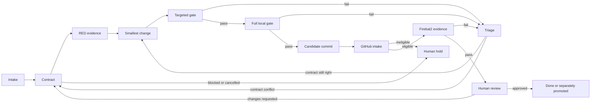

# Agent request intake and delivery runbook

This is the entrypoint for a human or coding agent changing MaCSad. It turns a
request into one bounded, reviewable candidate with evidence. It is inspired by
the useful idea in `pit` that work should move through an explicit, navigable
process graph; the states, rules, roles, and evidence contract here are
MaCSad-owned and deliberately small.

A request is permission to investigate and propose the named outcome. It is not
permission to broaden scope, expose a credential, activate policy, upgrade a
toolchain, deploy, merge, or change Firebat state unless the requester said so
explicitly.

## The bumpers

Before doing any work:

- read `AGENTS.md`, `GETTING_STARTED.md`, this runbook, and the nearest owning
  design or operations document;
- inspect `git status --short`, the current branch, `HEAD`, and the files in
  scope; preserve every unrelated change;
- use the exact checked-in harness; do not invent a parallel build or test path;
- treat the commit SHA as candidate identity and test evidence as immutable;
- never give a coding agent a repository, Firebat, database, Cloudflare,
  OpenRouter, or private-toolchain credential;
- never execute an untrusted webhook body or untrusted pull-request code on an
  owned Firebat host; and
- stop at an authority boundary instead of converting a proposal into an
  approval.

`logicaffeine-private` is currently pinned. An ordinary request must not fetch,
pull, check out, rebuild, or repin it. A separately authorized promotion follows
[`upgrading-logos.md`](upgrading-logos.md).

## 1. Write the request contract

Record this compact card in the task handoff, issue, or pull-request body. Do
not create a second database or board just for this record.

```text
Outcome:       one observable result
Job to be done: why the result matters to the requester
In scope:      exact behaviors and likely owning paths
Out of scope:  adjacent work that must remain unchanged
Authority:     read / edit / commit / push / operate / deploy, as granted
Acceptance:    executable evidence that decides success
Risk lane:     docs / LOGOS / database / operations / toolchain / control plane
Blockers:      missing access, decision, runtime, or framework primitive
```

Ask only when a missing answer would materially change the result or cross an
authority boundary. Otherwise state a narrow assumption and continue. Split a
request when it has more than one independently reviewable outcome.

The contract is invalid when its acceptance criterion is “looks good,” “the
command exited,” or “the agent says it works.” Select the owning behavior and a
test that can fail for the right reason.

## 2. Follow one control-flow graph



The graph is a responsibility contract, not an authorization system. Role names
do not grant capabilities:

| Responsibility | Owns | Cannot substitute for |
|---|---|---|
| Requester/director | Outcome, bounds, priorities, exceptional authority | Test or verifier evidence |
| Working agent | RED evidence, smallest implementation, exact handoff | Its own approval or promotion |
| Repository harness | Deterministic mechanical checks | Product judgment |
| Firebat2 worker | Isolated expensive/private test execution for an exact SHA | Merge, deploy, or toolchain approval |
| Human reviewer/promoter | Scope and evidence review; explicit promotion when authorized | A missing or failed required gate |

At the current baseline, the Firebat2 edge is a **visible RED governance gap**.
The repository's private plan/API currently returns `403` for the required
branch-protection or ruleset controls. Do not register or enable the Firebat2
runner, and route GitHub intake to the human hold, until an equivalent reviewed
admission control is actually enforced. Neither `main` nor this lane may be
described as protected yet. Keep `FIREBAT2_ENABLED` absent or unequal to
`true`; the complete host and enablement hold is in
[`firebat2-verification.md`](firebat2-verification.md).

### State rules

1. **Intake:** preserve the original request and identify granted authority.
2. **Contract:** select one outcome, owner, risk lane, non-goals, and executable
   acceptance criterion.
3. **RED:** observe the missing behavior fail when practical. Record why that
   failure is expected.
4. **Smallest change:** edit only the owning layer. Domain policy remains in
   LOGOS, durable invariants in PostgreSQL, and mechanical effects in narrow
   adapters.
5. **Targeted gate:** run the smallest real test. A zero-test, skipped, or
   unavailable required tier is a failure.
6. **Full local gate:** run the complete gate required by the lane below.
7. **Candidate commit:** review the diff, exclude runtime/generated/secret
   material, and bind the claim to the exact commit SHA.
8. **GitHub intake:** a push creates a test candidate. It does not activate,
   merge, publish, or deploy anything.
9. **Firebat2 evidence:** the isolated worker evaluates that exact candidate and
   returns append-only evidence keyed by SHA and attempt.
10. **Human review:** compare outcome, diff, risks, local evidence, and Firebat2
    evidence. Promotion is a separate, explicit decision.

Do not repeatedly rerun a deterministic product failure. Fix it in a new commit.
An infrastructure retry keeps the same SHA, increments the attempt, and records
the infrastructure reason; it never replaces the failed attempt.

## 3. Select the evidence lane

Use every row touched by the change, not merely the cheapest row:

| Changed contract | Targeted evidence | Required handoff evidence |
|---|---|---|
| Prose only | Link/path checks and owning-contract consistency | `git diff --check`; no false runtime claim |
| LOGOS source or UI policy | Exact registered leaf test and module audit | `make test`, deterministic WASM bundle digest, browser tier when the behavior requires it |
| PostgreSQL | New migration/invariant test against a fresh PG16 database | Migrate, repeat, catalog verify, invariants, and least-privilege negative checks |
| Host adapter | Unit test plus real-adapter contract when available | `make test`; unavailable live evidence named exactly |
| Compose/Firebat operations | Compose guardrail and resolved configuration | `make test`, then authorized running-stack checks on the intended host |
| GitHub workflow, runner, guardrail, or security boundary | Positive fixture plus an adversarial escape-path fixture | Credential-free CI and reviewed Firebat2 control-path evidence; human hold on control-path changes |
| LOGOS toolchain identity or framework-gap closure | Stop ordinary intake | Follow `upgrading-logos.md`; never silently update the lock |

`make test-foundation` is a fast iteration gate, not a substitute for `make
test`. Database, browser, running-stack, and private-toolchain evidence must be
described at the tier that actually ran.

## 4. Tie GitHub intake to Firebat2

GitHub is the ingestion ledger for code candidates; Firebat2 is a test worker,
not a source of truth or deployment authority.

The checked-in, currently disabled baseline uses GitHub Actions itself as the
queue; there is no custom inbound webhook or Firebat2 coordinator. After the RED
admission gap above is closed:

1. successful `Foundation CI` completion triggers the reviewed
   `.github/workflows/firebat2-ingestion.yml` through `workflow_run`;
2. its GitHub-hosted admission job accepts only a successful `push` run from
   this repository's `main`, produced by the exact
   `.github/workflows/foundation-ci.yml@main` run path and the matching
   `.github/workflows/foundation-ci.yml` workflow definition;
3. it passes the exact SHA, `refs/heads/main`, and Foundation run ID to the
   reusable `.github/workflows/firebat2-verify.yml`;
4. GitHub's self-hosted runner service long-polls for a worker in group
   `macsad-firebat2` with the exact `self-hosted`, `linux`, `x64`, `firebat2`,
   and `macsad-verifier` labels; and
5. the SHA-specific `firebat2-macsad-verification-<sha>` concurrency group
   deduplicates only repeated attempts to queue the same candidate, while the
   single reviewed ephemeral-runner capacity serializes distinct SHAs without
   GitHub's constant-group pending-run replacement behavior.

Foundation CI also keys its own queue by event plus exact SHA and does not
cancel an older commit when a newer push arrives. Thus every distinct pushed
SHA that succeeds in Foundation can enter this queue; a newer push cannot erase
the earlier candidate before admission. Repeated requests for the same SHA may
coalesce, but distinct successful SHAs may not. The single ephemeral-runner
controller serializes actual execution; GitHub's observed queue order is
transport behavior, never research priority or authority. This prevents
concurrency-group replacement; it does not promise indefinite retention.
GitHub fails a self-hosted job that remains queued for more than 24 hours. Such
expiry is a visible failed candidate that requires an explicit same-SHA requeue
and new run attempt; it is never test evidence.

Each queued candidate is identified by this immutable tuple:

```text
repository identity
candidate commit SHA
refs/heads/main
Foundation CI run ID
reviewed ingestion/verification workflow revision
attempt number
```

The GitHub-hosted admission job performs credential-free structural checks
before requesting owned hardware. The local reusable workflow is nevertheless
loaded from the caller's default-branch revision: it is not an immutable
control plane independent of the candidate. A candidate that changes runner or
control paths, action definitions, toolchain locks, test-discovery rules, or
admission policy therefore requires explicit human review under the missing
branch-admission controls, with the Firebat2 flag held false throughout that
change. This is an activation prerequisite, not a property the current
repository can mechanically prove. If a custom webhook queue is ever justified
later, original-body signature verification, delivery deduplication, and API
reconciliation become mandatory then; they are not part of this baseline.

Before a Firebat2 worker runs, the reusable verifier must prove:

- the repository and SHA are exact and still eligible;
- the default-branch control-workflow revision was human-reviewed under the
  required branch-admission controls; the repository cannot establish that
  boundary today, so the lane remains disabled;
- the source is a same-repository trusted candidate, never fork code;
- the workspace is fresh and disposable, with no sibling checkout mounted;
- the worker has no SSH agent, host Docker socket, Firebat1 access, deployment
  secret, database credential, or writable private LOGOS checkout;
- outbound access and resource/time limits match the selected suite; and
- logs and artifacts have retention, size, and secret-redaction bounds.

The worker returns a conclusion, suite inventory, exact toolchain and source
identities, artifact digests, timing, and bounded logs. Its bounded
`firebat2-<40-character-sha>-attempt-<run_attempt>` artifact contains the
Foundation run/commit/ref, deterministic bundles, browser
DOM/screenshots/logs, exact stage elapsed times and budgets, and a hash manifest.
GitHub records that evidence against the candidate SHA and attempt for 14 days.
Accept it only when the final workflow conclusion is `success` and the artifact
manifest re-verifies; artifact presence before a failed cleanup or action
post-step is never evidence. A green job is still not approval.

The speed contract is fail-closed: Foundation has a 10-minute job limit; the
Firebat2 job has a 15-minute limit; and its sequential `quality-gate`,
`bundle-build`, and `browser-smoke` stages have limits of 300, 120, and 120
seconds. A stage that times out or merely records elapsed time above its budget
fails the candidate. A successful artifact must contain exactly those three
ordered timing rows. An over-budget attempt produces failure evidence in the
Actions run, never a successful artifact or a silently enlarged budget.

The reviewed design requires a dedicated, unprivileged **one-job ephemeral
runner inside a freshly created KVM/QEMU guest**. The guest must register with
`--ephemeral --disableupdate`, start from the reviewed immutable image, and have
its entire overlay destroyed on every terminal path. Cleanup inside a persistent
runner, a reused VM, or direct execution on bare Firebat2 is not an acceptable
substitute. Until that controller, image, network, attestation, and destruction
contract is implemented and reviewed, the lane remains disabled and no actual
Firebat2 execution is claimed.

## 5. Handoff without ambiguity

Every handoff states:

```text
Outcome and exact candidate SHA:
Changed contracts and files:
RED evidence observed:
Targeted evidence:
Full local evidence:
GitHub/Firebat2 evidence and attempt:
Recorded stage timings and budgets:
Unavailable evidence and reason:
Operational state changed:
Residual risk or decision required:
Smallest safe next step:
```

Call the work done only when `AGENTS.md`'s definition of done is satisfied. If
the task is blocked, preserve the evidence and name the missing decision or
capability; do not weaken the bumper to make the card move.
