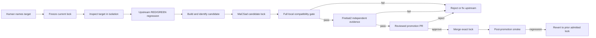

# Upgrading the pinned LOGOS toolchain

> **Current state: HOLD. Do not pull yet.**
>
> The admitted LOGOS source remains the exact revision in
> `.macsad/toolchains/logos.lock.toml`. Do not fetch, pull, check out, merge,
> rebase, reset, rebuild, or repin `logicaffeine-private` as part of ordinary
> MaCSad work. Begin this runbook only after a human explicitly authorizes a
> named LOGOS promotion.

This runbook upgrades an immutable toolchain dependency; it does not “get the
latest.” A newer upstream commit becomes usable only after it passes focused,
adversarial, cross-tier, MaCSad, and independent-worker gates and a human merges
the reviewed MaCSad lock change.

## Authority and safety boundary

One person may prepare a candidate. A different reviewer approves promotion
when practical. Neither the preparing agent nor Firebat2 can approve its own
candidate.

During promotion:

- preserve the currently admitted checkout and bundle so rollback is possible;
- inspect upstream in a separate detached worktree or disposable clone;
- never move a shared checkout with `reset`, force-push, or an implicit pull;
- never resolve a registry crate, branch name, tag, or local path at runtime;
- never put the private checkout, Git credential, SSH agent, or absolute
  developer path in a MaCSad artifact or container; and
- never close `LOGOS_GAPS.md` from prose, a parser success, or an unselected
  test.

## Promotion control flow



## 1. Open a promotion record

Record these before touching upstream state:

```text
Authorizing human and request:
MaCSad base commit:
Current LOGOS commit/tree/version:
Current Cargo.lock SHA-256:
Current largo SHA-256:
Named target commit or reviewed upstream branch:
Expected capabilities/fixes:
Affected LOGOS_GAPS sections:
Required tiers and fixtures:
Rollback lock/commit:
```

The target must be named. “Main,” “latest,” and “whatever was pulled” are not
target identities.

## 2. Freeze and verify the admitted baseline

From MaCSad, inspect the committed lock and prove the current checkout still
matches it:

```bash
git status --short
git rev-parse HEAD
sed -n '1,120p' .macsad/toolchains/logos.lock.toml
LOGOS_WORKSPACE=/path/to/current/logicaffeine-private make test
```

Record the complete result. A dirty checkout, lock mismatch, failing baseline,
or unavailable rollback artifact stops promotion. Do not “fix forward” before
the baseline is preserved.

## 3. Inspect the named target without moving the baseline

Only after explicit authorization, update remote knowledge first; do not pull:

```bash
git -C /path/to/logicaffeine-private status --short
git -C /path/to/logicaffeine-private remote -v
git -C /path/to/logicaffeine-private fetch --prune origin
git -C /path/to/logicaffeine-private show --no-patch --format=fuller <target-commit>
```

Create a separate detached worktree or disposable clone at the exact target.
Keep the original checkout untouched. Confirm the candidate's origin, commit,
tree, clean status, `Cargo.lock`, release notes, and upstream test/build
instructions before running them. If the target changes after review begins,
discard the candidate record and start again with the new exact identity.

## 4. Require upstream regression evidence

For every capability relied on by MaCSad:

1. name a focused fixture that fails on the admitted revision for the expected
   reason;
2. run it on the candidate and observe it pass;
3. add an adversarial fixture for the original false-green or escape path;
4. run the actual affected interpreter, VM, WASM-DOM, AOT, HTTP, proof, and
   browser tiers instead of inferring them; and
5. retain exact commands, suite/test counts, skipped count, and results.

The required set is capability-specific. A tier may be marked not applicable
only with a reviewed reason; an unavailable required tier is a failed promotion.
Upstream tests that were ignored but not explicitly selected are not evidence.

## 5. Build and identify the candidate

Use only the target revision's reviewed, checked-in build instructions and its
locked dependency closure. Do not improvise registry fallbacks or relax locked
resolution to get a binary.

Record at least:

```bash
git -C /path/to/candidate rev-parse HEAD
git -C /path/to/candidate rev-parse 'HEAD^{tree}'
sha256sum /path/to/candidate/Cargo.lock
sha256sum /path/to/candidate/target/debug/largo
/path/to/candidate/target/debug/largo --version
```

Also record Rust/Cargo/linker/target/build-image identities and the required
runtime source/vendor closure. A standalone `largo` executable is insufficient
when its behavior depends on adjacent private source or generated runtime
packages. Do not claim a byte-reproducible compiler until two clean isolated
builds actually produce identical bytes; preserve the original candidate bytes
and behavioral evidence until that gate exists.

## 6. Propose, but do not activate, a MaCSad lock

On a dedicated MaCSad branch, update
`.macsad/toolchains/logos.lock.toml` with only measured candidate identities:

- exact semantic version;
- 40-character source commit and tree;
- `Cargo.lock` SHA-256;
- exact relative binary path and binary SHA-256; and
- unchanged fail-closed test requirements unless a separately reviewed
  contract intentionally strengthens them.

Update focused MaCSad fixtures, the exact test manifest, guardrails, and
`LOGOS_GAPS.md` in the same candidate when the upstream behavior changes their
contract. Do not delete a compatibility lock or gap until its negative fixture
proves the workaround is no longer required.

The proposed lock makes the branch testable; it does not make the toolchain
active. Ordinary `main` work continues to use the preceding lock.

## 7. Run compatibility and independent gates

Against the isolated candidate checkout, run:

```bash
LOGOS_WORKSPACE=/path/to/candidate make test
```

Add a fresh PostgreSQL gate when generated server/database behavior can change.
Require deterministic double emission of every MaCSad WASM bundle, exact named
tests with zero skips, finite proof evidence, module-closure checks, negative
fixtures, and any browser/HTTP/AOT behavior touched by the candidate.

After the repository's RED ruleset/admission gap is closed, submit the exact
candidate commit to the reviewed Firebat2 lane described in
[`agent-request-intake.md`](agent-request-intake.md) and
[`firebat2-verification.md`](firebat2-verification.md). Until then, Firebat2
stays disabled and toolchain promotion cannot use it as independent evidence.
The independent worker must consume the exact candidate closure, verify every
digest before use, run in a fresh disposable workspace, and return evidence
keyed to the MaCSad and LOGOS SHAs. It must not pull a floating branch or use
the preparer's writable checkout.

## 8. Review and promote

The promotion pull request contains one evidence manifest:

```text
MaCSad base/candidate commits:
LOGOS old/new commit and tree:
Cargo.lock and largo digests:
Build/runtime closure identities:
Upstream RED/GREEN and adversarial fixtures:
Tiers actually run, test counts, skips, and failures:
MaCSad gate and deterministic bundle digests:
Firebat2 run/attempt and artifact digests:
LOGOS_GAPS entries changed or intentionally retained:
Known compatibility or reproducibility limits:
Rollback commit/lock/bundle:
Preparer and approving reviewer:
```

Promotion requires the repository's active admission controls plus explicit
toolchain-promotion authority; the ordinary autonomous merge queue does not
grant that separate capability. `main` protection is active. Firebat2 promotion
evidence remains unavailable until the disposable runner/controller and the
organization runner-group permission currently returning HTTP 403 are ready.
A successful push, green Firebat2 check, newer version number, or locally
working binary cannot activate the candidate by itself.

After merge, run the normal post-merge gate and authorized Firebat smoke checks
using the promoted immutable bytes. Record the exact deployed/tested MaCSad and
LOGOS identities.

## 9. Roll back without rewriting history

If the promoted toolchain regresses:

1. stop further promotion/deployment and preserve failing logs and artifacts;
2. revert the MaCSad promotion commit in a new reviewed commit;
3. restore the prior admitted toolchain closure by its recorded digests; do not
   move or reset a shared upstream checkout;
4. rerun `make test` and the affected Firebat smoke checks against the reverted
   MaCSad commit; and
5. reopen the relevant `LOGOS_GAPS.md` contract with the new regression fixture.

Database changes roll forward through a new migration; a LOGOS rollback never
rewrites an applied migration or destroys Firebat data. Keep the rejected
candidate available by immutable identity for diagnosis, but do not leave it as
an ambient “latest” dependency.
