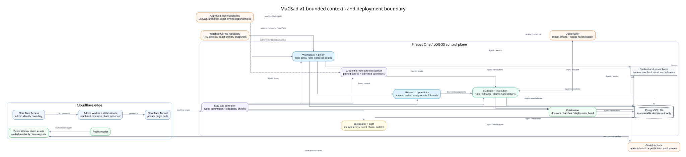

# MaCSad domain model

> **Status:** Draft v1 logical data model
>
> **Date:** 2026-08-31
>
> **Source:** [`design_document.md`](./design_document.md)
>
> **Product contract:** [`user_story.md`](./user_story.md)
>
> **Target:** PostgreSQL as the sole mutable domain authority; a provider-neutral content-addressed store for immutable bytes, using Firebat's local CAS first

## 1. Domain thesis

MaCSad's power comes from the distinctions its types preserve.

The system must distinguish:

- a question from a revision of that question;
- a research case from the task currently advancing it;
- an attempt from the artifacts it consumes or produces;
- a claim from evidence about that claim;
- an observation from a proof-checker result;
- an Investigator assertion from an independent attestation;
- workflow completion from research truth;
- research disposition from editorial eligibility;
- a sealed publication from a deployment attempt; and
- durable domain state from cache, queue, or presentation projections.

If these distinctions collapse into booleans, generic JSON, or prose, the rest of the system cannot recover them. If they are represented as explicit types and constrained relations, many unsafe states become unrepresentable or fail at a transaction boundary.

The useful category-theoretic analogy is:

- immutable revisions, claims, artifacts, and attestations are **objects**;
- assignments, attempts, attestations, transitions, and publication inclusion are **typed arrows**;
- foreign keys and predicates define which arrows are legal;
- transaction rules define valid composition; and
- immutable hashes let us identify the exact objects that were composed.

This is an analogy, not a claim that the database is literally a mathematical category. We should use the language only where identity, source, target, and composition laws are explicit.

## 2. Modeling decisions

### 2.1 The smallest coherent relational core

This document refines the larger record inventory in the design document. V1 merges concepts that have the same lifecycle and transaction boundary:

| Larger-design concepts | V1 model | Reason |
|---|---|---|
| Repository project + workspace | `workspace` | A workspace is exactly one GitHub repository |
| Organization bundle + workflow bundle + role/decision activation | `policy_revision` | They activate and remain pinned as one compiled semantic unit |
| Card + workflow run + node instance | `research_case` + sequential `task` rows | The case is the card; a task is one instantiated workflow node |
| Handoff + assignment | `task_assignment` lifecycle | Offering and accepting responsibility is one concept |
| Fact record + evidence record + verification attestation + human decision | `attestation` with a typed kind and authority | One immutable statement by an accountable issuer, without a generic `verified` flag |
| Run + attempt | `execution` | Every retry is another bounded execution |
| Budget ledger | `budget_account` + append-only `budget_entry` | Limits and movement of reserved/spent value need separate types |
| Webhook receipt + external callback | `inbound_delivery` | Both are deduplicated observations from an external provider |

The model does **not** introduce:

- a universal `entity` table;
- a universal `edge(source_type, source_id, target_type, target_id)` table;
- a graph database;
- a writable D1 copy of PostgreSQL;
- event sourcing as the sole source of truth; or
- JSON blobs in place of core relations.

### 2.2 Authority and storage

PostgreSQL is authoritative for mutable control state and immutable domain metadata. The LOGOS controller is the only service allowed to perform domain transitions.

The v1 local content-addressed filesystem on Firebat stores large immutable bytes: workspace bundles, inputs, outputs, logs, certificates, patches, dossiers, and sealed public bundles. PostgreSQL stores intrinsic blob metadata plus each logical artifact's classification, provenance, rights, and opaque provider locator. The storage contract is provider-neutral so a later migration or public-only replication to R2 does not change domain identity.

Cloudflare queues, schedules, cache, and static deployments are transports or projections. Their state never establishes that a task advanced, evidence passed, a budget was approved, or a batch was published.

### 2.3 Immutable versus stateful types

**Immutable after insertion:**

- `workspace_snapshot`
- activated or retired `policy_revision` content
- `problem_revision`
- `message`
- completed `execution` specification/result
- `blob`
- `artifact`
- `execution_artifact`
- `claim`
- `attestation`
- `attestation_artifact`
- `budget_entry`
- sealed `publication_batch` content
- `publication_item`
- `domain_event`
- accepted `inbound_delivery` payload digest

**Stateful aggregate roots with optimistic versions:**

- `workspace`
- candidate/active status of `policy_revision`
- `research_case`
- `task`
- `task_assignment`
- live `execution` lease/status
- `budget_account` balance projection
- unsealed `publication_batch`
- `publication_head`
- `publication_attempt`
- `command_receipt`
- `outbox_message`

Stateful does not mean freely mutable. Each change is a command guarded by expected version, actor capability, invariant checks, an audit event, and—when an external effect follows—an outbox row in the same transaction.

## 3. Bounded contexts



| Context | Aggregate roots | Owns | Does not own |
|---|---|---|---|
| **Workspace and policy** | `workspace`, `policy_revision` | GitHub identity, exact snapshots, active compiled process/role/tool semantics | Research conclusions or artifact bytes |
| **Identity and organization** | `actor`, `membership`, `capability_grant` | Accountable identities, external authentication, workspace participation, explicit authority | Workflow state merely because a role name says so |
| **Research operations** | `research_case`, `task`, `thread` | Frozen case scope, sequential process obligations, assignments, board projection, conversation | Mechanical truth or publication deployment |
| **Evidence and execution** | `execution`, `blob`, `artifact`, `claim`, `attestation`, `budget_account` | Bounded attempts, immutable bytes and contextual artifacts, provenance, typed judgments, reservations and spend | Human editorial eligibility or public `latest` |
| **Publication** | `publication_batch`, `publication_head` | Public closure, manifest, signature, deployment attempts, correction chain, exact public pointer | Private live state or stronger claims than the selected evidence permits |
| **Integration and audit** | `command_receipt`, `domain_event`, `outbox_message`, `inbound_delivery` | Command idempotency, hash-chained history, reliable external side effects and observations | Business decisions of its own |

Dependencies point inward toward the domain. Cloudflare and GitHub adapters translate external messages into commands or observations; they do not write tables directly.

## 4. Domain vocabulary and algebraic types

The LOGOS domain layer should define closed sum types. PostgreSQL persists their discriminants using checked `text` columns or lookup tables owned by migrations. Do not let arbitrary strings enter from agents or clients.

### 4.1 Core sum types

```text
ActorKind = Human | Agent | Service

ResearchKind = Mathematics | ComputerScience

CaseLifecycle = Inbox | Ready | Active | Closed | Cancelled

MathDisposition = Proved | Refuted | Inconclusive | InvalidFormalization

CSDisposition = ObservedUnderFrozenProtocol | ExactlyReproduced
              | Refuted | Inconclusive | InvalidExperiment

AdministrativeDisposition = Superseded | Cancelled | PolicyDenied

ResearchDisposition = Math(MathDisposition) | CS(CSDisposition)
                    | Administrative(AdministrativeDisposition)

EditorialDecision = NotReviewed | Private | Eligible

TaskState = Offered | Ready | Running | Waiting | Completed | Cancelled

AssignmentState = Offered | Accepted | Rejected | Expired | Released

TransportOutcome = Accepted | Rejected | Unavailable | ProtocolError

TerminationOutcome = CleanExit | StepLimit | WallTimeout | OutOfMemory
                   | Signal | Cancelled | PolicyDenied | ToolError
                   | PartialOutput

ExecutionState = Pending | Leased | Running | CancelRequested
               | Completed | Failed | Expired

ClaimOutcome = Candidate | Supported | Rejected | Unknown | Inconclusive

AttestationKind = AgentAssertion | ToolObservation | SemanticReview
                | CheckerResult | CounterexampleValidation
                | Reproduction | MethodologicalReview
                | HumanDisposition | EditorialDecision

AuthorityClass = AgentAsserted | ToolObserved | CheckerAttested
               | ControllerDerived | HumanDecided

PublicationState = Draft | Previewed | Sealed | Published | Superseded

PublicationAttemptState = Pending | Running | Succeeded | Failed
```

`ResearchDisposition` is a tagged union. A math case cannot be `ObservedUnderFrozenProtocol`; a CS case cannot be `Proved`. Administrative closure is never presented as a scientific result. `Unknown` belongs to an attempt/check layer; a final case that established neither success nor refutation is `Inconclusive`. Enforce these rules in the domain command and a database constraint trigger.

### 4.2 Value objects

| Value object | PostgreSQL representation | Rule |
|---|---|---|
| Typed ID | `uuid` | Generated by the application; wrapped in distinct LOGOS types such as `CaseId` and `ArtifactId` |
| SHA-256 | checked `bytea` domain | Exactly 32 bytes; rendered as lowercase hex at boundaries |
| Git repository ID | `bigint` | Stable GitHub numeric ID; owner/name remains display metadata |
| Git object ID | checked lowercase hex text | Algorithm and length recorded; never assume all repositories remain SHA-1 forever |
| Money | `numeric(20,8)` + ISO currency | Never binary floating point |
| Token/compute quantity | `numeric(30,6)` + unit | Unit is part of the type |
| Instant | `timestamptz` | Stored in UTC; presentation converts time zones |
| Canonical payload | schema-versioned `jsonb` + SHA-256 | Canonicalization version is part of the digest contract |
| External locator | provider + opaque key | Never use a mutable public URL as identity |

Recommended PostgreSQL domains:

```sql
CREATE DOMAIN sha256_digest AS bytea
  CHECK (octet_length(VALUE) = 32);

CREATE DOMAIN nonnegative_quantity AS numeric(30, 8)
  CHECK (VALUE >= 0);

CREATE DOMAIN canonical_json AS jsonb
  CHECK (jsonb_typeof(VALUE) = 'object');
```

PostgreSQL domains improve storage validation. They do not replace distinct LOGOS types at compile time.

## 5. Workspace, identity, and control model


### 5.1 `workspace`

The one v1 project boundary.

Essential fields:

| Field | Type | Meaning |
|---|---|---|
| `id` | `uuid` PK | Internal stable workspace ID |
| `github_repository_id` | `bigint` unique | Stable external identity |
| `owner_name`, `repository_name` | `text` | Mutable display/routing metadata |
| `default_branch` | `text` | Branch to reconcile, never used without resolving a commit |
| `installation_id` | `bigint` | GitHub App installation boundary; not a token |
| `state` | checked `text` | `pending`, `active`, `paused`, or `disconnected` |
| `version` | `bigint` | Optimistic concurrency token |
| `created_at`, `updated_at` | `timestamptz` | Audit-friendly timestamps |

V1 permits exactly one active workspace by configuration. The schema remains correctly keyed so a later second workspace does not require rewriting identity.

### 5.2 `workspace_snapshot`

An immutable repository state that executions can actually reproduce.

Essential fields:

- `workspace_id`
- exact commit OID and tree OID, with algorithm
- observed default-branch name and delivery/reconciliation source
- source-bundle `artifact_id`
- `.macsad` configuration digest
- submodule/LFS/filter policy result
- preservation timestamp and canonical snapshot digest

Snapshots are append-only. Force-pushing GitHub cannot invalidate a preserved snapshot.

### 5.3 `policy_revision`

One immutable compiled unit containing the organization roles, sequential workflow graph, decision matrices, tool policy, schemas, and compiler identity.

Essential fields:

- `workspace_id` and source `workspace_snapshot_id`
- source path/digest and compiled canonical JSON/digest
- compiler and schema versions
- `state`: `candidate`, `active`, or `retired`
- activating actor, time, and semantic-diff artifact
- optional prior revision

Only one policy revision is active per workspace:

```sql
CREATE UNIQUE INDEX one_active_policy_per_workspace
  ON policy_revision (workspace_id)
  WHERE state = 'active';
```

Activation changes status; it never mutates compiled content. Cases pin the exact revision they started with.

### 5.4 `actor` and `actor_identity`

`actor` is the accountable cause of an action: a human, agent, or service. `actor_identity` maps external authentication to that actor.

`actor` fields include only stable identity attributes: `kind`, display name, state, and timestamps. An agent actor survives profile and policy revisions; no changing profile digest belongs on this identity row.

`actor_identity` has a unique `(issuer, subject, audience)` tuple. Examples include a Cloudflare Access identity, GitHub account, worker certificate subject, or service token identity.

Do not put bearer tokens, private keys, or provider secrets in either table.

### 5.5 `membership` and `capability_grant`

`membership` says how an actor participates in a workspace:

- workspace and actor;
- exact policy revision plus role/profile key and immutable profile digest from that revision;
- supervisor actor where applicable;
- validity interval and state.

`capability_grant` says what an actor may actually authorize:

- workspace and actor;
- fixed capability code such as `budget.approve`, `policy.activate`, `publication.eligibility.decide`, or `publication.seal`;
- optional resource constraint;
- grantor, validity, revocation, and reason.

A role never implies a capability. A capability check snapshots the actor, external identity, membership, grant, and policy revision into the resulting domain event.

`membership(policy_revision_id, role_key)` must reference a role/profile in the compiled policy revision. Assignments and executions copy the exact policy/profile identity used for the work so a later membership or policy change cannot rewrite history.

## 6. Research operations model

### 6.1 `problem_revision`

An immutable semantic object containing what is being asked.

Common fields:

- `workspace_id`
- `research_kind`
- original question and normalized title
- definitions/vocabulary
- assumptions
- domain and bounds
- success, refutation, and inconclusive criteria
- permitted sources, tools, effects, and data classification
- prior revision and revision reason
- canonical content digest

Math-specific canonical payload:

- formal source and rendered statement;
- reverse paraphrase;
- goal and counterexample condition.

CS-specific canonical payload:

- executable specification or falsifiable hypothesis;
- baseline, metric, input/dataset digest, environment, seed policy, and stopping rule.

The common columns remain relational. The kind-specific payload may be schema-versioned JSONB because it is an immutable tagged value validated before insert.

### 6.2 `research_case`

The aggregate shown as one Kanban card. It pins one exact semantic and execution context:

- `workspace_id`
- `workspace_snapshot_id`
- `policy_revision_id`
- `problem_revision_id`
- lifecycle and priority
- final typed disposition, initially null
- disposition `attestation_id`, initially null
- editorial decision and eligibility `attestation_id`
- optional `supersedes_case_id`
- optimistic `version`

A semantic revision creates a new problem revision and a new research case linked by `supersedes_case_id`. The old case remains closed. This is simpler and safer than mutating the meaning under an existing workflow.

V1 enforces `UNIQUE (problem_revision_id)`: one frozen problem revision belongs to one case. Composite foreign keys require the case's snapshot, policy, and problem revision to share its `workspace_id`. The disposition and eligibility references are composite `(attestation_id, problem_revision_id)` foreign keys with kind checks requiring `HumanDisposition` and `EditorialDecision` respectively.

### 6.3 `task`

A task is one instantiated sequential workflow node for a case. It replaces separate workflow-run and node-instance tables in v1.

Fields include:

- `research_case_id`
- monotonic `sequence_no`
- node key and node kind from the pinned policy revision
- board phase snapshot from the compiled node definition
- required role
- state, deadline, timeout/cancel routing keys
- input and output closure digests
- entered edge/matched decision record
- opened/finished timestamps and optimistic version

V1 permits one nonterminal task per case:

```sql
CREATE UNIQUE INDEX one_live_task_per_case
  ON task (research_case_id)
  WHERE state IN ('offered', 'ready', 'running', 'waiting');
```

The Kanban column is the live task's `board_phase`. A command never sets a card column directly.

### 6.4 `task_assignment`

Assignment and handoff are one lifecycle:

- task and offered actor;
- required role plus exact policy/profile key and digest at offer time;
- offering actor;
- prior assignment, if this is a handoff;
- exact package digest and thread reference;
- state and offer/accept/reject/expire/release timestamps;
- reason and optimistic version.

Only one accepted assignment may exist per task:

```sql
CREATE UNIQUE INDEX one_accepted_assignment_per_task
  ON task_assignment (task_id)
  WHERE state = 'accepted';
```

The sender remains responsible until acceptance. Acceptance and release of the prior assignment occur atomically.

### 6.5 `thread` and `message`

V1 supports one workspace operations thread and one primary thread per case.

`thread` fields include workspace, optional case, kind, state, and created time. Partial unique indexes enforce one operations thread per workspace and one primary thread per case.

`message` is immutable and contains:

- thread, author actor, and optional task context;
- reply-to message;
- content format/body and content digest;
- typed artifact/claim references represented through explicit link tables only when needed;
- created time.

Editing creates a correcting message. A message cannot carry a hidden workflow transition, budget mutation, or approval. UI buttons shown near chat issue separate authenticated commands.

## 7. Evidence, execution, and budget model


### 7.1 `execution`

One bounded attempt for one task. A retry is a new row.

Identity and specification fields:

- task and accepted assignment;
- performing actor, exact policy/profile key and digest, and worker service actor;
- exact workspace snapshot, policy revision, and problem revision (copied as integrity keys);
- request, tool manifest, provider, model, environment, seed, and resource-limit digests;
- idempotency key/request hash.

Lease fields:

- lease owner, fencing token, claimed/heartbeat/expiry times;
- cancellation request and reason.

Outcome fields remain independent:

- execution state;
- transport outcome;
- termination outcome;
- claim/check outcome (`Candidate`, `Supported`, `Rejected`, `Unknown`, or `Inconclusive`);
- started/finished timestamps;
- result envelope digest.

A zero exit code can coexist with `claim_outcome='unknown'`. A timeout cannot be mapped to refutation.

When an execution is attached to a claim or attestation, composite `(execution_id, problem_revision_id)` foreign keys enforce the frozen-revision boundary. Claim source executions and attestation target executions cannot cross revisions.

### 7.2 `blob` and `artifact`

`blob` is intrinsic, deduplicated byte identity. `artifact` is a logical use of those bytes in a workspace and evidentiary context. The split matters because identical bytes may be produced by different executions or arrive with different source, confidentiality, licensing, or export constraints.

`blob` fields:

- SHA-256 digest as the primary/unique byte identity;
- byte length, media type, intrinsic encoding/compression, and optional provider checksum;
- storage provider (`local_cas` initially), opaque locator, and storage class;
- stored/verified timestamps.

`artifact` fields:

| Field group | Contents |
|---|---|
| Identity | logical `id`, `workspace_id`, `blob_digest` FK, artifact kind, schema ID/version |
| Safety | private/public classification, secret-scan result, quarantine state |
| Provenance | producing actor/execution, original source, observed time |
| Rights | license, attribution, export decision, redistribution rule |

The canonical provider key should be hash-addressed, for example `sha256/ab/cd/<full-hex>`. A blob row is accepted only after a read-back or provider checksum confirms the stored bytes. Every artifact read rechecks—or consumes a previously trusted, freshness-bounded check of—the blob digest before the bytes can satisfy an evidence or publication gate.

`execution_artifact` is the typed many-to-many relation between execution and artifact, with roles such as `input`, `output`, `log`, `certificate`, `patch`, `diagnostic`, or `environment_manifest`.

Artifact lineage is derived from executions: inputs transformed by an execution into outputs. Deduplicating blob bytes never merges artifact provenance or rights. A generic artifact-edge table is unnecessary in v1.

### 7.3 `claim`

An immutable statement that evidence can assess.

Fields include:

- `problem_revision_id`
- claim kind: formal proposition, counterexample, bounded observation, reproduction statement, or human interpretation
- canonical text and optional schema-validated payload
- scope/bounds and content digest
- proposing actor and source execution

Claim status is derived from attestations. There is no mutable `verified` column.

### 7.4 `attestation`

The central evidence type: one accountable issuer makes one typed statement about one frozen problem, optionally a claim or execution.

Fields include:

- `problem_revision_id`
- optional `claim_id` and `execution_id`
- issuer actor and optional membership/role snapshot
- attestation kind and authority class
- schema ID/version, method/tool digest, and outcome code
- schema-validated typed value
- limitations and achieved independence dimensions
- optional superseded attestation
- canonical content digest and created time

Examples:

| Attestation kind | Issuer | Meaning |
|---|---|---|
| `AgentAssertion` | Investigator | Candidate interpretation; useful for routing, never approval |
| `ToolObservation` | Trusted tool adapter | Exact bounded output or measurement |
| `SemanticReview` | Human/Verifier | Formal representation faithfully reflects the frozen question, or does not |
| `CheckerResult` | Admitted checker service | Named checker accepted/rejected a named artifact for a named formal claim |
| `CounterexampleValidation` | Validator/Verifier | Candidate satisfies the frozen counterexample condition |
| `Reproduction` | Independent Verifier | Exact replay matched, mismatched, or was inconclusive |
| `HumanDisposition` | Director | Honest final interpretation based on an exact evidence closure |
| `EditorialDecision` | Authorized human | Closed work is private or eligible for batch selection |

`attestation_artifact` explicitly names supporting artifacts and their roles. The same-revision rule is enforced with composite foreign keys:

```sql
ALTER TABLE claim
  ADD CONSTRAINT claim_id_revision_unique
  UNIQUE (id, problem_revision_id);

ALTER TABLE attestation
  ADD CONSTRAINT attestation_claim_same_revision
  FOREIGN KEY (claim_id, problem_revision_id)
  REFERENCES claim (id, problem_revision_id);
```

Verifier separation is checked using the candidate-producing actor, assignment, and attestation issuer. The achieved independence dimensions are stored individually, not collapsed to a badge.

The same-revision closure also applies to optional execution targets and claim source executions. Case disposition and eligibility references use composite attestation/revision keys plus constrained triggers that require `HumanDisposition` and `EditorialDecision` kinds; a generic attestation cannot occupy either slot.

### 7.5 Decision facts

There is no standalone `fact` table in v1. The workflow evaluator assembles a typed fact snapshot from:

- attestations;
- execution and budget state;
- authenticated actor, membership, and capability state; and
- controller-derived values with their input digests.

The exact fact snapshot, allowed authority/issuer constraints, matched decision row, and selected edge are recorded in the transition's immutable `domain_event` body.

### 7.6 `budget_account` and `budget_entry`

One budget account represents one resource dimension over a declared scope and period.

Fields:

- workspace and optional research case;
- resource kind: currency, model tokens, CPU time, wall time, or storage;
- unit/currency;
- period start/end, limit, reserved projection, spent projection;
- optimistic version.

`budget_entry` is append-only:

- account and optional execution;
- kind: `reserve`, `commit`, `release`, or `adjust`;
- quantity and idempotency key;
- actor/reason and created time;
- related reservation entry where applicable.

Required invariant:

```text
limit >= 0
reserved >= 0
spent >= 0
reserved + spent <= limit
```

Starting an execution locks the relevant accounts, reserves controller-calculated worst-case quantities, creates the execution and lease, updates projections, and appends entries/events in one transaction. Provider reconciliation may commit less than the reservation and release the remainder. Raising a limit is an explicit adjustment by an authorized human, never a negative spend entry.

## 8. Publication, integration, and audit model


### 8.1 `publication_batch`

One immutable public release closure after sealing.

Fields:

- workspace and monotonic `batch_sequence`;
- state;
- prior/superseded batch and erratum relation;
- generator/platform/toolchain/policy identities;
- evidence and artifact closure digests;
- audit-chain head and previous published head;
- manifest digest, publication signature, sealing actor/time;
- public bundle `artifact_id`.

`batch_sequence` is null while drafting and allocated at seal time. PostgreSQL enforces a partial `UNIQUE (workspace_id, batch_sequence) WHERE batch_sequence IS NOT NULL`; sequences are workspace-local and monotonic. Sealed fields are immutable.

### 8.2 `publication_item`

An exact member of a batch:

- publication batch;
- research case and problem revision;
- selected public claim;
- disposition and eligibility attestation IDs;
- evidence closure digest;
- public dossier artifact.

Composite keys verify that the selected case, problem, claim, disposition attestation, eligibility attestation, and dossier artifact belong to the same workspace/case/revision. Kind checks require the two named attestation roles. The manifest generator independently recomputes the transitive public artifact closure.

### 8.3 `publication_attempt`

A delivery observation, separate from research content.

Fields include:

- batch;
- `deployment_release_sequence`;
- trigger kind;
- exact platform/generator revision;
- release-request digest;
- GitHub Actions workflow/run/attempt IDs;
- Cloudflare version/deployment IDs;
- attempt state (`pending`, `running`, `succeeded`, or `failed`), timestamps, error, and reconciliation evidence.

The release identity is:

```text
(manifest_digest, platform_or_generator_revision,
 deployment_release_sequence, trigger_kind)
```

An exact retry reuses that identity. A template redeploy creates a new attempt and release sequence while leaving the already-published batch published. A research correction creates a new/erratum batch.

### 8.4 `publication_head`

One mutable, versioned pointer per workspace identifies exactly what is public:

- `workspace_id` as primary key;
- `publication_batch_id` and successful `publication_attempt_id`;
- manifest digest and deployment/version identity copied as integrity keys;
- optimistic version, advanced actor/service, and advanced time.

The head advances only after API reconciliation proves that the intended Cloudflare deployment succeeded. A template redeploy may change the attempt while retaining the batch; a rollback points to an earlier successful attempt through a new versioned command and audit event. Batch state alone is never used as the public `latest` pointer.

### 8.5 `command_receipt`

One workspace-scoped command receipt owns request idempotency across all aggregates changed by that command:

- workspace, authenticated actor/session, command kind, and correlation/causation identity;
- client idempotency key and canonical request hash;
- processing/completed/rejected state;
- first/last domain-event sequence and stable result/error digest;
- created/completed timestamps.

`UNIQUE (workspace_id, idempotency_key)` is enforced here. Reusing the key with the same request hash returns the completed result; reuse with different content conflicts. A crashed in-progress receipt is reconciled under a lease rather than blindly re-executed.

### 8.6 `domain_event`

Every accepted mutation appends one immutable event **per changed aggregate root** in the same transaction. A start-execution command can therefore append correlated events for the task, execution, and each budget account it changes. The events share command correlation/causation IDs and request identity without pretending that one aggregate version represents all of them.

Fields:

- workspace-scoped sequence;
- aggregate type, ID, and resulting version;
- event type/schema and canonical body or body-artifact reference;
- actor and authorization snapshot;
- command receipt, correlation, causation, and request hash;
- prior event hash and event hash;
- occurred/recorded times.

Required uniqueness:

- `(workspace_id, sequence_no)`
- `(aggregate_type, aggregate_id, resulting_version)`
- event hash

The event log is an immutable audit and replay/explanation source. Aggregate tables remain the command-side source of truth; v1 does not rebuild all state from events. If one command changes several aggregates, the command idempotency result names the complete correlated event range.

### 8.7 `outbox_message`

One external side effect derived from one event:

- event and destination;
- message schema/body or body-artifact reference;
- deduplication key;
- pending/leased/delivered/failed state;
- attempts, next attempt, lease/fencing values, and observed provider ID.

Domain mutation, event, and outbox insert commit atomically. Delivery occurs afterward and is safe to retry.

### 8.8 `inbound_delivery`

Deduplicates GitHub webhooks, Cloudflare deployment callbacks, queue deliveries, and other external observations:

- provider and external delivery ID;
- event kind and payload digest;
- signature/authentication result;
- received time;
- processing state and correlation/command identity;
- error/attempt metadata.

Uniqueness on `(provider, external_delivery_id)` prevents duplicate processing. One delivery may cause zero, one, or many correlated domain events; events may carry an optional `inbound_delivery_id` foreign key. Store large/private payload bytes as a classified artifact rather than an unbounded row.

## 9. Relationship and cardinality rules

The ER images are partitioned for readability, but these rules apply across them:

1. A workspace has many snapshots and policy revisions; only one policy revision is active.
2. A research case pins exactly one workspace snapshot, policy revision, and problem revision.
3. A problem revision seeds exactly one case in v1; a semantic change creates a new revision/case.
4. A case has many sequential tasks but at most one nonterminal task.
5. A task has many assignment offers but at most one accepted assignment.
6. A task has many executions; a retry never mutates the prior execution.
7. An execution consumes/produces many logical artifacts through typed links; multiple artifacts may reference the same immutable blob bytes without sharing provenance or rights.
8. A claim and every attestation assessing it share one problem revision.
9. An attestation may cite many artifacts; an artifact may support many attestations.
10. A case may own multiple resource-specific budget accounts; entries are append-only.
11. A publication batch contains one or more exact items and may have many deployment attempts; one workspace publication head selects one successful batch/attempt pair.
12. One command receipt owns one idempotency key and may correlate many per-aggregate domain events; an event may produce zero or more outbox messages.
13. An inbound delivery may cause zero or many correlated events and is never itself evidence that an external claim is true.

## 10. Critical invariants

### 10.1 Identity and scope

- GitHub repository numeric ID, not owner/name, establishes workspace identity.
- Every case, execution, claim, attestation, and publication traces to one workspace and exact problem revision.
- Cross-workspace foreign keys are impossible or protected by composite `(workspace_id, id)` keys.
- Case snapshot/policy/problem references and publication item case/problem/claim/attestation references use composite same-workspace/same-revision foreign keys.
- External identities authenticate actors; role guidance never grants permission.

### 10.2 Immutability and revision

- A semantic edit creates a new `problem_revision` and case.
- A changed process creates a new `policy_revision`; in-flight cases remain pinned.
- Blob, artifact, claim, attestation, message, budget-entry, sealed-batch, and event content is append-only.
- Correction uses explicit supersession/erratum links.

### 10.3 Workflow

- One live task per case in v1.
- One accepted assignment per task.
- The board phase derives from the active task.
- A transition validates expected aggregate version, pinned policy, actor/capability, required facts, authority classes, issuer constraints, and selected decision row.
- A command receipt, state mutation, one event per changed aggregate, and required outbox records commit together.

### 10.4 Evidence

- No single `verified` Boolean exists.
- Investigator and independent Verifier are different actors for gates that require separation.
- Human approval cannot substitute for checker or replay evidence.
- Transport, termination, and research outcomes are independent.
- Every accepted artifact resolves to blob bytes that match the recorded digest, while provenance, classification, and rights remain artifact-specific.
- Every attestation names method, issuer, authority class, schema, outcome, problem revision, and exact supporting closure.

### 10.5 Budget and execution

- `reserved + spent <= limit` per account.
- Budget is reserved before execution begins.
- A lease uses a monotonically increasing fencing token.
- Expired, cancelled, or superseded leases cannot submit accepted completion.
- Sandboxes cannot settle provider usage or mutate budget accounts.

### 10.6 Publication

- Only closed, editorially eligible cases may enter a preview.
- A sealed batch is immutable and has a complete public-safe evidence/artifact closure.
- Batch sequence advances monotonically.
- Deployment success is reconciled before the versioned `publication_head` advances.
- Retry and template redeploy semantics cannot collapse to manifest-only idempotency.

## 11. Command transaction boundaries

### 11.1 Start an execution

One PostgreSQL transaction:

1. lock case, task, accepted assignment, and relevant budget accounts;
2. verify expected versions, state, capability, WIP, worker availability, and policy pin;
3. reserve worst-case budget with append-only entries;
4. create execution and fenced lease;
5. move task to `running`;
6. complete the command receipt and append correlated per-aggregate domain events; and
7. append a worker-dispatch outbox message linked to the execution event.

Any failure rolls back all seven effects.

### 11.2 Complete an execution

1. verify worker identity, execution state, lease owner, and fencing token;
2. verify all staged artifact digests and metadata;
3. insert artifacts and typed execution links;
4. record independent outcome layers and result digest;
5. commit/release budget reservations;
6. evaluate the pinned task completion/edge predicates;
7. close the task and create the next task, or leave an explicit blocked/failed outcome;
8. complete the command receipt and append correlated per-aggregate events/outbox atomically.

### 11.3 Record verification

1. verify assignment and required actor separation;
2. verify problem/claim/artifact revision closure;
3. insert immutable attestation and artifact links;
4. evaluate the exact gate fact snapshot;
5. close/open sequential tasks if the gate selects an edge;
6. complete the command receipt and append correlated per-aggregate events/outbox atomically.

### 11.4 Seal a publication

Filesystem/object-store I/O cannot be atomic with PostgreSQL, so sealing is an explicit prepare/finalize protocol rather than one long transaction:

1. In a short prepare transaction, lock the draft and selected cases; verify closed/eligible state, exact attestations, classifications, licenses, and artifact closure; allocate a workspace-local sequence; freeze the selected item/input-closure digest; and record a `previewed` seal intent.
2. Outside database locks, deterministically construct and sign the exact bundle, commit it to the local CAS under its digest, and read it back for verification. A crash may leave an unreachable CAS blob, which is harmless and later reconciled; it cannot create a sealed batch.
3. In a short finalize transaction, relock the batch, verify its expected version and frozen input closure, insert the blob/artifact metadata, store the manifest digest/signature, move the batch to `sealed`, append correlated events, complete the command receipt, and insert the exact release-request outbox row.

Retries reuse the frozen seal intent and content digest. A changed selection or closure creates a new draft rather than reusing the sequence.

## 12. Read models

Read models are derived views, not independently writable tables.

| View | Derivation | Used by |
|---|---|---|
| `case_board_v` | Case + one live task + accepted assignment + budget balances | Admin Kanban |
| `case_detail_v` | Case/problem + tasks + thread + executions + artifacts | Task drawer |
| `evidence_summary_v` | Claims + attestations grouped by independent dimension | Evidence review |
| `member_inbox_v` | Offered/accepted assignments and mentions | Agent/human inbox |
| `budget_balance_v` | Accounts + append-only entries | Spend and remaining budget |
| `publication_catalog_v` | Published batches/items and correction links | Generator input/admin history |
| `audit_timeline_v` | Domain events ordered by workspace sequence | Explainability/operations |

The initial UI may query these views through the controller and poll. No realtime projection store is required.

## 13. PostgreSQL implementation rules

1. Use application-generated UUIDs and distinct LOGOS wrapper types.
2. Use `timestamptz`, checked digests, and exact numeric quantities.
3. Use `NOT NULL` aggressively; optional values must reflect a real lifecycle state.
4. Use foreign keys for every core relation; avoid polymorphic IDs outside the audit log.
5. Use partial unique indexes for “one active/live/accepted” invariants.
6. Use composite foreign keys to enforce workspace and problem-revision closure.
7. Use `jsonb` only for immutable, schema-versioned tagged payloads and event bodies.
8. Keep mutable balance columns as transactionally maintained projections over append-only entries; reconcile them in tests and scheduled checks.
9. Restrict immutable tables with database privileges and defensive update/delete triggers.
10. Give the application role no schema-migration privilege. Use a separate migration role.
11. Give publication generation read access only to sealed/public-safe views and named CAS objects.
12. Back up PostgreSQL and the complete CAS bytes/index separately; exercise restore as an acceptance test.

RLS is not required for a single-workspace v1. Add it only when multiple mutually distrusting workspaces become a real requirement. Application authorization is still mandatory.

## 14. Cloudflare data boundary

```text
Admin browser
  -> Cloudflare Access
  -> proposed admin Worker + Static Assets/API gateway
     (validate Cf-Access-Jwt-Assertion explicitly)
  -> Cloudflare Tunnel
  -> LOGOS controller
  -> PostgreSQL (domain authority)

LOGOS controller / trusted worker
  -> local CAS on Firebat (content-addressed immutable bytes)

Publication pipeline
  -> sealed local-CAS bundle
  -> GitHub Actions exact-artifact handoff
  -> public Worker Static Assets (read-only generated site)

Optional later public replication
  -> separate public-only R2 bucket/binding
```

The preferred admin Worker gateway remains conditional on a Phase 0 fixture. With Static Assets configured, Cloudflare currently does not pass `ctx.access` to user Worker code, so `/api/*` must validate `Cf-Access-Jwt-Assertion` issuer, audience, signature, expiry, and human-versus-service claims. If that fixture fails, the same admin/API contract is served directly through the Access-protected Tunnel. Workers VPC is beta and, for this topology, would still use Tunnel as its private-network on-ramp; it is not part of v1.

### 14.1 Why PostgreSQL, not PostgreSQL plus D1

D1 is SQLite, not PostgreSQL. A dual-write model would create two competing answers to questions such as “is this task running?”, “is this budget available?”, and “was this batch published?”. V1 therefore does not mirror private control state into D1.

If dynamic public search becomes necessary, D1 may hold a disposable `public_catalog` projection whose only input is sealed publication manifests. It must be:

- asynchronously generated after sealing;
- versioned by batch/manifest digest;
- read-only to public requests;
- safe to delete and rebuild; and
- unable to trigger domain commands.

### 14.2 Why not Durable Objects initially

Durable Objects would introduce another single-writer state machine. V1 already has one controller, PostgreSQL row locks/transactions, optimistic versions, one worker, and one live task per case. Use Durable Objects later only for demonstrated edge-local coordination, WebSocket sessions, or a per-workspace realtime hub—not for research truth or budget authority.

### 14.3 CAS, optional R2, and cache

The design's v1 artifact authority is the local Firebat CAS. If public-bundle retention later justifies R2, it is a public-only replication target with a separate bucket/binding; the private Worker has no listing or read binding to the private CAS, and export occurs only after classification, licensing, sealing, and digest checks.

R2 direct bindings/S3 operations are strongly consistent, but a CDN-cached custom-domain response may remain stale until expiry or purge. Whether bytes come from the local CAS or optional public R2 replication:

- private/controller reads verify CAS blob digests directly;
- public artifacts are immutable and hash-addressed rather than overwritten;
- publication advances `publication_head` only after deployment reconciliation; and
- cache never determines whether content is sealed or current.

The Workers Cache API is not used for the Access-protected admin app. Public Static Assets and normal CDN behavior are sufficient initially.

### 14.4 Schedules and queues

A Cron Trigger may submit idempotent reconciliation, compaction, or publication-candidate commands. It does not directly update data.

Cloudflare Queues are optional. If introduced, PostgreSQL outbox messages feed the queue, the consumer is idempotent, and the domain event remains the durable record. Queue retention is not backup or audit history.

### 14.5 Current official references

- [Workers Static Assets](https://developers.cloudflare.com/workers/static-assets/)
- [Workers limits](https://developers.cloudflare.com/workers/platform/limits/)
- [Cloudflare Tunnel](https://developers.cloudflare.com/tunnel/)
- [Workers VPC](https://developers.cloudflare.com/workers-vpc/)
- [Workers Access and `ctx.access` limitations](https://developers.cloudflare.com/workers/configuration/cloudflare-access/#ctxaccess-limitations)
- [Validating Access JWTs](https://developers.cloudflare.com/cloudflare-one/access-controls/applications/http-apps/authorization-cookie/validating-json/)
- [R2 pricing](https://developers.cloudflare.com/r2/pricing/)
- [R2 consistency](https://developers.cloudflare.com/r2/reference/consistency/)
- [D1 pricing](https://developers.cloudflare.com/d1/platform/pricing/)
- [D1 limits](https://developers.cloudflare.com/d1/platform/limits/)
- [Durable Objects pricing](https://developers.cloudflare.com/durable-objects/platform/pricing/)
- [Workers Cache API](https://developers.cloudflare.com/workers/runtime-apis/cache/)
- [Queues pricing](https://developers.cloudflare.com/queues/platform/pricing/)
- [Cron Triggers](https://developers.cloudflare.com/workers/configuration/cron-triggers/)
- [Hyperdrive](https://developers.cloudflare.com/hyperdrive/)

Platform limits are not domain invariants. Recheck them before implementation and deployment.

## 15. Schema delivery sequence

Build migrations in the order that proves the vertical slice:

1. **Foundation:** checked domains, workspace, actor/identity, blob/artifact metadata, command receipt, domain event, inbound delivery, outbox. Add optional execution provenance FKs to artifact later.
2. **Frozen context:** workspace snapshot, policy revision, membership/capability, problem revision, research case.
3. **Work control:** task, task assignment, thread, message, board/detail views.
4. **Execution and cost:** execution, execution-artifact, budget account/entry, and deferred provenance constraints on artifact.
5. **Meaning:** claim, attestation, attestation-artifact, evidence views.
6. **Publication:** batch, item, attempt, publication head, catalog view.
7. **Hardening:** immutability triggers/roles, restore fixtures, hash-chain verification, reconciliation jobs.

Each migration ships with:

- positive insert/transition tests;
- foreign-key and same-revision negative tests;
- partial-unique-index race tests;
- expected-version/idempotency tests;
- transaction rollback/fault injection;
- immutable-row update/delete rejection;
- budget conservation checks; and
- restore/replay verification.

## 16. Explicitly deferred model concepts

- Multiple active workspaces or tenants and row-level tenant isolation.
- Teams, departments, general channels, DMs, presence, and organization charts.
- Generic workflow definitions normalized into many editable tables; v1 pins compiled policy JSON.
- Fork/join branches, subworkflow calls, and loop iterations.
- A general knowledge graph or polymorphic edge table.
- Persistent browser/session domain records; audit events retain authorization snapshots.
- Separate tool/provider catalog tables; exact manifests live in the pinned policy revision and execution digest.
- A general change-proposal aggregate; a v1 patch is an artifact and the pull request is an external observation.
- D1 copies of private state, Durable Object workflow state, or KV-backed permissions.
- Private-artifact R2 migration and Workers VPC until local CAS or direct Tunnel no longer fits.
- Realtime event fan-out and WebSockets.
- Public users, comments, votes, funding, or personalized feeds.

## 17. Questions to settle before migration 001

1. Which PostgreSQL major version and hosting location will v1 use on Firebat?
2. What backup target/retention applies to the local CAS, and what measured threshold would justify optional public-only R2 replication?
3. Which UUID strategy will the LOGOS/host boundary generate?
4. What canonical JSON and digest specification will all runtimes share?
5. What exact schema payloads refine the declared `ClaimOutcome` and attestation outcomes for the first admitted math and CS checker families?
6. Which immutable-table protections belong in database triggers versus restricted roles?
7. What retention and deletion policy applies to private prompts, raw model responses, and personal identity data?
8. Who controls publication-signing keys, and how are restore and rotation exercised?

These questions tune storage and operations. They do not change the core model: exact frozen context, bounded tasks and executions, immutable artifacts, typed attestations, explicit authority, conserved budgets, and sealed publication closures.
