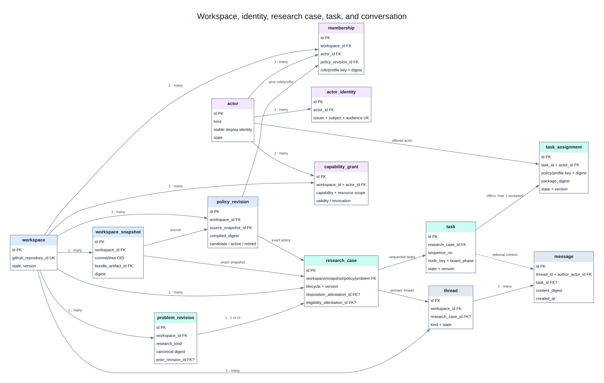
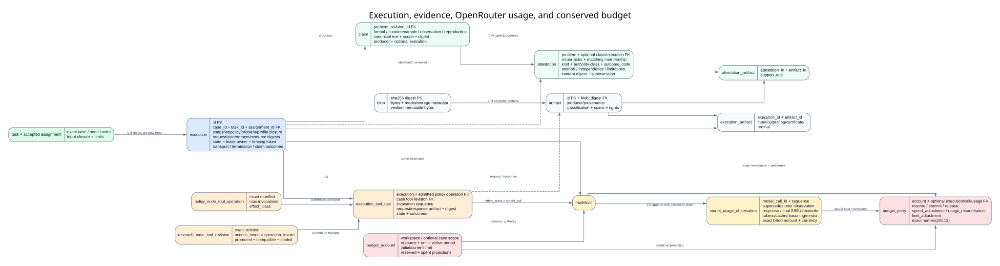
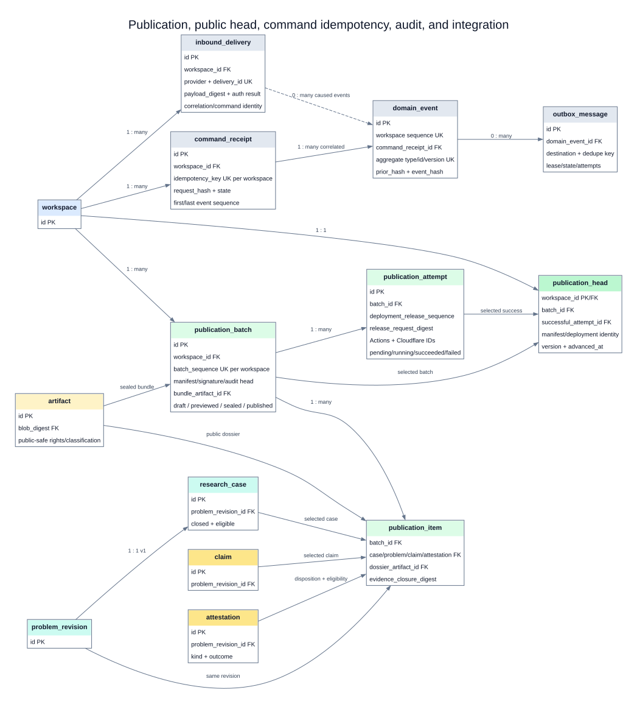

# MaCSad domain model

> **Status:** Greenfield v1 logical data model; the executable schema is `database/migrations/0001_initial_schema.sql`
>
> **Date:** 2026-08-31
>
> **Source:** [`design_document.md`](./design_document.md)
>
> **Product contract:** [`user_story.md`](./user_story.md)
>
> **Schema operations:** [`database/README.md`](./database/README.md)
>
> **Target:** PostgreSQL 16.15 in Firebat One's private Docker Compose network as the sole mutable domain authority; a provider-neutral content-addressed store for immutable bytes, using Firebat's local CAS first
>
> **Schema inventory:** 47 tables including `macsad_meta.schema_migration`, 50 native enum types, and six read views: `case_board_v`, `budget_balance_v`, `model_cost_variance_v`, `publication_catalog_v`, `audit_timeline_v`, and `schema_version_v`

## 1. Domain thesis

MaCSad's power comes from the distinctions its types preserve.

The system must distinguish:

- a question from a revision of that question;
- a research case from the task currently advancing it;
- an attempt from the artifacts it consumes or produces;
- a claim from evidence about that claim;
- an observation from a proof-checker result;
- an Investigator assertion from an independent attestation;
- workflow completion from research truth;
- research disposition from editorial eligibility;
- a sealed publication from a deployment attempt; and
- durable domain state from cache, queue, or presentation projections.

If these distinctions collapse into booleans, generic JSON, or prose, the rest of the system cannot recover them. If they are represented as explicit types and constrained relations, many unsafe states become unrepresentable or fail at a transaction boundary.

The useful category-theoretic analogy is:

- immutable revisions, claims, artifacts, and attestations are **objects**;
- assignments, attempts, attestations, transitions, and publication inclusion are **typed arrows**;
- foreign keys and predicates define which arrows are legal;
- transaction rules define valid composition; and
- immutable hashes let us identify the exact objects that were composed.

This is an analogy, not a claim that the database is literally a mathematical category. We should use the language only where identity, source, target, and composition laws are explicit.

## 2. Modeling decisions

### 2.1 The smallest coherent relational core

V1 uses explicit aggregates and relations where their identity, lifecycle, or constraints differ:

| Domain concept | V1 model | Boundary |
|---|---|---|
| Research project | `workspace` + `workspace_snapshot` | Exactly one watched GitHub repository defines the project and its immutable primary source states |
| Approved tool dependency | `tool_repository` + exact `tool_repository_revision` + sealed `tool_operation_manifest` catalogue | Read-only, exactly pinned dependencies; never projects or policy authorities |
| Organization and process policy | `policy_revision` plus compiler-emitted member/process/node/transition projections | One immutable semantic unit with relational foreign-key anchors |
| Card and current work | `research_case` + sequential `task` rows + immutable `task_transition` rows | The case is the Kanban card; a task instantiates one policy node |
| Handoff and responsibility | `task_assignment` lifecycle | Ownership transfers only when an offer is accepted atomically |
| Evidence and judgment | `claim` + typed `attestation` | Accountable statements over one frozen problem; never a generic `verified` flag |
| Bounded attempt | `execution` | Every retry is a new execution with an exact source/tool closure |
| Model-provider effect | `model_call` + append-only `model_usage_observation` | One OpenRouter request and every authoritative usage observation remain attributable and reconcilable |
| Conserved resource | `budget_account` + append-only `budget_entry` | Admission reservations and actual settlement remain exact and auditable |
| External observation | `inbound_delivery` | Provider deliveries are deduplicated by external identity and bound to a payload digest before commands use them |
| Ordered audit history | `audit_stream` + immutable `domain_event` | Stream head serialization is separate from immutable event facts |

The model does **not** introduce:

- a universal `entity` table;
- a universal `edge(source_type, source_id, target_type, target_id)` table;
- a graph database;
- a writable D1 copy of PostgreSQL;
- event sourcing as the sole source of truth; or
- JSON blobs in place of core relations.

### 2.2 Authority and storage

PostgreSQL 16.15 is authoritative for mutable control state and immutable domain metadata. The LOGOS controller is the only service allowed to perform domain transitions. Firebat runs PostgreSQL in the Docker Compose project with durable named storage, an internal-only data network, health-gated startup, and no published database port. The one-shot migrator applies and verifies the checksum ledger before application services start; the pgAdmin viewer has forced read-only database authority.

The v1 local content-addressed filesystem on Firebat stores large immutable bytes: workspace bundles, inputs, outputs, logs, certificates, patches, dossiers, and sealed public bundles. PostgreSQL stores intrinsic blob metadata plus each logical artifact's classification, provenance, rights, and opaque provider locator. The storage contract is provider-neutral so a later migration or public-only replication to R2 does not change domain identity.

Cloudflare queues, schedules, cache, and static deployments are transports or projections. Their state never establishes that a task advanced, evidence passed, a budget was approved, or a batch was published.

### 2.3 Immutable versus stateful types

**Immutable after insertion:**

- `workspace_snapshot`
- immutable source and promotion fields of `tool_repository_revision`; its operation catalogue is sealed once
- `tool_operation_manifest`
- activated or retired `policy_revision` content
- compiler-emitted `policy_member_profile`, `policy_process`, `policy_node`, `policy_transition`, and `policy_node_tool_operation` rows
- `problem_revision`
- `message`
- `message_mention`
- `task_transition`
- completed `execution` specification/result
- `blob`
- `artifact`
- `execution_artifact`
- `claim`
- `attestation`
- `attestation_artifact`
- `model_usage_observation`
- `budget_entry`
- `publication_dossier`
- sealed `publication_batch` content
- `publication_item`
- `domain_event`

**Stateful aggregate roots with optimistic versions:**

- `workspace`
- `tool_repository`
- candidate/active status of `policy_revision`
- `research_case`
- `task`
- `task_assignment`
- live `execution` lease/status
- `model_call`
- `budget_account` balance projection
- unsealed `publication_batch`
- `publication_head`
- `publication_attempt`
- `command_receipt`
- `inbound_delivery`
- `outbox_message`
- `audit_stream`

Stateful does not mean freely mutable. Each change is a command guarded by expected version, actor capability, invariant checks, an audit event, and—when an external effect follows—an outbox row in the same transaction.

## 3. Bounded contexts


[Full-resolution PNG](./docs/images/domain-context-map.png) · [Pan/zoom viewer](./docs/diagrams.html#domain-context-map)

| Context | Aggregate roots | Owns | Does not own |
|---|---|---|---|
| **Workspace and policy** | `workspace`, `tool_repository`, `policy_revision` | Primary GitHub identity, exact primary/tool pins, active compiled process/role/tool semantics | Research conclusions or artifact bytes |
| **Identity and organization** | `actor`, `membership`, `capability_grant` | Accountable identities, external authentication, workspace participation, explicit authority | Workflow state merely because a role name says so |
| **Research operations** | `research_case`, `task`, `thread` | Frozen case scope, sequential process obligations, assignments, board projection, conversation | Mechanical truth or publication deployment |
| **Evidence and execution** | `execution`, `blob`, `artifact`, `claim`, `attestation`, `budget_account`, `model_call` | Bounded attempts, immutable bytes and contextual artifacts, provenance, typed judgments, model usage, reservations and spend | Human editorial eligibility or public `latest` |
| **Publication** | `publication_dossier`, `publication_batch`, `publication_head` | Public-safe dossier closure, manifest, signature, deployment attempts, correction chain, exact public pointer | Private live state or stronger claims than the selected evidence permits |
| **Integration and audit** | `command_receipt`, `audit_stream`, `domain_event`, `outbox_message`, `inbound_delivery` | Command idempotency, hash-chained history, reliable external side effects and observations | Business decisions of its own |

Dependencies point inward toward the domain. Cloudflare and GitHub adapters translate external messages into commands or observations; they do not write tables directly.

## 4. Domain vocabulary and algebraic types

The LOGOS domain layer defines closed sum types. PostgreSQL native enums persist deliberately stable, closed state machines. Evolving vocabularies—profile, process, node, operation, capability, provider, and model identifiers—remain scoped text values backed by immutable compiler projections, manifests, digests, or reference relations. Agents and clients never introduce unchecked discriminants.

### 4.1 Core sum types

```text
ActorKind = Human | Agent | Service

ResearchKind = Mathematics | ComputerScience

CaseState = Open | Closed

CaseControlState = Normal | Paused | Blocked

KanbanPhase = Inbox | Ready | Running | Verify | Review | Closed

PolicyNodeKind = Start | Task | Decision | Gate | Fork | Join
               | Handoff | Wait | Call | Terminal

PolicyTransitionKind = Normal | Success | Failure | Timeout | Cancel | Default

MathDisposition = Proved | Refuted | Inconclusive | InvalidFormalization

CSDisposition = ObservedUnderFrozenProtocol | ExactlyReproduced
              | Refuted | Inconclusive | InvalidExperiment

AdministrativeDisposition = Superseded | Cancelled | PolicyDenied

ResearchDisposition = Math(MathDisposition) | CS(CSDisposition)
                    | Administrative(AdministrativeDisposition)

EditorialDecision = NotReviewed | Private | Eligible

TaskState = Offered | Ready | Running | Waiting | Completed | Cancelled

AssignmentState = Offered | Accepted | Rejected | Expired | Released

TransportOutcome = Accepted | Rejected | Unavailable | ProtocolError

TerminationOutcome = CleanExit | StepLimit | WallTimeout | OutOfMemory
                   | Signal | Cancelled | PolicyDenied | ToolError
                   | PartialOutput

ExecutionState = Pending | Leased | Running | CancelRequested
               | Completed | Failed | Expired

ModelCallState = Reserved | Submitted | Streaming | Succeeded | Failed
               | UsagePending | Reconciled | Cancelled

UsageObservationSource = Response | FinalSSE | GenerationReconcile
                       | ManualReconciliation

ClaimOutcome = Candidate | Supported | Rejected | Unknown | Inconclusive

AttestationKind = AgentAssertion | ToolObservation | SemanticReview
                | CheckerResult | CounterexampleValidation
                | Reproduction | MethodologicalReview
                | HumanDisposition | EditorialDecision

AuthorityClass = AgentAsserted | ToolObserved | CheckerAttested
               | ControllerDerived | HumanDecided

PublicationState = Draft | Previewed | Sealed | Published | Superseded

PublicationAttemptState = Pending | Running | Succeeded | Failed

BudgetEntryKind = Reserve | Commit | Release | SpendAdjustment
                | UsageReconciliation | LimitAdjustment
```

`ResearchDisposition` is a tagged union. A math case cannot be `ObservedUnderFrozenProtocol`; a CS case cannot be `Proved`. Administrative closure is never presented as a scientific result. `Unknown` belongs to an attempt/check layer; a final case that established neither success nor refutation is `Inconclusive`. Enforce these rules in the domain command and a database constraint trigger.

### 4.2 Value objects

| Value object | PostgreSQL representation | Rule |
|---|---|---|
| Typed ID | `uuid` | Defaults to `gen_random_uuid()` for entity rows; wrapped in distinct LOGOS types such as `CaseId` and `ArtifactId` |
| SHA-256 | checked `bytea` domain | Exactly 32 bytes; rendered as lowercase hex at boundaries |
| Git repository ID | `bigint` | Stable GitHub numeric ID; owner/name remains display metadata |
| Git object ID | checked lowercase hex text | Algorithm and length recorded; never assume all repositories remain SHA-1 forever |
| Money | `numeric(30,12)` + ISO currency | Never binary floating point |
| Token/compute quantity | `numeric(30,12)` + unit | Unit is part of the type |
| Instant | `timestamptz` | Stored in UTC; presentation converts time zones |
| Canonical payload | schema-versioned `jsonb` + SHA-256 | Canonicalization version is part of the digest contract |
| External locator | provider + opaque key | Never use a mutable public URL as identity |

Recommended PostgreSQL domains:

```sql
CREATE DOMAIN macsad.sha256_digest AS bytea
  CHECK (pg_catalog.octet_length(VALUE) = 32);

CREATE DOMAIN macsad.nonnegative_quantity AS numeric(30, 12)
  CHECK (VALUE >= 0);

CREATE DOMAIN macsad.exact_money AS numeric(30, 12)
  CHECK (VALUE >= 0);

CREATE DOMAIN macsad.canonical_json AS jsonb
  CHECK (pg_catalog.jsonb_typeof(VALUE) = 'object');
```

PostgreSQL domains improve storage validation. They do not replace distinct LOGOS types at compile time.

## 5. Workspace, identity, and control model



[Full-resolution PNG](./docs/images/domain-control-erd.png) · [Pan/zoom viewer](./docs/diagrams.html#domain-control-erd)

### 5.1 `workspace`

The one v1 project boundary.

Essential fields:

| Field | Type | Meaning |
|---|---|---|
| `id` | `uuid` PK | Internal stable workspace ID |
| `github_repository_id` | `bigint` unique | Stable external identity |
| `owner_name`, `repository_name` | `text` | Mutable display/routing metadata |
| `default_branch` | `text` | Branch to reconcile, never used without resolving a commit |
| `installation_id` | `bigint` | GitHub App installation boundary; not a token |
| `state` | checked `text` | `pending`, `active`, `paused`, or `disconnected` |
| `version` | `bigint` | Optimistic concurrency token |
| `created_at`, `updated_at` | `timestamptz` | Audit-friendly timestamps |

V1 permits exactly one active workspace by configuration. The schema remains correctly keyed so a later second workspace does not require rewriting identity.

### 5.2 `workspace_snapshot`

An immutable repository state that executions can actually reproduce.

Essential fields:

- `workspace_id`
- exact commit OID and tree OID, with algorithm
- observed default-branch name and delivery/reconciliation source
- optional source-bundle `artifact_id`
- `.macsad` configuration digest
- schema-versioned repository-policy result, body, and digest
- preservation timestamp and canonical snapshot digest

Snapshots are append-only. Force-pushing GitHub cannot invalidate a preserved snapshot.

### 5.3 Approved tool repositories and immutable revisions

The watched repository remains the sole project. A `tool_repository` is an explicitly approved, read-only dependency available to that workspace—for example the local private LOGOS source used to produce an admitted toolchain. It cannot receive project webhooks, contribute `.macsad` policy, define workspace identity, or grant a worker Git credentials.

`tool_repository` stores:

- workspace and unique human-readable alias;
- purpose and source kind (`github` or `local_checkout`);
- stable GitHub repository ID when one exists, plus mutable display remote metadata;
- an opaque host connection/locator reference, never a credential or portable identity;
- default classification and exposure boundary;
- approving actor/time, lifecycle state, and optimistic version.

`tool_repository_revision` is an exact preserved or promoted pin:

- exact commit OID and tree OID with algorithm;
- preserved source-bundle artifact and source-bundle digest;
- manifest, lock, dependency-closure, build-environment, and access-policy digests;
- optional promoted bundle, executable, and compatibility-evidence artifacts;
- observed, preserved, and promoted timestamps; and
- canonical revision digest.

`tool_operation_manifest` is the small relational interface exposed by one revision. An operation has a stable operation key/version, provider identity/revision, request and response schema identities/digests, effect class, and canonical manifest body/digest. Operations may be inserted only while the revision catalogue is open. One atomic update records its operation count, catalogue digest, sealing actor, and sealing time; no operation can be added or changed afterward.

A case attaches zero or more exact revisions through `research_case_tool_revision`, with `access_mode` equal to `source_read` or `operation_invoke`. Source access requires preserved bytes. Invocation additionally requires a promoted bundle, compatibility evidence, and a sealed operation catalogue. An execution records only admitted `operation_invoke` operations through `execution_tool_use`. Thus a local checkout can be updated without changing any existing case, and a worker receives only the preserved or promoted closure admitted for that case—not the private checkout.

### 5.4 `policy_revision` and compiled projections

One immutable compiled unit containing the organization roles, sequential workflow graph, decision matrices, tool policy, schemas, and compiler identity.

Essential fields:

- `workspace_id` and source `workspace_snapshot_id`
- source path/digest and compiled canonical JSON/digest
- compiler and schema versions
- validation result, schema-versioned validation body/digest, and validation time
- `state`: `candidate`, `active`, or `retired`
- activating actor, time, and semantic-diff artifact
- optional prior revision

Only one policy revision is active per workspace:

```sql
CREATE UNIQUE INDEX policy_revision_one_active_uq
  ON macsad.policy_revision (workspace_id)
  WHERE state = 'active';
```

Activation changes status; it never mutates compiled content. Cases pin the exact revision they started with.

The canonical, schema-versioned compiled JSON remains the policy source of truth. The compiler also emits immutable relational projections so core foreign keys are enforceable rather than pointing into JSON:

| Projection | Relational purpose |
|---|---|
| `policy_member_profile` | Profile/role keys, optional supervisor profile, WIP limit, and schema-versioned profile body/digest |
| `policy_process` | Process key, entry node, schema-versioned process body, and graph digest |
| `policy_node` | Node key/kind, board phase, required profile, timeout, retry limit, and schema-versioned node body/digest |
| `policy_transition` | Ordered source-to-target edge, transition kind, decision code, optional assignment profile, and schema-versioned predicate |
| `policy_node_tool_operation` | Exact allowed operation at a node, invocation ceiling, and required/optional flag |

Projection rows may be inserted only while their policy revision is a candidate. Updates and deletes are rejected, and activation takes a row lock that closes the insert window, so an active or retired policy graph cannot acquire new profiles, processes, nodes, transitions, or tool rights. Foreign keys and unique indexes enforce the entry-node reference, valid endpoints and profiles, deterministic match order, and at most one default edge per source node. Whole-graph reachability and cycle checks remain compiler validation recorded in `policy_revision.validation_*`.

### 5.5 `actor` and `actor_identity`

`actor` is the accountable cause of an action: a human, agent, or service. `actor_identity` maps external authentication to that actor.

`actor` fields include only stable identity attributes: `kind`, display name, state, and timestamps. An agent actor survives profile and policy revisions; no changing profile digest belongs on this identity row.

`actor_identity` has a unique `(issuer, subject, audience)` tuple. Examples include a Cloudflare Access identity, GitHub account, worker certificate subject, or service token identity.

Do not put bearer tokens, private keys, or provider secrets in either table.

### 5.6 `membership` and `capability_grant`

`membership` says how an actor participates in a workspace:

- workspace and actor;
- exact policy revision plus profile key and immutable profile digest from that revision;
- supervisor actor where applicable;
- validity interval and state.

`capability_grant` says what an actor may actually authorize:

- workspace and actor;
- fixed capability code such as `budget.approve`, `policy.activate`, `publication.eligibility.decide`, or `publication.seal`;
- optional resource constraint;
- grantor, validity, revocation, and reason.

A role never implies a capability. The command layer records its authorization facts in the schema-versioned event payload rather than granting authority from a profile name.

`membership(policy_revision_id, profile_key, profile_digest)` must reference the compiled profile. Assignments and executions copy that exact identity so a later membership or policy change cannot rewrite history.

## 6. Research operations model

### 6.1 `problem_revision`

An immutable semantic object containing what is being asked.

Common fields:

- `workspace_id`
- `research_kind`
- original question and normalized title
- definitions/vocabulary
- assumptions
- domain and bounds
- success, refutation, and inconclusive criteria
- prior revision and revision reason
- canonical content digest

Math-specific canonical payload:

- formal source and rendered statement;
- reverse paraphrase;
- goal and counterexample condition.

CS-specific canonical payload:

- executable specification or falsifiable hypothesis;
- baseline, metric, input/dataset digest, environment, seed policy, and stopping rule.

The common columns remain relational. Kind-specific formalization, protocol, permitted-method, and data-classification details live in the required schema-versioned `kind_body` JSON object and are identified by the revision's canonical content digest.

### 6.2 `research_case`

The aggregate shown as one Kanban card. It pins one exact semantic and execution context:

- `workspace_id`
- `workspace_snapshot_id`
- `policy_revision_id`
- `problem_revision_id`
- `process_key` and exact `tool_closure_digest`
- lifecycle and priority
- final typed disposition, initially null
- disposition `attestation_id`, initially null
- editorial decision and eligibility `attestation_id`
- optional `supersedes_case_id`
- optimistic `version`

`research_case_tool_revision` freezes the approved dependency closure for that case. Its composite keys permit at most one revision of a given tool repository per case and require the tool, revision, case, and workspace to agree. It records ordered closure position, `source_read` or `operation_invoke` access, purpose, an optional schema-versioned scope, and the actor who pinned it. The case stores the digest of the complete tool closure. Pin rows are append-only, and no additional pin can be inserted after the first task exists.

A semantic revision creates a new problem revision and a new research case linked by `supersedes_case_id`. The old case remains closed. This is simpler and safer than mutating the meaning under an existing workflow.

V1 enforces `UNIQUE (problem_revision_id)`: one frozen problem revision belongs to one case. Composite foreign keys require the case's snapshot, policy, and problem revision to share its `workspace_id`. The disposition and eligibility references are composite `(attestation_id, problem_revision_id)` foreign keys with kind checks requiring `HumanDisposition` and `EditorialDecision` respectively.

### 6.3 `task`

A task is one instantiated sequential workflow node for a case.

Fields include:

- `research_case_id`
- monotonic `sequence_no`
- process/node key with a composite foreign key to the pinned `policy_node`
- board phase derived from the immutable compiled node definition
- required profile key referencing the same policy revision
- state and optional deadline
- entry transition reference and input/output closure digests
- opened/finished timestamps and optimistic version

V1 permits one nonterminal task per case:

```sql
CREATE UNIQUE INDEX task_one_live_per_case_uq
  ON macsad.task (research_case_id)
  WHERE state IN ('offered', 'ready', 'running', 'waiting');
```

The Kanban column is the live task's `board_phase`. A command never sets a card column directly.

The first task must instantiate the compiled process entry node and has no entering transition. Every successor task must be the next sequence number and must close the preceding `task_transition` path through the same compiled transition. The source task must be finished; cancellation must use a cancel edge; and a transition without a successor must target a compiled terminal node.

`task_transition` is the immutable record of every accepted control-flow arrow. It names the source task, optional target task, exact compiled transition, decision code and match order, schema-versioned fact snapshot/digest, deciding actor, and exact `task.transitioned` domain event. The event must name the same source task version, transition row, policy edge, and decision code. MCP may read the node and propose an edge; only the controller can append the authoritative path.

### 6.4 `task_assignment`

Assignment and handoff are one lifecycle:

- task and offered actor;
- offered actor and its exact active `membership`, policy/profile key, and profile digest;
- offering actor;
- prior assignment, if this is a handoff;
- exact package digest and thread reference;
- state and offer/accept/reject/expire/release timestamps;
- reason and optimistic version.

Only one accepted assignment may exist per task:

```sql
CREATE UNIQUE INDEX task_assignment_one_accepted_uq
  ON macsad.task_assignment (task_id)
  WHERE state = 'accepted';
```

The sender remains responsible until acceptance. Acceptance and release of the prior assignment occur atomically.

### 6.5 `thread` and `message`

V1 supports one workspace operations thread, one primary thread per case, and one task thread per task.

`thread` fields include workspace, optional case, kind, state, and created time. Partial unique indexes enforce one operations thread per workspace and one primary thread per case.

`message` is immutable and contains:

- thread, author actor, and optional task context;
- reply-to message;
- content format/body and content digest;
- created time.

`message_mention` is an explicit many-to-many relation from a message to an actor. It supports a deterministic inbox without parsing names from prose.

Editing creates a correcting message. A message cannot carry a hidden workflow transition, budget mutation, or approval. UI buttons shown near chat issue separate authenticated commands.

## 7. Evidence, execution, and budget model



[Full-resolution PNG](./docs/images/domain-evidence-erd.png) · [Pan/zoom viewer](./docs/diagrams.html#domain-evidence-erd)

### 7.1 `execution`

One bounded attempt for one task. A retry is a new row.

Identity and specification fields:

- task and accepted assignment;
- performing actor, exact policy/profile key and digest, and worker service actor;
- exact workspace snapshot, policy revision, and problem revision (copied as integrity keys);
- schema-versioned request body/digest, environment digest, deterministic seed, and schema-versioned resource-limit body/digest;
- idempotency key.

Lease fields:

- lease owner, fencing token, claimed/heartbeat/expiry times;
- cancellation request and reason.

Outcome fields remain independent:

- execution state;
- transport outcome;
- termination outcome;
- claim/check outcome (`Candidate`, `Supported`, `Rejected`, `Unknown`, or `Inconclusive`);
- started/finished timestamps;
- result envelope digest.

A zero exit code can coexist with `claim_outcome='unknown'`. A timeout cannot be mapped to refutation.

When an execution is attached to a claim or attestation, composite `(execution_id, problem_revision_id)` foreign keys enforce the frozen-revision boundary. Claim source executions and attestation target executions cannot cross revisions.

`execution_tool_use` records each admitted operation used by the attempt: the exact case tool revision, operation manifest, invocation sequence, request/result digests, transport/termination observations, and optional request/response artifacts. Composite foreign keys require an `operation_invoke` case pin, the exact current task-node policy mapping, and an invocation sequence no greater than that mapping's `max_invocations`.

### 7.2 `blob` and `artifact`

`blob` is intrinsic, deduplicated byte identity. `artifact` is a logical use of those bytes in a workspace and evidentiary context. The split matters because identical bytes may be produced by different executions or arrive with different source, confidentiality, licensing, or export constraints.

`blob` fields:

- SHA-256 digest as the primary/unique byte identity;
- byte length, media type, intrinsic encoding/compression, and optional provider checksum;
- storage provider (`local_cas` initially), opaque locator, and storage class;
- stored/verified timestamps.

`artifact` fields:

| Field group | Contents |
|---|---|
| Identity | logical `id`, `workspace_id`, `blob_digest` FK, artifact kind, schema ID/version |
| Safety | private/public classification, secret-scan result, quarantine state |
| Provenance | producing actor/execution, original source, observed time |
| Rights | license, attribution, export decision, redistribution rule |

The canonical provider key should be hash-addressed, for example `sha256/ab/cd/<full-hex>`. A blob row is accepted only after a read-back or provider checksum confirms the stored bytes. Every artifact read rechecks—or consumes a previously trusted, freshness-bounded check of—the blob digest before the bytes can satisfy an evidence or publication gate.

`execution_artifact` is the typed many-to-many relation between execution and artifact, with roles such as `input`, `output`, `log`, `certificate`, `patch`, `diagnostic`, or `environment_manifest`.

Artifact lineage is derived from executions: inputs transformed by an execution into outputs. Deduplicating blob bytes never merges artifact provenance or rights. A generic artifact-edge table is unnecessary in v1.

### 7.3 `claim`

An immutable statement that evidence can assess.

Fields include:

- `problem_revision_id`
- claim kind: formal proposition, counterexample, bounded observation, reproduction statement, or human interpretation
- canonical text and optional schema-validated payload
- scope/bounds and content digest
- proposing actor and source execution

Claim status is derived from attestations. There is no mutable `verified` column.

### 7.4 `attestation`

The central evidence type: one accountable issuer makes one typed statement about one frozen problem, optionally a claim or execution.

Fields include:

- `problem_revision_id`
- optional `claim_id` and `execution_id`
- issuer actor and optional exact membership/profile snapshot
- attestation kind and authority class
- schema ID/version, optional method digest, and outcome code
- schema-validated typed value
- limitations and achieved independence dimensions
- optional superseded attestation
- canonical content digest and created time

Examples:

| Attestation kind | Issuer | Meaning |
|---|---|---|
| `AgentAssertion` | Investigator | Candidate interpretation; useful for routing, never approval |
| `ToolObservation` | Trusted tool adapter | Exact bounded output or measurement |
| `SemanticReview` | Human/Verifier | Formal representation faithfully reflects the frozen question, or does not |
| `CheckerResult` | Admitted checker service | Named checker accepted/rejected a named artifact for a named formal claim |
| `CounterexampleValidation` | Validator/Verifier | Candidate satisfies the frozen counterexample condition |
| `Reproduction` | Independent Verifier | Exact replay matched, mismatched, or was inconclusive |
| `HumanDisposition` | Director | Honest final interpretation based on an exact evidence closure |
| `EditorialDecision` | Authorized human | Closed work is private or eligible for batch selection |

`attestation_artifact` explicitly names supporting artifacts and their roles. The same-revision rule is enforced by the composite `attestation(workspace_id, claim_id, problem_revision_id) → claim(workspace_id, id, problem_revision_id)` foreign key.

The achieved producer, environment, method, and data independence dimensions are stored individually, not collapsed to a badge. Any `human_decided` attestation requires an active human actor and an active matching workspace membership at the attestation time.

The same-revision closure also applies to optional execution targets and claim source executions. Case disposition and eligibility references use composite attestation/revision keys plus constrained triggers that require `HumanDisposition` and `EditorialDecision` kinds. Their `outcome_code` must exactly equal the selected typed disposition or editorial decision; a generic or mismatched attestation cannot occupy either slot.

### 7.5 Decision facts

There is no standalone `fact` table in v1. The workflow evaluator assembles a typed fact snapshot from:

- attestations;
- execution and budget state;
- authenticated actor, membership, and capability state; and
- controller-derived values with their input digests.

The exact fact snapshot, allowed authority/issuer constraints, matched decision row, and selected edge are recorded in the transition's immutable `domain_event` body.

### 7.6 `model_call` and `model_usage_observation`

`model_call` represents one controller-side OpenRouter effect. An execution may make zero or more calls; every call has its own identity, reservation, provider reconciliation, and provenance. Composite foreign keys require the call, execution, and task to identify the same case and task, and require the call to arise from an admitted `model_call` operation.

Core fields include:

- workspace, case, task, execution, requesting agent actor, and controller service actor;
- provider (`openrouter` in v1), an opaque credential reference and epoch—never the API key;
- workspace-scoped idempotency key and canonical request digest;
- required prompt artifact/digest, optional context artifact plus required context digest, and parameters digest rather than an unclassified raw prompt column;
- requested model, routing-policy digest, requested maximum output tokens, stream flag, pricing-snapshot digest, estimated cost, reserved cost, and ISO currency;
- lifecycle (`reserved`, `submitted`, `streaming`, `succeeded`, `failed`, `usage_pending`, `reconciled`, or `cancelled`);
- unique OpenRouter generation ID when observed, provider request/upstream IDs, resolved model/provider, service tier, data region, and BYOK flag;
- HTTP status, error code, submission/response/reconciliation times, and optional response artifact.

`model_usage_observation` is append-only. A call can have observations from the completed response, final SSE event, and later generation reconciliation. Each records its source, observation time, exact native token/media/search counts where supplied, provider-reported charge or credits, optional upstream inference cost, resolved routing identity, canonical sanitized-usage schema/digest, and an optional directly superseded observation. Per-call sequence and digest uniqueness plus a one-successor constraint form one correction chain without overwriting history. A reconciled call must first reopen to `usage_pending` before a correction can be appended.

The final response/final SSE usage is the first settlement source. The generation endpoint reconciles missing or corrected facts. The credits endpoint is only an aggregate operational cross-check and requires a separate management credential; it never settles an individual call. Missing final stream usage means `usage_pending`, not zero cost, and an ambiguous network result is reconciled rather than blindly retried.

### 7.7 `budget_account` and `budget_entry`

One budget account represents one resource dimension over a workspace or optional research-case scope and a half-open period `[period_start, period_end)`.

Fields:

- workspace and optional `research_case_id`;
- resource kind: currency, model tokens, CPU time, wall time, or storage;
- unit/currency;
- period start/end, initial/current spending limit, reserved projection, and spent projection;
- optimistic version.

`budget_entry` is append-only:

- account and optional execution/model call;
- kind: `reserve`, `commit`, `release`, `spend_adjustment`, `usage_reconciliation`, or `limit_adjustment`;
- quantity and idempotency key;
- actor/reason and created time;
- related reservation entry where applicable.

Required invariants distinguish admission from settlement:

```text
limit >= 0
reserved >= 0
spent >= 0

admission:
  current time is inside the account period
  spent + reserved + requested_reservation <= limit

settlement:
  record the complete provider-reported actual quantity
  release the reservation and commit the actual quantity
  if spent exceeds limit, expose the overrun in the read model
  deny new reservations until an authorized human resolves it
```

`record_budget_entry` locks the account. A reservation is admitted only during the active period and only within the remaining limit. Settlement never clamps, rejects, or hides an actual provider charge above its reservation. A model-cost commit must settle that same call's one exact reservation and equal the final usage observation's billed amount and currency. A corrected billed amount appends `spend_adjustment`; a cost-equivalent correction appends a zero-quantity `usage_reconciliation`. Raising a limit uses `limit_adjustment`, never negative spend.

For model calls, `model_cost_variance_v` exposes:

```text
reservation_variance = actual_cost - reserved_cost
reconciliation_variance = recorded_spend - latest billed amount
```

## 8. Publication, integration, and audit model



[Full-resolution PNG](./docs/images/domain-publication-erd.png) · [Pan/zoom viewer](./docs/diagrams.html#domain-publication-erd)

### 8.1 `publication_dossier`

An immutable publication candidate closes one eligible case and claim over one public-safe dossier artifact. It stores the workspace, case, problem revision, claim, dossier artifact, schema-versioned closure body/digest, creating actor, and time. Composite keys keep the case and claim on one problem revision and the artifact in that workspace. Insertion requires a closed, editorially eligible case and an artifact classified `public_candidate` or `public`, with a passed secret scan, no quarantine, and redistribution allowed.

### 8.2 `publication_batch`

One batch moves through `draft → previewed → sealed → published → superseded`.

Its relational closure includes:

- workspace, pinned policy revision, optional `corrects_batch_id`, and state;
- workspace-local `batch_sequence`;
- generator/toolchain artifacts and generator/platform/toolchain digests;
- evidence and artifact closure digests;
- exact workspace audit-head event, sequence, and hash;
- manifest artifact/digest, signature, sealing actor, and lifecycle times.

Items may be inserted only while the batch is `draft`. Acceptance of a nonempty preview allocates the positive `batch_sequence`, records the generator/toolchain/evidence/artifact closure and current audit head, and freezes that preview closure. Sealing adds a public-safe manifest artifact, digest, signature, sealer, and time; those fields then freeze. A sealed batch can become `published` only after a related `publication_attempt` has succeeded. PostgreSQL enforces uniqueness of non-null `(workspace_id, batch_sequence)`; the command layer allocates the next workspace-local sequence during preview.

### 8.3 `publication_item`

An immutable item selects one exact batch, case, problem revision, claim, disposition attestation, eligibility attestation, and `publication_dossier`, plus an ordinal and item digest. Composite keys ensure that the dossier's case/problem/claim/artifact closure matches the selected item. The item validator also requires the case to be closed and eligible with those exact two case attestations, and requires the dossier artifact to remain public-safe at selection time.

### 8.4 `publication_attempt`

A delivery observation is separate from research content. Each attempt stores:

- batch and positive `attempt_no`;
- trigger kind, target environment, platform/generator revision digests, and release-request digest;
- GitHub repository/workflow and observed run/attempt IDs;
- Cloudflare account/project references and observed version/deployment IDs/URL;
- `pending`, `running`, `succeeded`, or `failed` state, optional response artifact, times, error code, and optimistic version.

The request and deployment target are immutable, and observed GitHub/Cloudflare identities are write-once. A succeeded or failed attempt is terminal. Success requires the GitHub run identity and Cloudflare version, deployment, and URL.

### 8.5 `publication_head`

One mutable, versioned row per workspace identifies exactly what is public through `publication_batch_id` and `publication_attempt_id`, plus creation/update times. The referenced attempt must have succeeded and its batch must already be `published` or `superseded`. Batch state alone is never the public pointer.

### 8.6 `command_receipt`

One workspace-scoped command receipt owns request idempotency across all aggregates changed by that command. It stores the authenticated actor and optional actor identity, command kind, idempotency key, request digest, correlation/causation IDs, processing/completed/rejected state, optional schema-versioned result, optional processing lease, completion time, and optimistic version.

`UNIQUE (workspace_id, idempotency_key)` prevents a second receipt with the same workspace key. The command layer compares `request_digest` before returning an existing result. A processing receipt can be leased for crash recovery.

### 8.7 `audit_stream` and `domain_event`

Every workspace automatically receives exactly one `audit_stream` row. It stores the last workspace sequence, last event hash, optimistic version, and timestamps. Inserting a `domain_event` locks that row, requires the next sequence and exact previous hash, requires the next version for that aggregate identity, and advances the stream head in the same transaction.

An immutable `domain_event` stores workspace sequence, aggregate kind/ID/version, event kind, optional command and inbound-delivery links, actor, correlation/causation IDs, schema-versioned payload body/digest, previous/event hashes, and occurrence/recording times. Required uniqueness is `(workspace_id, workspace_sequence_no)`, `(workspace_id, aggregate_kind, aggregate_id, aggregate_version)`, and `event_hash`. The canonical event producer computes the event hash; PostgreSQL enforces that each supplied link extends the current serialized workspace head.

The event log is an audit and explanation source. Aggregate tables remain the command-side source of truth.

### 8.8 `outbox_message`

One external side effect derived from one event stores the event, topic, message key, schema-versioned payload body/digest, state, attempt count, next-attempt time, optional lease owner/expiry, delivery time, last error code, and optimistic version. Its states are `pending`, `publishing`, `delivered`, and `dead_letter`; only `publishing` may return to `pending` for retry. `(domain_event_id, topic)` is unique. Domain mutation, event, and required outbox insert commit atomically.

### 8.9 `inbound_delivery`

An inbound delivery stores workspace, provider, external delivery ID, delivery kind, optional classified payload artifact, payload digest, optional command receipt, state, completion time, and optimistic version. Its states are `received`, `processing`, `completed`, `rejected`, and `dead_letter`. Uniqueness on `(provider, external_delivery_id)` prevents duplicate rows. One delivery may cause zero or many correlated events through their optional `inbound_delivery_id`.

## 9. Relationship and cardinality rules

The ER images are partitioned for readability, but these rules apply across them:

1. A workspace has many primary snapshots, approved tool repositories, and policy revisions; only one policy revision is active.
2. A tool repository has many exact revisions; each revision receives zero or more operation manifests and then seals that catalogue once.
3. A research case pins exactly one primary workspace snapshot, policy revision, and problem revision, plus zero or more exact tool revisions with at most one revision per tool repository.
4. A problem revision seeds exactly one case in v1; a semantic change creates a new revision/case.
5. A case has many sequential tasks but at most one nonterminal task; every accepted arrow is an immutable `task_transition` bound to the compiled policy edge and fact snapshot.
6. A task has many assignment offers but at most one accepted assignment.
7. A task has many executions; a retry never mutates the prior execution.
8. An execution may use many admitted tool operations and make many model calls; invocation requires an `operation_invoke` case pin and the current task-node operation mapping, and each call must belong to that same task and execution.
9. A model call has many append-only usage observations and its budget entries retain direct call attribution.
10. An execution consumes/produces many logical artifacts through typed links; multiple artifacts may reference the same immutable blob bytes without sharing provenance or rights.
11. A claim and every attestation assessing it share one problem revision.
12. An attestation may cite many artifacts; an artifact may support many attestations.
13. A case may own multiple resource-specific budget accounts; entries are append-only.
14. A publication dossier binds one eligible case/claim to one public-safe artifact; a draft batch selects one or more exact dossiers and may have many deployment attempts; one workspace publication head selects one successful published batch/attempt pair.
15. One command receipt owns one idempotency key and may correlate many per-aggregate domain events; an event may produce zero or more outbox messages.
16. An inbound delivery may cause zero or many correlated events and is never itself evidence that an external claim is true.

## 10. Critical invariants

### 10.1 Identity and scope

- GitHub repository numeric ID, not owner/name, establishes workspace identity.
- Tool repositories are read-only dependencies, never project identities; a case can read only preserved revisions and can invoke only promoted revisions with sealed operation catalogues.
- Every case, execution, claim, attestation, and publication traces to one workspace and exact problem revision.
- Cross-workspace foreign keys are impossible or protected by composite `(workspace_id, id)` keys.
- Case snapshot/policy/problem references and publication item case/problem/claim/attestation references use composite same-workspace/same-revision foreign keys.
- External identities authenticate actors; role guidance never grants permission.

### 10.2 Immutability and revision

- A semantic edit creates a new `problem_revision` and case.
- A changed process creates a new `policy_revision`; in-flight cases remain pinned.
- A changed tool checkout creates a new `tool_repository_revision`; existing case and execution pins remain immutable.
- Blob, artifact, claim, attestation, message, budget-entry, sealed-batch, and event content is append-only.
- Correction uses explicit supersession/erratum links.

### 10.3 Workflow

- One live task per case in v1.
- One accepted assignment per task.
- The first task is the compiled entry node; every successor closes the preceding finished task's exact compiled transition and sequence path.
- The board phase derives from the active task's compiled policy node.
- Compiler projections may be inserted only while the policy is a candidate and cannot change after activation.
- Every process/member/node/edge/operation reference resolves through immutable projections for the same policy revision.
- A transition validates expected aggregate version, pinned policy edge, actor/capability, required facts, authority classes, issuer constraints, ordered decision row, and fail-closed default, then records the exact fact and rule digests.
- A command receipt, state mutation, one event per changed aggregate, and required outbox records commit together.

### 10.4 Evidence

- No single `verified` Boolean exists.
- Investigator and independent Verifier are different actors for gates that require separation.
- Human approval cannot substitute for checker or replay evidence.
- Transport, termination, and research outcomes are independent.
- Every accepted artifact resolves to blob bytes that match the recorded digest, while provenance, classification, and rights remain artifact-specific.
- Every attestation names issuer, authority class, schema, exact outcome code, problem revision, and optional method/supporting closure; human decisions require an active human membership.

### 10.5 Budget, model calls, and execution

- New reservations are admitted only during the account period and when `spent + reserved + requested_reservation <= limit`.
- Provider settlement always records the complete actual charge; `budget_balance_v` exposes any overrun and the locked reservation function rejects new reservations that exceed the limit.
- Budget is reserved before an execution or model-provider effect begins.
- Every OpenRouter call has a durable idempotency/request identity, exact request and pricing digests, provider generation identity when known, append-only correction-linked usage observations, and directly attributable ledger entries.
- A model commit settles that same call's exact reservation; later cost corrections append `spend_adjustment` or zero-delta `usage_reconciliation` entries.
- Missing stream usage remains pending and ambiguous effects are reconciled before retry.
- First lease acquisition requires fencing token `1`; lease owner and token are immutable after acquisition, and heartbeats cannot move backward.
- Completed, failed, and expired executions are terminal and immutable.
- Sandboxes cannot settle provider usage or mutate budget accounts.

### 10.6 Publication

- Only closed, editorially eligible cases may enter a preview.
- Publication items can be selected only while the batch is draft and must reference a validated immutable dossier.
- Preview allocates the batch sequence and freezes the selected generator/toolchain/evidence/artifact closure and current audit head.
- Sealing freezes the public-safe manifest and signature.
- A successful deployment attempt is required before the batch becomes published; only then can the versioned `publication_head` select it.
- Retry and template redeploy semantics cannot collapse to manifest-only idempotency.

## 11. Command transaction boundaries

### 11.1 Start an execution

One PostgreSQL transaction:

1. lock case, task, accepted assignment, and relevant budget accounts;
2. verify expected versions, state, capability, WIP, worker availability, primary snapshot, policy pin, and admitted tool-revision closure;
3. reserve worst-case budget with append-only entries;
4. create execution and fenced lease;
5. move task to `running`;
6. complete the command receipt and append correlated per-aggregate domain events; and
7. append a worker-dispatch outbox message linked to the execution event.

Any failure rolls back all seven effects.

### 11.2 Complete an execution

1. verify worker identity, execution state, lease owner, and fencing token;
2. verify all staged artifact digests and metadata;
3. insert artifacts and typed execution links;
4. record independent outcome layers and result digest;
5. append final model-usage observations and commit/release budget reservations without hiding an actual overage;
6. evaluate the pinned task completion/edge predicates;
7. close the task and create the next task, or leave an explicit blocked/failed outcome;
8. complete the command receipt and append correlated per-aggregate events/outbox atomically.

### 11.3 Record verification

1. verify assignment and required actor separation;
2. verify problem/claim/artifact revision closure;
3. insert immutable attestation and artifact links;
4. evaluate the exact gate fact snapshot;
5. close/open sequential tasks if the gate selects an edge;
6. complete the command receipt and append correlated per-aggregate events/outbox atomically.

### 11.4 Seal a publication

Filesystem/object-store I/O cannot be atomic with PostgreSQL, so sealing is an explicit preview/seal protocol rather than one long transaction:

1. In a short preview transaction, insert all `publication_item` rows while the batch is draft; lock the batch and selected cases; verify each dossier and exact case attestations; allocate the workspace-local sequence; record the generator/toolchain/evidence/artifact closure and current audit head; and move the batch to `previewed`, freezing that closure.
2. Outside database locks, deterministically construct and sign the exact bundle, commit it to the local CAS under its digest, and read it back for verification. A crash may leave an unreachable CAS blob, which is harmless and later reconciled; it cannot create a sealed batch.
3. In a short seal transaction, relock the previewed batch, verify its expected version and frozen closure, insert the blob/artifact metadata, store the public-safe manifest digest/signature and sealing authority, move the batch to `sealed`, append correlated events, complete the command receipt, and insert the exact release-request outbox row.

Retries reuse the frozen preview closure. A changed selection or closure creates a new draft rather than modifying a previewed batch.

## 12. Read models

Read models are derived views, not independently writable tables.

| View | Derivation | Used by |
|---|---|---|
| `case_board_v` | Case/problem + one live task + accepted assignment | Admin Kanban |
| `budget_balance_v` | Accounts + append-only entries | Spend and remaining budget |
| `model_cost_variance_v` | Model calls + latest usage + reservation/settlement/adjustment attribution | Estimated, reserved, recorded, billed, and reconciliation status by call |
| `publication_catalog_v` | Published/superseded batches and items, with current-head attempt when selected | Generator input/admin history |
| `audit_timeline_v` | Domain events ordered by workspace sequence | Explainability/operations |
| `schema_version_v` | Maximum applied migration version | Application/schema compatibility gate |

The initial UI may query these views through the controller and poll. No realtime projection store is required.

## 13. PostgreSQL implementation rules

1. Use PostgreSQL's `gen_random_uuid()` defaults and distinct LOGOS wrapper types at the application boundary.
2. Use `timestamptz`, checked digests, and exact numeric quantities.
3. Use `NOT NULL` aggressively; optional values must reflect a real lifecycle state.
4. Use foreign keys for every core relation; avoid polymorphic IDs outside the audit log.
5. Use partial unique indexes for “one active/live/accepted” invariants.
6. Use composite foreign keys to enforce workspace and problem-revision closure.
7. Use `jsonb` only for immutable, schema-versioned tagged payloads and event bodies.
8. Keep mutable balance columns as transactionally maintained projections over append-only entries; reconcile them in tests and scheduled checks.
9. Restrict immutable tables with database privileges and defensive update/delete triggers.
10. Give the application role no schema-migration privilege. Use a separate migration role.
11. Give publication generation read access only to sealed/public-safe views and named CAS objects.
12. Back up PostgreSQL and the complete CAS bytes/index separately; exercise restore as an acceptance test.
13. Keep trusted policy and tool identities relational: foreign keys terminate at immutable compiler/manifest projections, not paths inside JSON.
14. Store money and resource quantities as exact `numeric`; never use floating point for price, charge, reservation, or ledger movement.
15. Use constrained nullable foreign keys for closed scope unions; do not introduce polymorphic `entity_type/entity_id` relations into the operational model.

RLS is not required for a single-workspace v1. Add it only when multiple mutually distrusting workspaces become a real requirement. Application authorization is still mandatory.

## 14. Runtime and Cloudflare data boundary

```text
Authorized operator browser
  -> Headscale-managed tailnet
  -> Firebat exact tailnet IP :18080
  -> unprivileged LOGOS sites container
     (shares the LOGOS gateway network namespace)
  -> LOGOS gateway/controller
  -> PostgreSQL 16.15 on internal Compose data network
     (domain authority; no published port)

Authorized database viewer
  -> Headscale-managed tailnet
  -> Firebat exact tailnet IP :8978
  -> authenticated pgAdmin
  -> ACL-constrained macsad_viewer with read-only session default
  -> PostgreSQL internal Compose service

LOGOS controller / trusted worker
  -> local CAS on Firebat (content-addressed immutable bytes)

Publication pipeline
  -> sealed local-CAS bundle
  -> GitHub Actions exact-artifact handoff
  -> public Worker Static Assets (read-only generated site)

Optional later public replication
  -> separate public-only R2 bucket/binding
```

The Firebat environment publishes only `18080` (admin), `18082` (public preview), and `8978` (pgAdmin) on an address verified as Firebat's own tailnet IPv4. It publishes nothing on wildcard, loopback, LAN, public, or Tailscale Funnel interfaces. Cloudflare receives only future release artifacts and sealed public projections; it does not connect to the private development database or determine domain state. Any protected production admin edge requires its own reviewed identity, origin, and negative-test design before it is provisioned.

### 14.1 Why PostgreSQL, not PostgreSQL plus D1

D1 is SQLite, not PostgreSQL. A dual-write model would create two competing answers to questions such as “is this task running?”, “is this budget available?”, and “was this batch published?”. V1 therefore does not mirror private control state into D1.

If dynamic public search becomes necessary, D1 may hold a disposable `public_catalog` projection whose only input is sealed publication manifests. It must be:

- asynchronously generated after sealing;
- versioned by batch/manifest digest;
- read-only to public requests;
- safe to delete and rebuild; and
- unable to trigger domain commands.

### 14.2 Why not Durable Objects initially

Durable Objects would introduce another single-writer state machine. V1 already has one controller, PostgreSQL row locks/transactions, optimistic versions, one worker, and one live task per case. Use Durable Objects later only for demonstrated edge-local coordination, WebSocket sessions, or a per-workspace realtime hub—not for research truth or budget authority.

### 14.3 CAS, optional R2, and cache

The design's v1 artifact authority is the local Firebat CAS. If public-bundle retention later justifies R2, it is a public-only replication target with a separate bucket/binding; the private Worker has no listing or read binding to the private CAS, and export occurs only after classification, licensing, sealing, and digest checks.

R2 direct bindings/S3 operations are strongly consistent, but a CDN-cached custom-domain response may remain stale until expiry or purge. Whether bytes come from the local CAS or optional public R2 replication:

- private/controller reads verify CAS blob digests directly;
- public artifacts are immutable and hash-addressed rather than overwritten;
- publication advances `publication_head` only after deployment reconciliation; and
- cache never determines whether content is sealed or current.

The Workers Cache API is not used for the Access-protected admin app. Public Static Assets and normal CDN behavior are sufficient initially.

### 14.4 Schedules and queues

A Cron Trigger may submit idempotent reconciliation, compaction, or publication-candidate commands. It does not directly update data.

Cloudflare Queues are optional. If introduced, PostgreSQL outbox messages feed the queue, the consumer is idempotent, and the domain event remains the durable record. Queue retention is not backup or audit history.

### 14.5 Current official references

- [Workers Static Assets](https://developers.cloudflare.com/workers/static-assets/)
- [Workers limits](https://developers.cloudflare.com/workers/platform/limits/)
- [Cloudflare Tunnel](https://developers.cloudflare.com/tunnel/)
- [Workers VPC](https://developers.cloudflare.com/workers-vpc/)
- [Workers Access and `ctx.access` limitations](https://developers.cloudflare.com/workers/configuration/cloudflare-access/#ctxaccess-limitations)
- [Validating Access JWTs](https://developers.cloudflare.com/cloudflare-one/access-controls/applications/http-apps/authorization-cookie/validating-json/)
- [R2 pricing](https://developers.cloudflare.com/r2/pricing/)
- [R2 consistency](https://developers.cloudflare.com/r2/reference/consistency/)
- [D1 pricing](https://developers.cloudflare.com/d1/platform/pricing/)
- [D1 limits](https://developers.cloudflare.com/d1/platform/limits/)
- [Durable Objects pricing](https://developers.cloudflare.com/durable-objects/platform/pricing/)
- [Workers Cache API](https://developers.cloudflare.com/workers/runtime-apis/cache/)
- [Queues pricing](https://developers.cloudflare.com/queues/platform/pricing/)
- [Cron Triggers](https://developers.cloudflare.com/workers/configuration/cron-triggers/)
- [Hyperdrive](https://developers.cloudflare.com/hyperdrive/)

Platform limits are not domain invariants. Recheck them before implementation and deployment.

## 15. Canonical schema and lifecycle

[`database/migrations/0001_initial_schema.sql`](./database/migrations/0001_initial_schema.sql) is the one greenfield creation script for all initial domains, stable enums, tables, constraints, indexes, views, routines, triggers, and grants. It is applied only to PostgreSQL 16 through [`database/apply_migrations.sh`](./database/apply_migrations.sh). The script, verification checks, and [`database/README.md`](./database/README.md) are the executable data-architecture contract.

The lifecycle rules are:

1. Apply contiguous, forward-only `NNNN_lowercase_slug.sql` files with one trusted runner.
2. Each migration owns one transaction, takes the MaCSad advisory transaction lock, and writes its exact SHA-256 ledger row before commit.
3. A migration is immutable after it has been applied anywhere. Every later change receives the next number.
4. Application startup never migrates. A dedicated deployment step migrates, verifies structure/ownership/grants and schema compatibility, and only then starts a compatible binary.
5. Use separate no-login owner, migrator, application, and reader group roles; revoke `PUBLIC`; constrain `search_path`; keep credentials outside SQL and Git.
6. Evolve breaking shapes through expand, bounded/restartable backfill, reader/writer cutover, and contract in a later deployment.
7. Back up before migration, restore PostgreSQL and its CAS boundary into a clean environment, apply all forward migrations, and pass verification before calling the backup usable.

Every schema release ships with:

- positive insert/transition tests;
- foreign-key and same-revision negative tests;
- partial-unique-index race tests;
- expected-version/idempotency tests;
- transaction rollback/fault injection;
- immutable-row update/delete rejection;
- budget conservation checks; and
- restore/replay verification.

## 16. Explicitly deferred model concepts

- Multiple active workspaces or tenants and row-level tenant isolation.
- Teams, departments, general channels, DMs, presence, and organization charts.
- Generic workflow definitions normalized into many editable tables; v1 pins compiled policy JSON.
- Fork/join branches, subworkflow calls, and loop iterations.
- A general knowledge graph or polymorphic edge table.
- Persistent browser/session domain records; command receipts retain actor/identity links and events retain actor, correlation, and schema-versioned payload digests.
- A general provider/model/tool marketplace or mutable tool catalogue; v1 has only workspace-scoped approved tool repositories, immutable promoted revisions, and exact operation manifests.
- A general change-proposal aggregate; a v1 patch is an artifact and the pull request is an external observation.
- D1 copies of private state, Durable Object workflow state, or KV-backed permissions.
- Private-artifact R2 migration and Workers VPC until the local CAS and private Firebat topology no longer fit.
- Realtime event fan-out and WebSockets.
- Public users, comments, votes, funding, or personalized feeds.

## 17. Deployment parameters that do not alter the model

PostgreSQL 16.15 in Firebat's internal Compose network, the initial role topology, and the canonical `0001` contract are fixed. The following operational values remain configuration rather than schema design questions:

1. backup target, retention window, and measured threshold for optional public-only R2 replication;
2. UUID generation strategy at the LOGOS/host boundary;
3. canonical JSON serialization version shared by every runtime;
4. admitted payload schemas for the first math and CS checker families;
5. retention policy for classified prompts, model responses, and personal identity data; and
6. publication-signing key custody, rotation, and restore exercise schedule.

None changes the core model: one watched project repository, exact approved tool pins, frozen questions, navigable typed process arrows, bounded executions, immutable evidence, attributable provider cost, explicit authority, honest budget settlement, and sealed publication closures.
